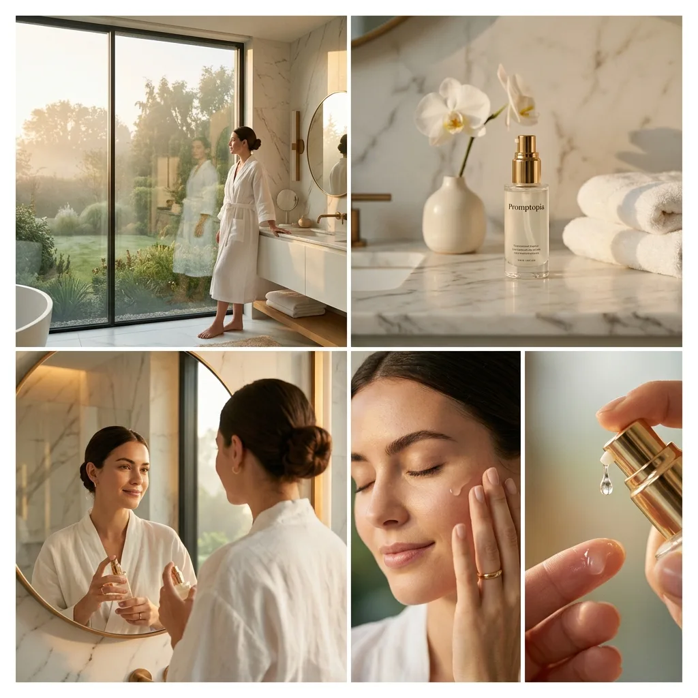

# Woman, appears to be in her 20s or 30s

[← Back to the collection](../../README.md) · Category: [Product & Brand](../../gallery/product-brand.md) · Model: `Vinano Image Pro` · ID: `vn-00997`

<a href="https://vinano.ai?utm_source=github&utm_medium=readme&utm_campaign=awesome-image-video-prompts-updating&utm_content=prompt-page-image"></a>

<sub>Preview generated with <a href="https://vinano.ai?utm_source=github&utm_medium=readme&utm_campaign=awesome-image-video-prompts-updating&utm_content=prompt-page-caption">vinano.ai</a></sub>

## Prompt

```text
{
 "subject": {
 "person": "Woman, appears to be in her 20s or 30s",
 "pose_and_expression": ["Standing by window, looking out, relaxed",
 "Reaching for bottle on counter, hand focus",
 "Looking in mirror, slight smile",
 "Hand dispensing serum from bottle, close-up",
 "Serum drop on fingertip, macro shot",
 "Applying serum to face, eyes closed, serene",
 "Face close-up, eyes closed, content",
 "Bottle and orchid on counter, still life",
 "Walking away from camera, standing by window"]
 },
 "clothing": {
 "items": "White robe, white pajamas/loungewear",
 "material": "Soft, flowing fabric",
 "style": "Casual, luxurious"
 },
 "hair": {
 "color": "Dark brown",
 "style": "Pulled back, neat bun or ponytail"
 },
 "face": {
 "makeup": "Natural, minimal",
 "skin": "Clear, glowing",
 "expression": "Calm, serene, content"
 },
 "accessories": {
 "jewelry": "Simple ring on ring finger",
 "props": ["Glass skincare bottle gold pump dispenser",
 "Product label: 'Promptopia'",
 "White orchid in a small white vase"]
 },
 "environment": {
 "location": "Modern, luxurious bathroom",
 "elements": ["Large floor-to-ceiling windows",
 "Marble countertop and walls",
 "Round mirror",
 "View of trees/garden outside",
 "Fog or mist outside window"],
 "atmosphere": "Serene, spa-like, tranquil"
 },
 "lighting": {
 "source": "Natural daylight",
 "quality": "Warm, golden, soft, diffused",
 "time_of_day": "Sunrise or golden hour"
 },
 "camera": {
 "type": "Photography collage",
 "shots": ["Wide shot",
 "Medium shot",
 "Close-up",
 "Macro shot"],
 "focus": "Sharp on subject and product, soft background blur (bokeh)"
 },
 "style": {
 "aesthetic": "Cinematic, editorial, beauty, wellness, clean, refined minimalist",
 "color_palette": "Warm neutrals, white, gold, natural greens"
 }
}

Keep edges clean and the overall composition balanced for a polished, gallery-ready result.
```

## Try it on vinano.ai

1. Copy the prompt above.
2. Open **[vinano.ai](https://vinano.ai?utm_source=github&utm_medium=readme&utm_campaign=awesome-image-video-prompts-updating&utm_content=prompt-page-try)**, paste it into the image generator and pick a model.
3. Swap any placeholders (brand, product, city, person…) for your own details, then generate.

More prompts like this: [Product & Brand gallery](../../gallery/product-brand.md) · [all categories](../../README.md#contents)
