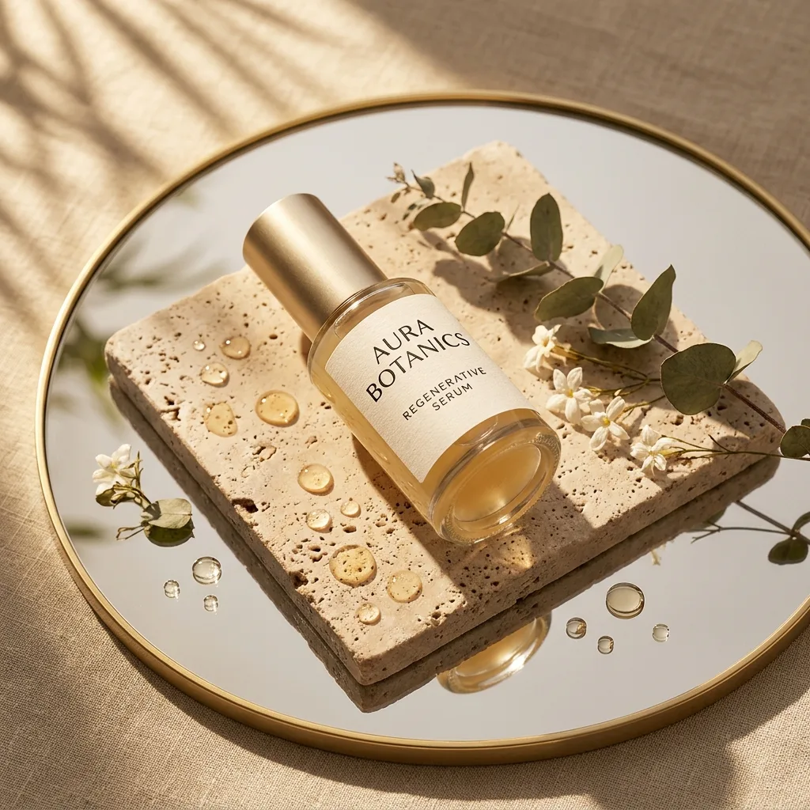

# Product & Brand prompt #1031

[← Back to the collection](../../README.md) · Category: [Product & Brand](../../gallery/product-brand.md) · Model: `Vinano Image Pro` · ID: `vn-01031`

<a href="https://vinano.ai?utm_source=github&utm_medium=readme&utm_campaign=awesome-image-video-prompts-updating&utm_content=prompt-page-image"></a>

<sub>Preview generated with <a href="https://vinano.ai?utm_source=github&utm_medium=readme&utm_campaign=awesome-image-video-prompts-updating&utm_content=prompt-page-caption">vinano.ai</a></sub>

## Prompt

```text
A high-end editorial studio photograph of a (PRODUCT FORM, e.g. bottle, jar, tube…), made of (MATERIAL, e.g. glass, ceramic, matte plastic…) a (COLOR) (DETAIL, e.g. cap, texture, label…). The product is placed on a natural, textured (BASE SURFACE, e.g. stone, wood, marble…) slab, itself resting on a round mirror laid on a (SURFACE TONE, e.g. beige, sand, light gray…) surface. Around the mirror and on the slab are scattered droplets of (LIQUID, e.g. serum, oil, gel…) realistic reflections. A few sprigs of (DECORATIVE NATURAL ELEMENTS, e.g. lavender, eucalyptus, rose petals…) lie gently across the slab and mirror, connecting both surfaces naturally. Strong, warm sunlight filters from the top left, casting soft diagonal leaf shadows to simulate filtered daylight. The aesthetic is (VISUAL STYLE, e.g. refined minimalist, organic, fresh, premium…), realistic materials and natural textures highlighted by golden hour tones. Style: 3D realism, luxury product photography, shallow depth of field. Format: 1:1, ultra-detailed. Keep edges clean and the overall composition balanced for a polished, gallery-ready result.
```

## Try it on vinano.ai

1. Copy the prompt above.
2. Open **[vinano.ai](https://vinano.ai?utm_source=github&utm_medium=readme&utm_campaign=awesome-image-video-prompts-updating&utm_content=prompt-page-try)**, paste it into the image generator and pick a model.
3. Swap any placeholders (brand, product, city, person…) for your own details, then generate.

More prompts like this: [Product & Brand gallery](../../gallery/product-brand.md) · [all categories](../../README.md#contents)
