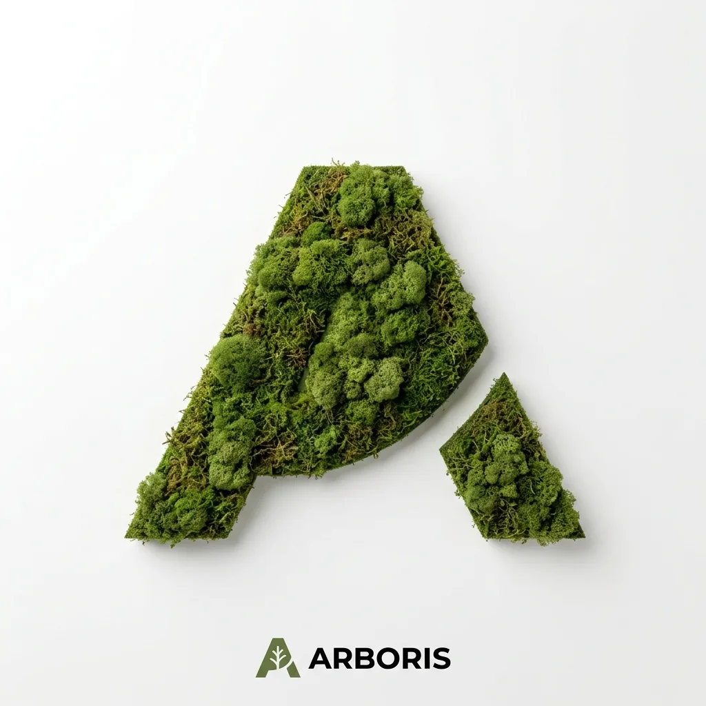

# Product & Brand prompt #1062

[← Back to the collection](../../README.md) · Category: [Product & Brand](../../gallery/product-brand.md) · Model: `Vinano Image Pro` · ID: `vn-01062`

<a href="https://vinano.ai?utm_source=github&utm_medium=readme&utm_campaign=awesome-image-video-prompts-updating&utm_content=prompt-page-image"></a>

<sub>Preview generated with <a href="https://vinano.ai?utm_source=github&utm_medium=readme&utm_campaign=awesome-image-video-prompts-updating&utm_content=prompt-page-caption">vinano.ai</a></sub>

## Prompt

```text
[BRAND NAME]: Enter the brand name here.
Goal: Generate a refined minimalist organic image where a stylized logo icon of [BRAND NAME] is transformed into a large moss-textured artifact, a small brand signature at the bottom.
Constraint: NO TEXT inside or immediately near the central moss icon. Only the bottom signature.

1. THE CENTRAL MOSS ICON
- Main Subject: A large, geometrically precise symbol, sculpted into the exact form of the [BRAND NAME] logo icon.
- Material: The symbol is entirely made of dense, heavily textured, natural green stabilizing moss. The texture is rough and organic varying shades of green and brown.
- Form: The geometric edges are sharp and clean, but filled the soft, billowy texture of moss.

2. ENVIRONMENT & LAYOUT
- View: A top-down, central flat lay view.
- Background: A flawless, uniform, matte white studio background. Full refined minimalist negative space.
- Lighting: Bright, soft, diffused studio lighting that emphasizes the tactile moss texture while minimizing harsh shadows.

3. BOTTOM BRAND SIGNATURE (CRITICAL)
- Placement: A clean horizontal signature block centered at the bottom, far below the moss icon.
- Elements: A tiny, flat, refined minimalist version of the [BRAND NAME] logo icon on the left.
- Text: The word "[BRAND NAME]" in a clean, bold, black sans-serif typeface immediately to the right of the tiny logo.
- Scale: The signature must be very small compared to the central moss artifact.

4. AESTHETIC
- Biophilic design, premium product photography, clean, fresh, airy, high-end editorial look. 8k resolution.

Keep edges clean and the overall composition balanced for a polished, gallery-ready result.
```

## Try it on vinano.ai

1. Copy the prompt above.
2. Open **[vinano.ai](https://vinano.ai?utm_source=github&utm_medium=readme&utm_campaign=awesome-image-video-prompts-updating&utm_content=prompt-page-try)**, paste it into the image generator and pick a model.
3. Swap any placeholders (brand, product, city, person…) for your own details, then generate.

More prompts like this: [Product & Brand gallery](../../gallery/product-brand.md) · [all categories](../../README.md#contents)
