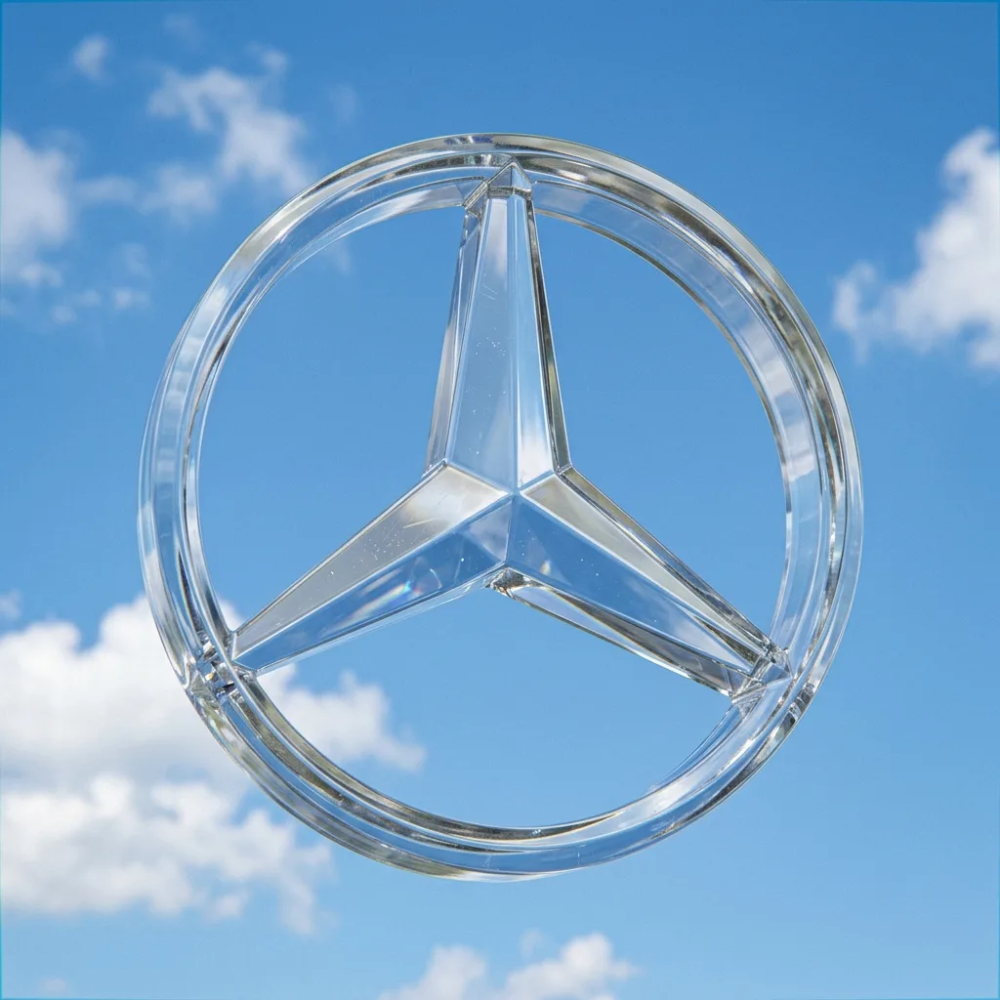

# Product & Brand prompt #1144

[← Back to the collection](../../README.md) · Category: [Product & Brand](../../gallery/product-brand.md) · Model: `Vinano Image Pro` · ID: `vn-01144`

<a href="https://vinano.ai?utm_source=github&utm_medium=readme&utm_campaign=awesome-image-video-prompts-updating&utm_content=prompt-page-image"></a>

<sub>Preview generated with <a href="https://vinano.ai?utm_source=github&utm_medium=readme&utm_campaign=awesome-image-video-prompts-updating&utm_content=prompt-page-caption">vinano.ai</a></sub>

## Prompt

```text
Act as a High-End Product Photographer and CGI Artist.

PHASE 1: SUBJECT & LOGIC
Generate a massive, perfectly centered, three-dimensional physical sculpture of the official, unaltered corporate logo for [BRAND NAME]. The sculpture must strictly adhere to the brand’s precise logo geometry and proportions (1:1 from brandbook). The sculpture is suspended in mid-air. Autonomously identify the exact official shape and structure of the [BRAND NAME] logo and render it as a single, flawless glass object without any modifications.
PHASE 2: MATERIALITY (GLASS)
The entire logo is made of hyper-realistic, optical-grade crystal glass (not water, not gel). The material is solid, colorless, and boasts high clarity a high refractive index. It must look heavy and монолитное (monolithic). The glass structure contains subtle, true-to-life photorealistic microscopic flaws: fine polished scratches on the surface and minor internal inclusions (dust particles/seed bubbles, very few) to avoid “CGI plastic.” The edges must be precision-beveled and fire-polished.

PHASE 3: ENVIRONMENT & CAUSTICS
The logo is suspended against a strictly clean, bright blue sky sparse, naturally defined white cumulus clouds. NO land, NO trees, NO palms. The background is purely atmospheric. The focus is entirely on the glass logo. Critically render hyper-realistic, complex glass caustics: intense, sharp patterns of focused light and color (refractions of the blue sky) cast inside and onto the surface of the glass form due to the sunlight passing through it.

TECH SPECS
Rendered Arnold or Octane. Phase One XF, 120mm Macro lens. Aperture f/5.6 for sharp depth across the entire glass sculpture. Intense, direct sunlight (hard lighting) to maximize caustics. Global illumination, ray-traced refractions (double-sided geometry), and chromatic aberration emulation (subtle) for optical realism. Fine grain film emulation (Fujifilm Velvia 50).

Preserve realistic proportions and depth for a confident, professional finish.
```

## Try it on vinano.ai

1. Copy the prompt above.
2. Open **[vinano.ai](https://vinano.ai?utm_source=github&utm_medium=readme&utm_campaign=awesome-image-video-prompts-updating&utm_content=prompt-page-try)**, paste it into the image generator and pick a model.
3. Swap any placeholders (brand, product, city, person…) for your own details, then generate.

More prompts like this: [Product & Brand gallery](../../gallery/product-brand.md) · [all categories](../../README.md#contents)
