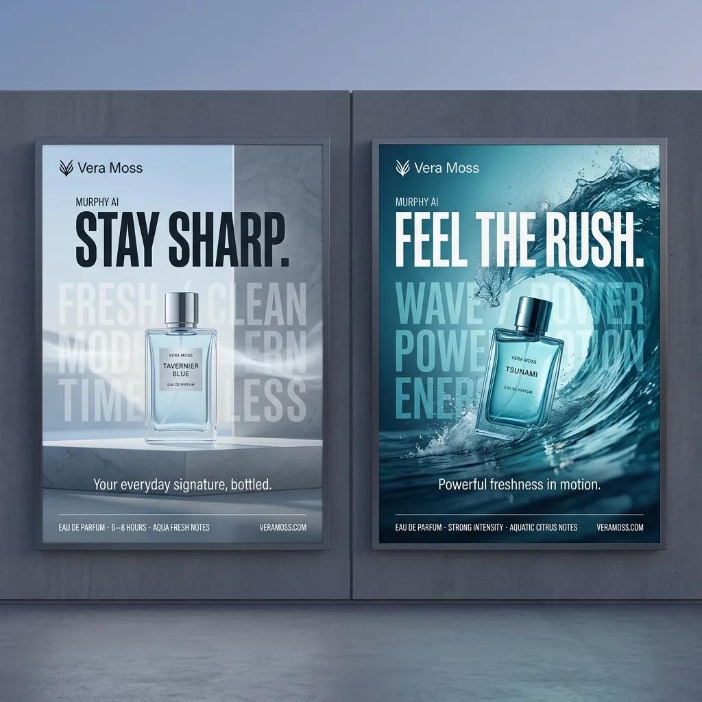

# Perfume billboard poster for Vera Moss Tavernier Blue Eau

[← Back to the collection](../../README.md) · Category: [Product & Brand](../../gallery/product-brand.md) · Model: `Vinano Image Pro` · ID: `vn-01161`

<a href="https://vinano.ai?utm_source=github&utm_medium=readme&utm_campaign=awesome-image-video-prompts-updating&utm_content=prompt-page-image"></a>

<sub>Preview generated with <a href="https://vinano.ai?utm_source=github&utm_medium=readme&utm_campaign=awesome-image-video-prompts-updating&utm_content=prompt-page-caption">vinano.ai</a></sub>

## Prompt

```text
Hyper-realistic cinematic perfume billboard poster for Vera Moss Tavernier Blue Eau De Parfum, built around freshness, clarity, and modern sharp identity

Scene: minimal architectural environment smooth stone surfaces and cool-toned textures, soft air-like mist flowing horizontally across frame, creating a sense of movement and freshness

Product placement:
perfume bottle placed center on a clean elevated platform, perfectly upright, label facing camera
subtle reflective surface beneath soft diffused reflection

Environment styling:
abstract stone formations + soft gradient sky tones (light blue to grey), inspired by open air and water freshness
no clutter, strong negative space

Composition:
centered hero product
strong breathing space around
background depth layers for cinematic feel

Typography system (Nike-style, strict hierarchy):

top-left — Vera Moss logo
beneath — small thin uppercase “MURPHY AI”

center massive —
“STAY SHARP.”
bold condensed sans-serif, high impact

background typography (very faint, oversized):
“FRESH / CLEAN / MODERN / TIMELESS”
layered subtly into environment

mid-lower —
“Your everyday signature, bottled.”

bottom strip (clean spec line):
“EAU DE PARFUM · 6–8 HOURS · AQUA FRESH NOTES”

bottom right — website

Lighting:
soft cool daylight slight blue tint
gentle highlights on glass edges
subtle rim light for separation

Color palette:
icy blue, soft grey, white, silver accents

Atmosphere:
light mist / air particles to represent freshness

Camera:
50mm lens, slight low angle for presence
shallow depth of field, ultra sharp product focus

Mood:
calm, confident, modern, effortless

Output:
4:5 billboard format
ultra high resolution
luxury commercial finish

Hyper-realistic cinematic perfume billboard poster for Vera Moss Tsunami Eau De Parfum, built around energy, motion, and explosive freshness

Scene: dynamic water environment where a powerful wave is frozen mid-impact, curling around the perfume bottle, capturing the exact moment of motion and force

Product placement:
perfume bottle placed center, emerging from the water surface
partially surrounded by a rising wave arc
glass and liquid reflecting blue tones

Environment styling:
deep aqua-blue gradient background transitioning from dark ocean tones to bright fresh highlights
water particles suspended in air
fine droplets and mist frozen in motion

Composition:
central hero bottle
diagonal motion created by wave direction
strong depth and perspective

Typography system (Nike-style, high energy):

top-left — Vera Moss logo
beneath — small thin uppercase “MURPHY AI”

center massive —
“FEEL THE RUSH.”
bold condensed sans-serif, slightly stretched vertically

background typography (layered, kinetic):
“WAVE / POWER / MOTION / ENERGY”

subtly warped as if affected by water movement

mid-lower —
“Powerful freshness in motion.”

bottom strip —
“EAU DE PARFUM · STRONG INTENSITY · AQUATIC CITRUS NOTES”

bottom right — website

Lighting:
high contrast lighting
strong highlights on water edges
reflective glow on bottle
subtle backlight through water for depth

Color palette:
aqua blue, deep navy, white highlights

Atmosphere:
water spray, mist, droplets, motion particles

Camera:
low angle + slight tilt for dynamism
35mm cinematic lens feel

Mood:
energetic, powerful, refreshing, bold

Output:
4:5 billboard format
ultra high resolution
premium commercial finish

Keep edges clean and the overall composition balanced for a polished, gallery-ready result.
```

## Try it on vinano.ai

1. Copy the prompt above.
2. Open **[vinano.ai](https://vinano.ai?utm_source=github&utm_medium=readme&utm_campaign=awesome-image-video-prompts-updating&utm_content=prompt-page-try)**, paste it into the image generator and pick a model.
3. Swap any placeholders (brand, product, city, person…) for your own details, then generate.

More prompts like this: [Product & Brand gallery](../../gallery/product-brand.md) · [all categories](../../README.md#contents)
