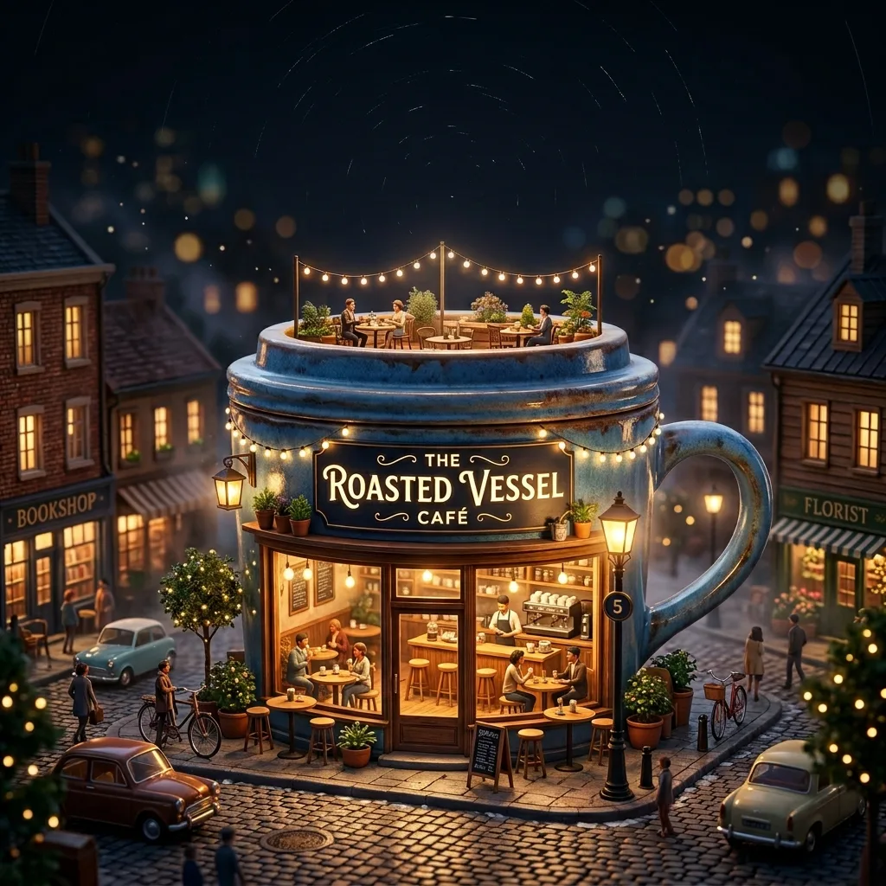

# Chat.5 × Google Veo 3.1 → /.5 → Copy

[← Back to the collection](../../README.md) · Category: [Product & Brand](../../gallery/product-brand.md) · Model: `Vinano Image Pro` · ID: `vn-01164`

<a href="https://vinano.ai?utm_source=github&utm_medium=readme&utm_campaign=awesome-image-video-prompts-updating&utm_content=prompt-page-image"></a>

<sub>Preview generated with <a href="https://vinano.ai?utm_source=github&utm_medium=readme&utm_campaign=awesome-image-video-prompts-updating&utm_content=prompt-page-caption">vinano.ai</a></sub>

## Prompt

```text
Chat.5 × Google Veo 3.1

→ /.5
→ Copy & Paste the Prompt
→ View Results Below ⤵️

Prompt:

A surreal miniature city scene where a giant coffee cup transforms into a cozy café building. The coffee cup forms the main structure, steam rising like clouds, ceramic textures glowing softly, and the lid acting as a rooftop terrace. The ground floor is a warmly lit café storefront glass windows, tiny tables, stools, barista counters, and glowing street lamps. Nighttime atmosphere cinematic bokeh lights, floating particles, soft fog, warm interior glow, hyper-detailed materials, fantasy realism, premium brand storytelling. Tilt-shift effect, ultra-sharp focus, dramatic lighting, square frame, 1080×1080, high-end commercial illustration, ultra-detailed 8K quality.

Aim for an editorial, design-driven look with deliberate negative space.
```

## Try it on vinano.ai

1. Copy the prompt above.
2. Open **[vinano.ai](https://vinano.ai?utm_source=github&utm_medium=readme&utm_campaign=awesome-image-video-prompts-updating&utm_content=prompt-page-try)**, paste it into the image generator and pick a model.
3. Swap any placeholders (brand, product, city, person…) for your own details, then generate.

More prompts like this: [Product & Brand gallery](../../gallery/product-brand.md) · [all categories](../../README.md#contents)
