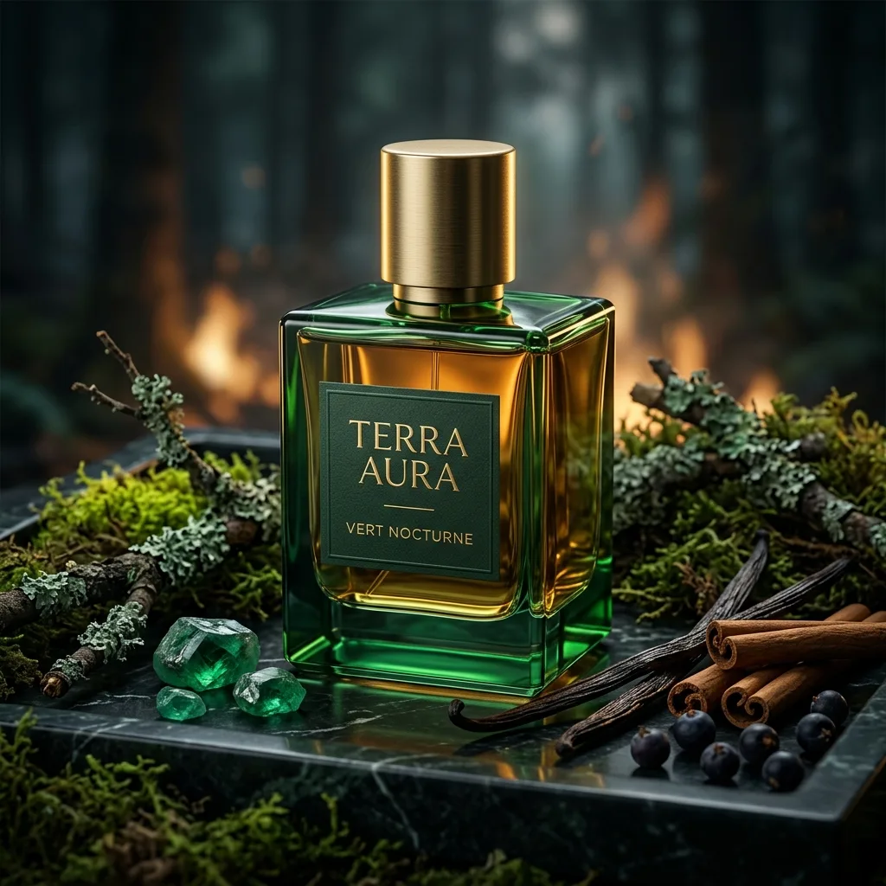

# Luxury perfume product photograph featuring PERFUME BOTTLE DESIGN positioned

[← Back to the collection](../../README.md) · Category: [Product & Brand](../../gallery/product-brand.md) · Model: `Vinano Image Pro` · ID: `vn-01169`

<a href="https://vinano.ai?utm_source=github&utm_medium=readme&utm_campaign=awesome-image-video-prompts-updating&utm_content=prompt-page-image"></a>

<sub>Preview generated with <a href="https://vinano.ai?utm_source=github&utm_medium=readme&utm_campaign=awesome-image-video-prompts-updating&utm_content=prompt-page-caption">vinano.ai</a></sub>

## Prompt

```text
Create a hyper-realistic cinematic luxury perfume product photograph featuring [PERFUME BOTTLE DESIGN] positioned in [COMPOSITION / ANGLE] within a dramatic elemental environment of [ELEMENTAL SETTING: water, smoke, ice, firelight, forest, florals, spices, gemstones].

The bottle should feel premium and tactile, [MATERIAL DETAILS: glossy glass, metallic cap, gold label, transparent liquid, frosted surface, engraved text], sharp reflections, realistic refractions, and crisp readable branding: [BRAND / LABEL TEXT].

Surround the product carefully arranged sensory ingredients such as [BOTANICALS / SPICES / FRUITS / OBJECTS], strong contrast between [PRIMARY COLOR PALETTE] and [ACCENT COLORS].

Lighting should be cinematic and high-contrast, [LIGHTING STYLE], deep shadows, sparkling highlights, volumetric atmosphere, and a luxurious commercial advertising finish.

Background: [BACKGROUND DESCRIPTION], shallow depth of field, premium editorial composition, ultra-detailed textures, 8k resolution, true-to-life photorealistic studio quality.

Cheat Sheet
[PERFUME BOTTLE DESIGN]: shape, color, cap, label style
[COMPOSITION / ANGLE]: tilted crash, centered still life, close-up tray, hand interaction
[ELEMENTAL SETTING]: splash, smoke, candlelight, ice, forest, aurora
[MATERIAL DETAILS]: glass, metal, liquid, frost, reflections
[BRAND / LABEL TEXT]: exact readable perfume text
[BOTANICALS / SPICES / FRUITS / OBJECTS]: lemons, vanilla pods, roses, pinecones, gemstones
[PRIMARY COLOR PALETTE]: navy, amber, silver, black, icy blue
[ACCENT COLORS]: gold, red, lime green, magenta, teal
[LIGHTING STYLE]: dramatic spotlight, candle glow, cool moonlight, golden rim light
[BACKGROUND DESCRIPTION]: moody studio, dark forest, blurred luxury interior, smoky backdrop

Preserve realistic proportions and depth for a confident, professional finish.
```

## Try it on vinano.ai

1. Copy the prompt above.
2. Open **[vinano.ai](https://vinano.ai?utm_source=github&utm_medium=readme&utm_campaign=awesome-image-video-prompts-updating&utm_content=prompt-page-try)**, paste it into the image generator and pick a model.
3. Swap any placeholders (brand, product, city, person…) for your own details, then generate.

More prompts like this: [Product & Brand gallery](../../gallery/product-brand.md) · [all categories](../../README.md#contents)
