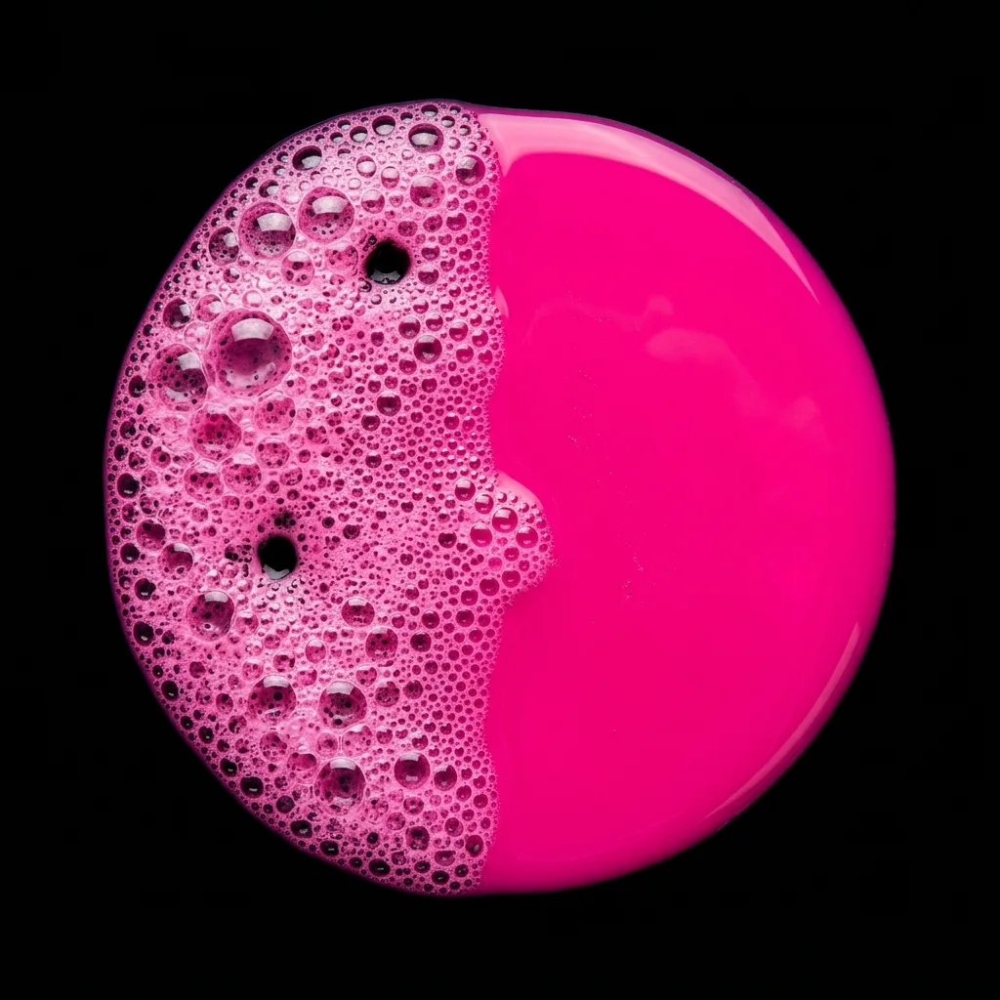

# Product & Brand prompt #1219

[← Back to the collection](../../README.md) · Category: [Product & Brand](../../gallery/product-brand.md) · Model: `Vinano Image Pro` · ID: `vn-01219`

<a href="https://vinano.ai?utm_source=github&utm_medium=readme&utm_campaign=awesome-image-video-prompts-updating&utm_content=prompt-page-image"></a>

<sub>Preview generated with <a href="https://vinano.ai?utm_source=github&utm_medium=readme&utm_campaign=awesome-image-video-prompts-updating&utm_content=prompt-page-caption">vinano.ai</a></sub>

## Prompt

```text
[BRAND NAME] | [COLOR]

ABSOLUTE RULE — READ BEFORE GENERATING ANYTHING: The fluid mass in this image has the exact shape of the [BRAND NAME] logo and nothing else. Not a circle. Not an oval. Not a blob. Not a rounded shape the logo inside it. The outer silhouette of the fluid IS the logo outline — identical to the canonical [BRAND NAME] logo trademark. If someone covers the bubble texture and looks only at the silhouette they must immediately recognize it as the [BRAND NAME] logo. The fluid does not flow into a circle. The fluid does not form a blob. The fluid is constrained to the exact logo shape. This is the single most important rule in this prompt — it overrides everything else. Act as a Macro Fluid Photographer and CGI Art Director creating a hero typographic image where the brand logo is formed entirely from living fluorescent foam and bubble liquid — as if the logo was poured into a logo-shaped mold on a black surface and captured at the exact moment of maximum bubble activity. References: macro fluid photography, fluorescent paint foam art, soap bubble macro photography. --- PHASE 0: BRAND LOGO INTELLIGENCE — GEOMETRY IS LAW Retrieve the 100% canonical trademark-accurate primary mark of [BRAND NAME]. Use only the core logo symbol or emblem. STEP 1 — ESTABLISH EXACT SILHOUETTE: reconstruct the precise canonical [BRAND NAME] logo silhouette — every curve, every angle, every proportion exactly as trademarked. Draw this silhouette in your mind as a flat solid shape. This is the mold. It is rigid. It does not change shape. STEP 2 — FLUID FILLS THE MOLD: the fluid foam fills the interior of this rigid mold. The outer boundary of the fluid mass IS the logo outline — precise, hard, clean. Think of it as the logo shape cut from foam rubber and placed on a black surface. The fluid is solid where the logo is solid. The fluid is absent where the logo has designed empty space — those gaps show pure black background. STEP 3 — NO CONTAINER: there is no circle, no oval, no badge, no rounded rectangle, no frame around the logo. The logo floats directly on the black background. Its edges are the logo edges — nothing more. STEP 4 — ORIENTATION LOCKED: correct canonical upright orientation exactly as in official brand materials. Not rotated, not flipped, not mirrored, not tilted. STEP 5 — ZERO FLUID OUTSIDE BOUNDARY: the logo silhouette is an absolute hard boundary. Zero fluid, zero bubbles, zero tendrils, zero droplets outside this boundary. The black background begins exactly where the logo outline ends. STEP 6 — GEOMETRY WINS ALWAYS: wherever fluid simulation physics conflict exact logo geometry — the logo geometry wins. Always. Apply [COLOR] as the fluid foam color throughout — in its most saturated fluorescent version. --- PHASE 1: FLUID MATERIAL SYSTEM — CRITICAL The entire logo form is filled a single continuous viscous fluid existing in two physical states simultaneously. The fluid is NOT water — thick, viscous, surface-tension-dominant, like fluorescent soap foam, acrylic paint trapped air, or colored slime. Base color: [COLOR] at maximum fluorescent saturation — self-luminous quality as if internally lit, consistent UV-reactive fluorescent paint. Tonal variation strictly within [COLOR] family: thin bubble membrane walls — 35 to 45% lighter than base [COLOR], approaching near-transparency. Mid-thickness fluid zones — pure saturated [COLOR]. Deep thick liquid pools — 25 to 35% darker than base [COLOR]. Fluid surface in liquid zone: high gloss, wet, shiny, visible broad specular reflection. Foam zone membranes: lower gloss, slight soap film iridescence. --- PHASE 2: BUBBLE ARCHITECTURE SYSTEM Full bubble size hierarchy present across the foam zone only. Large anchor bubbles — 10 to 18mm diameter, 4 to 8 present. Medium bubbles — 4 to 9mm, 15 to 25 present. Small bubbles — 1.5 to 3mm, 30 to 50 present. Micro bubbles — 0.5 to 1mm, 50 to 100+ present. Each bubble: physically accurate sphere of trapped air enclosed by thin colored fluid membrane, 0.1 to 0.3mm thick, semi-transparent. Soap film iridescence barely perceptible. Bubble dome highlight: bright white crescent arc in UPPER-LEFT portion of each dome — 15 to 20% of dome surface, soft-edged, white regardless of bubble color. Inside large bubbles: dark reflection [COLOR] tint confirming membrane transparency. Bubble contact deformation: flat septum membranes at contact points. Burst bubble holes: 3 to 8 irregular dark voids within foam zone only — revealing black background. Never at or near the logo boundary edges. --- PHASE 3: DUAL-STATE CONTRAST — CRITICAL Left zone — foam state: dense chaotic foam full bubble hierarchy strictly within the logo silhouette. All bubble activity stays inside the logo boundary — never at or beyond the edge. Right zone — liquid state: solid continuous smooth mass — bubbles completely absent, maximum 2 to 3 micro-bubbles at transition edge only. Smooth viscous pool: gentle surface tension undulation 0.5 to 1mm, high gloss, broad soft specular highlight toward upper-left. Dense, heavy, pooled. Transition zone: gradual 8 to 15mm wide transition through vertical center — large bubbles disappear, fluid surface becomes smooth, last bubbles partially collapsed sagging membranes dissolving into liquid surface. Edge behavior: both the foam side and the liquid side terminate exactly at the canonical logo outline. The logo boundary is geometric and exact on all sides. Clean edge. No organic ragged outer silhouette. The logo shape is always recognizable from the outer boundary alone. NO SPLATTER — ABSOLUTE: zero droplets, zero spray, zero tendrils, zero extensions beyond logo boundary. The composition is completely calm and contained. --- PHASE 4: LIGHTING — MATCH REFERENCE EXACTLY Primary light: large softbox upper-LEFT at 20 to 30° offset from vertical — NOT directly overhead. Light from above AND left simultaneously. Temperature 5500K neutral white. Left side and upper-left surfaces brighter. Right side relatively darker. Every bubble dome highlight arc in UPPER-LEFT. Liquid zone broad specular reflection toward upper-left. Micro-shadows from bubbles fall lower-right, 0.5 to 1mm, barely visible. Secondary ambient: 8 to 10% cool ambient from above. No fill from right. No rim light. No colored light. --- PHASE 5: COMPOSITION & CAMERA Background: absolute black #000000 — perfectly clean, zero texture, zero noise, zero gradient. Pure void. Aspect ratio: 1:1 square. Logo form occupies 60 to 70% of frame — centered horizontally and vertically. Generous clean black surround on all sides. Camera: directly overhead, perfectly perpendicular — zero elevation, zero perspective distortion, zero rotation. Pure top-down flat-lay macro. The logo silhouette reads as the correct [BRAND NAME] mark from this top-down view. Depth of field: sharp across entire fluid surface. --- PHASE 6: TECH SPECS Render: Houdini FLIP fluid simulation + Redshift or Octane, OR true-to-life photorealistic CGI achieving identical result. CRITICAL: the fluid simulation domain is bounded by the exact logo silhouette — the simulation cannot escape the logo boundary. Fluid mesh: real FLIP simulation geometry constrained to logo shape. Bubble geometry: real curved surface per bubble, not texture map. Bubble membranes: thin-shell geometry, IOR 1.33, transmission 0.7 to 0.85, thin-film iridescence. Liquid zone: smooth FLIP mesh, roughness 0.02 to 0.05, high gloss. Foam zone material: fluorescent shader, emissive 0.05 to 0.1, subsurface scattering 2 to 4mm. Lighting: one large rectangular area light 80×80cm, upper-left 20 to 30° from vertical, 5500K. Secondary HDRI ambient 8 to 10%, neutral gray. Ray tracing minimum 12 bounces. Caustics on. Sampling minimum 2048. Anti-aliasing maximum. No film grain. No post-process. Output feel: indistinguishable from professional macro photograph of real fluorescent foam in a perfectly clean studio. --- FINAL CHECK — MANDATORY BEFORE OUTPUT: (1) Does the outer silhouette of the fluid mass match the exact [BRAND NAME] logo shape? If no — regenerate. (2) Is the fluid inside a circle, oval, or any container? If yes — regenerate. (3) Is there any fluid, droplet, or bubble outside the logo boundary? If yes — regenerate. (4) Are both foam state and liquid state clearly visible? If no — regenerate.

Aim for an editorial, design-driven look with deliberate negative space.
```

## Try it on vinano.ai

1. Copy the prompt above.
2. Open **[vinano.ai](https://vinano.ai?utm_source=github&utm_medium=readme&utm_campaign=awesome-image-video-prompts-updating&utm_content=prompt-page-try)**, paste it into the image generator and pick a model.
3. Swap any placeholders (brand, product, city, person…) for your own details, then generate.

More prompts like this: [Product & Brand gallery](../../gallery/product-brand.md) · [all categories](../../README.md#contents)
