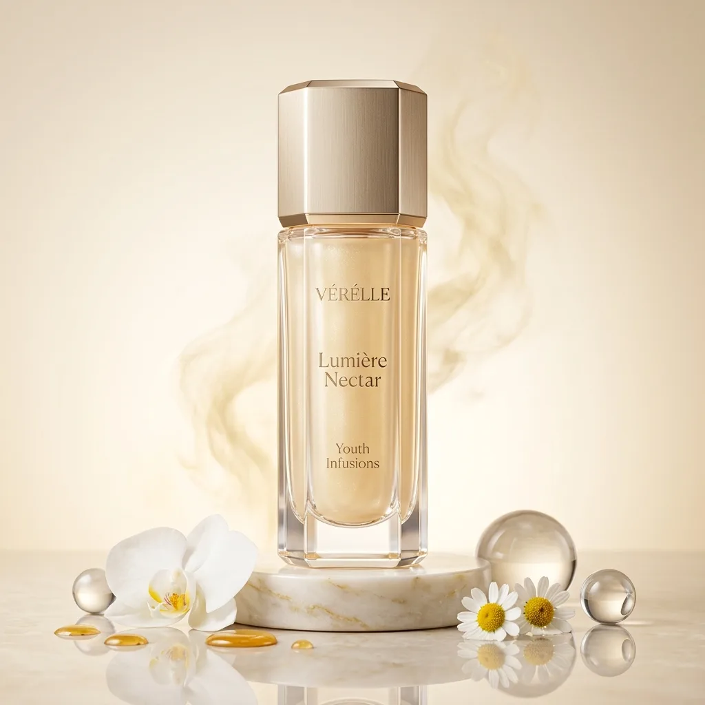

# Lumière Nectar

[← Back to the collection](../../README.md) · Category: [Product & Brand](../../gallery/product-brand.md) · Model: `Vinano Image Pro` · ID: `vn-01247`

<a href="https://vinano.ai?utm_source=github&utm_medium=readme&utm_campaign=awesome-image-video-prompts-updating&utm_content=prompt-page-image"></a>

<sub>Preview generated with <a href="https://vinano.ai?utm_source=github&utm_medium=readme&utm_campaign=awesome-image-video-prompts-updating&utm_content=prompt-page-caption">vinano.ai</a></sub>

## Prompt

```text
{
"master_prompt": {
"scene_type": "ultra-realistic luxury skincare commercial photography",

"product": {
 "type": "premium beauty elixir vial",
 "brand_name": "VÉRÉLLE",
 "product_name": "Lumière Nectar — Youth Infusions",
 "container_shape": "tall faceted crystal vial elegant vertical geometry",
 "material": "optical crystal glass",
 "finish": "prismatic clarity soft light dispersion",
 "cap_design": "brushed champagne-gold cap beveled edge",

 "label_design": {
 "style": "Parisian luxury serif typography",
 "primary_text": "Lumière Nectar",
 "secondary_text": "Youth Infusions",
 "finish": "champagne foil emboss micro-engraved detailing"
 },

 "liquid_color": "soft golden nectar luminous micro-pearl shimmer"
},

"composition": {
 "placement": "center hero placement",
 "pedestal": "ivory marble pedestal subtle gold veining",
 "base_surface": "polished reflective stone surface",

 "surrounding_elements": ["white orchid petals",
 "golden honey droplets",
 "chamomile blossoms",
 "glass dew spheres"],

 "liquid_effect": "soft golden mist swirl behind the vial"
},

"lighting": {
 "style": "high-end beauty studio lighting",
 "key_light": "soft frontal glow for glass clarity",
 "rim_light": "warm rim highlights enhancing crystal edges",
 "fill_light": "luxury soft diffusion",
 "reflections": "controlled highlights for premium finish"
},

"background": {
 "color": "warm ivory to champagne gradient",
 "style": "clean editorial luxury backdrop",
 "depth": "cinematic shallow depth elegant falloff"
},

"camera": {
 "angle": "slightly low hero angle",
 "focus": "crystal edges and typography",
 "depth_of_field": "cinematic shallow depth",
 "resolution": "8K ultra-detailed clarity"
},

"mood_keywords": ["Parisian luxury",
 "timeless beauty",
 "radiant skin",
 "elegant purity",
 "premium skincare campaign",
 "refined sophistication"]

}
}

Emphasise material texture and natural light so the final frame feels tactile and premium.
```

## Try it on vinano.ai

1. Copy the prompt above.
2. Open **[vinano.ai](https://vinano.ai?utm_source=github&utm_medium=readme&utm_campaign=awesome-image-video-prompts-updating&utm_content=prompt-page-try)**, paste it into the image generator and pick a model.
3. Swap any placeholders (brand, product, city, person…) for your own details, then generate.

More prompts like this: [Product & Brand gallery](../../gallery/product-brand.md) · [all categories](../../README.md#contents)
