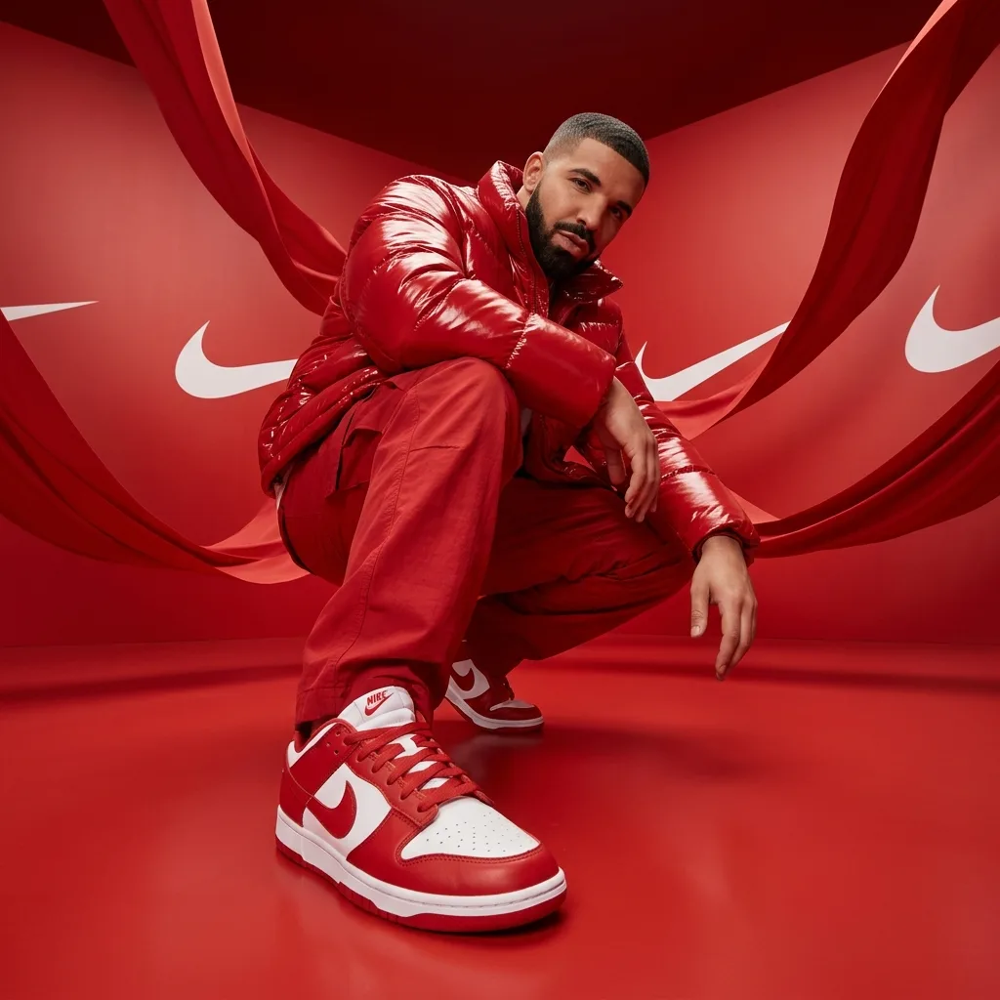

# Person from the reference image, a fade haircut, brown

[← Back to the collection](../../README.md) · Category: [Product & Brand](../../gallery/product-brand.md) · Model: `Vinano Image Pro` · ID: `vn-01269`

<a href="https://vinano.ai?utm_source=github&utm_medium=readme&utm_campaign=awesome-image-video-prompts-updating&utm_content=prompt-page-image"></a>

<sub>Preview generated with <a href="https://vinano.ai?utm_source=github&utm_medium=readme&utm_campaign=awesome-image-video-prompts-updating&utm_content=prompt-page-caption">vinano.ai</a></sub>

## Prompt

```text
Person from the reference image, a fade haircut, brown eyes, and a well-groomed short beard, wearing a glossy oversized red puffer jacket and loose red pants white and red nike sneakers, crouching low one knee up and one leg forward, left arm resting casually over the raised knee and right hand relaxed near the other leg, body angled slightly to the side while head tilts forward looking directly at the camera a confident expression, ultra wide-angle low perspective shot emphasizing the front sneaker appearing large and dominant in the foreground, set in a fully red environment smooth floor and backdrop featuring large white nike swoosh logos behind and flowing ribbon-like red shapes around, hyper-realistic photography, extremely sharp details on fabric shine and sneaker texture, dramatic studio lighting strong highlights and soft shadows, saturated monochromatic red color palette white accents, modern streetwear campaign style, no blur, no distortion, no extra limbs, no artifacts Keep edges clean and the overall composition balanced for a polished, gallery-ready result.
```

## Try it on vinano.ai

1. Copy the prompt above.
2. Open **[vinano.ai](https://vinano.ai?utm_source=github&utm_medium=readme&utm_campaign=awesome-image-video-prompts-updating&utm_content=prompt-page-try)**, paste it into the image generator and pick a model.
3. Swap any placeholders (brand, product, city, person…) for your own details, then generate.

More prompts like this: [Product & Brand gallery](../../gallery/product-brand.md) · [all categories](../../README.md#contents)
