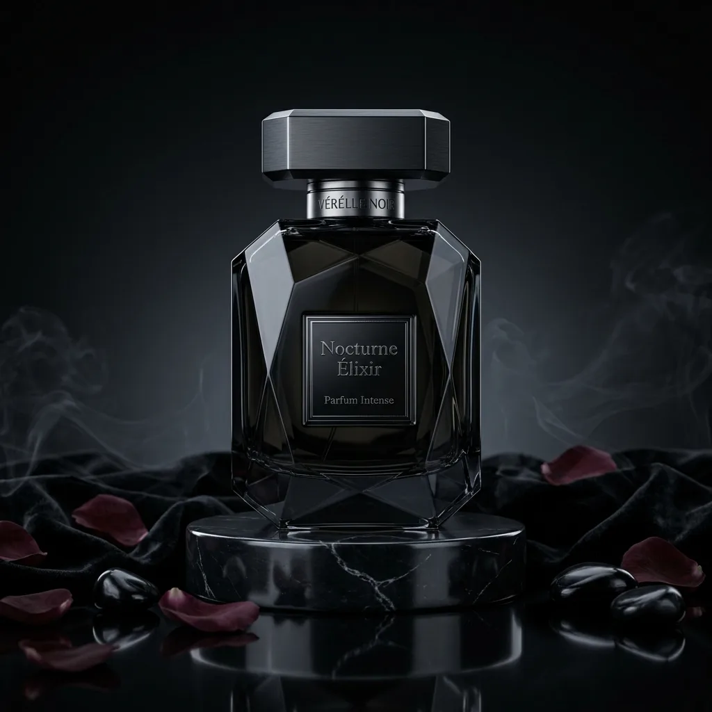

# Nocturne Élixir

[← Back to the collection](../../README.md) · Category: [Product & Brand](../../gallery/product-brand.md) · Model: `Vinano Image Pro` · ID: `vn-01288`

<a href="https://vinano.ai?utm_source=github&utm_medium=readme&utm_campaign=awesome-image-video-prompts-updating&utm_content=prompt-page-image"></a>

<sub>Preview generated with <a href="https://vinano.ai?utm_source=github&utm_medium=readme&utm_campaign=awesome-image-video-prompts-updating&utm_content=prompt-page-caption">vinano.ai</a></sub>

## Prompt

```text
{
 "master_prompt": {
 "scene_type": "ultra-realistic luxury perfume commercial photography",

 "product": {
 "type": "luxury perfume bottle",
 "brand_name": "VÉRÉLLE NOIR",
 "product_name": "Nocturne Élixir — Parfum Intense",
 "container_shape": "faceted architectural silhouette sharp beveled geometry",
 "material": "obsidian-black crystal glass",
 "finish": "deep glossy translucence mirror-like reflections",
 "cap_design": "magnetic cap in brushed black titanium precision-cut edges",

 "label_design": {
 "style": "minimal haute couture typography",
 "primary_text": "Nocturne Élixir",
 "secondary_text": "Parfum Intense",
 "finish": "black chrome foil emboss micro-engraved detailing"
 },

 "liquid_color": "midnight amber subtle smoky undertones"
 },

 "composition": {
 "placement": "center hero placement",
 "pedestal": "black marble pedestal subtle silver veining",
 "base_surface": "high-gloss reflective onyx surface",

 "surrounding_elements": ["black velvet fabric folds",
 "dark rose petals",
 "polished obsidian stones",
 "faint aromatic smoke wisps"],

 "atmospheric_effect": "soft drifting fragrance vapor creating a mysterious aura"
 },

 "lighting": {
 "style": "dark luxury filmic, cinematic lighting",
 "key_light": "soft focused glow revealing reflective contours",
 "rim_light": "cool silver edge highlights defining silhouette",
 "fill_light": "low ambient fill preserving deep shadows",
 "reflections": "controlled specular highlights for high-end finish"
 },

 "background": {
 "color": "deep charcoal to black gradient",
 "style": "editorial noir luxury backdrop",
 "depth": "cinematic shallow depth soft shadow falloff"
 },

 "camera": {
 "angle": "low dramatic hero angle",
 "focus": "glass texture and metallic detailing",
 "depth_of_field": "cinematic shallow depth",
 "resolution": "8K ultra-detailed clarity"
 },

 "mood_keywords": ["dark elegance",
 "noir luxury",
 "sensual sophistication",
 "mysterious allure",
 "modern opulence",
 "timeless night glamour"]
 }
}

Preserve realistic proportions and depth for a confident, professional finish.
```

## Try it on vinano.ai

1. Copy the prompt above.
2. Open **[vinano.ai](https://vinano.ai?utm_source=github&utm_medium=readme&utm_campaign=awesome-image-video-prompts-updating&utm_content=prompt-page-try)**, paste it into the image generator and pick a model.
3. Swap any placeholders (brand, product, city, person…) for your own details, then generate.

More prompts like this: [Product & Brand gallery](../../gallery/product-brand.md) · [all categories](../../README.md#contents)
