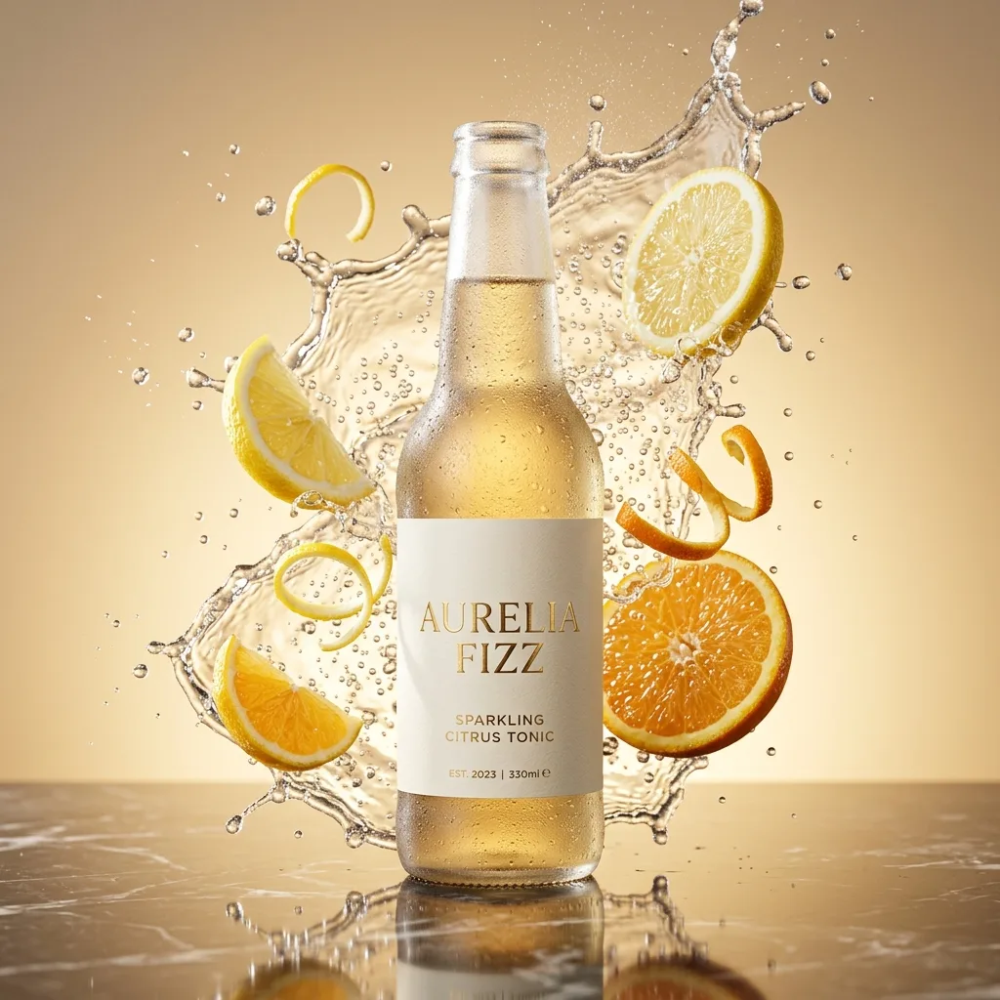

# Sleek frosted glass bottle filled sparkling citrus tonic

[← Back to the collection](../../README.md) · Category: [Product & Brand](../../gallery/product-brand.md) · Model: `Vinano Image Pro` · ID: `vn-01322`

<a href="https://vinano.ai?utm_source=github&utm_medium=readme&utm_campaign=awesome-image-video-prompts-updating&utm_content=prompt-page-image"></a>

<sub>Preview generated with <a href="https://vinano.ai?utm_source=github&utm_medium=readme&utm_campaign=awesome-image-video-prompts-updating&utm_content=prompt-page-caption">vinano.ai</a></sub>

## Prompt

```text
{
 "master_prompt": {
 "scene_type": "high-speed commercial beverage photography",
 "product": {
 "type": "sleek frosted glass bottle filled sparkling citrus tonic",
 "brand_name": "AURELIA FIZZ",
 "label_design": "refined minimalist vertical ivory label refined gold serif typography",
 "liquid_color": "translucent golden citrus effervescent bubbles"
 },
 "composition": {
 "action": "dynamic high-velocity liquid splash explosion",
 "surrounding_elements": ["sculptural splashes of sparkling tonic water",
 "spiraling ribbons of fresh lemon and orange zest",
 "floating citrus slices visible pulp texture",
 "tiny suspended carbonation bubbles",
 "mist of fine droplets catching the light"],
 "placement": "centered hero bottle a crisp reflection on a polished marble surface"
 },
 "lighting": {
 "style": "luxury glossy studio product lighting",
 "effects": ["sharp rim lighting to define bottle silhouette",
 "brilliant highlights on splashes and bubbles",
 "soft golden glow in the background for warmth"]
 },
 "color_palette": {
 "background": "sunlit gradient of warm gold fading into soft champagne beige",
 "accents": "citrus yellow, fresh orange, and subtle mint green"
 },
 "technical_specs": {
 "camera": "macro lens, eye-level angle",
 "shutter": "ultra-fast freeze-motion capture",
 "depth_of_field": "shallow focus on the label, gentle blur on dynamic splash elements",
 "quality": "8K resolution, ultra-true-to-life photorealistic texture"
 }
 }
}

Emphasise material texture and natural light so the final frame feels tactile and premium.
```

## Try it on vinano.ai

1. Copy the prompt above.
2. Open **[vinano.ai](https://vinano.ai?utm_source=github&utm_medium=readme&utm_campaign=awesome-image-video-prompts-updating&utm_content=prompt-page-try)**, paste it into the image generator and pick a model.
3. Swap any placeholders (brand, product, city, person…) for your own details, then generate.

More prompts like this: [Product & Brand gallery](../../gallery/product-brand.md) · [all categories](../../README.md#contents)
