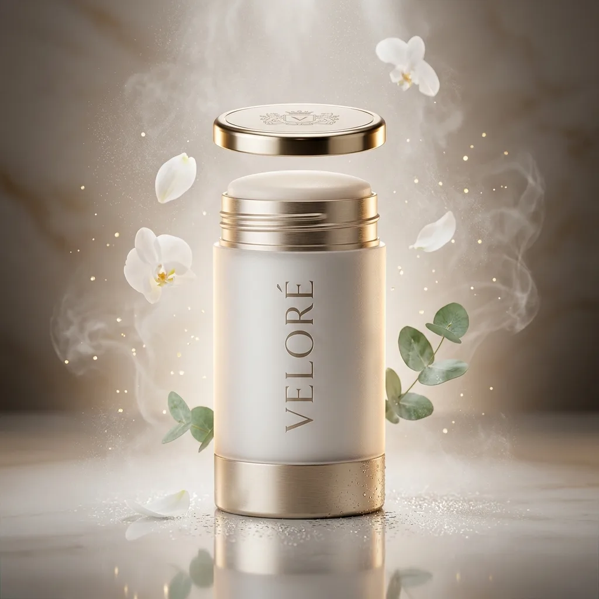

# Luxury body deodorant

[← Back to the collection](../../README.md) · Category: [Product & Brand](../../gallery/product-brand.md) · Model: `Vinano Image Pro` · ID: `vn-01337`

<a href="https://vinano.ai?utm_source=github&utm_medium=readme&utm_campaign=awesome-image-video-prompts-updating&utm_content=prompt-page-image"></a>

<sub>Preview generated with <a href="https://vinano.ai?utm_source=github&utm_medium=readme&utm_campaign=awesome-image-video-prompts-updating&utm_content=prompt-page-caption">vinano.ai</a></sub>

## Prompt

```text
{
 "master_prompt": {
 "product": {
 "type": "luxury body deodorant",
 "brand_name": "VELORÉ",
 "product_line": "Pure Aura",
 "container_style": "sleek cylindrical deodorant stick softly rounded edges",
 "material": "frosted glass body brushed champagne-gold metal accents",
 "finish": "velvety matte surface refined metallic detailing",
 "cap_design": "magnetic cap polished gold rim and engraved crest",
 "branding": "minimal serif logo etched vertically understated elegance",
 "dispense_style": "precision twist-up deodorant balm smooth surface finish",
 "color": "warm ivory body subtle golden undertones",
 "accent_details": "champagne gold band and minimal crest emblem",
 "texture_details": "soft satin deodorant balm surface visible at top"
 },

 "composition": {
 "scene_type": "ultra-cinematic luxury personal care advertising photography",
 "orientation": "vertical",
 "aspect_ratio": "4:5",
 "camera_angle": "low hero angle emphasizing elegance and premium form",
 "subject_position": "deodorant standing upright on reflective surface",
 "motion": "fine mist spray particles suspended mid-air for freshness effect"
 },

 "environment": {
 "background": "soft warm marble gradient fading into shadow",
 "atmosphere": "light spa mist creating a serene premium ambiance",
 "floating_elements": ["delicate mist particles suspended in air",
 "white orchid petals drifting gently",
 "tiny golden light particles shimmering softly",
 "fresh eucalyptus leaves floating nearby",
 "soft vapor trails suggesting freshness"],
 "surface_effects": "glossy reflections micro condensation droplets enhancing freshness"
 },

 "lighting": {
 "style": "soft spa-inspired studio lighting",
 "key_light": "diffused overhead light revealing frosted texture",
 "rim_lights": "subtle warm highlights outlining silhouette",
 "accent_lights": "soft golden glow enhancing luxury appeal",
 "shadow_depth": "gentle shadows for calm elegance",
 "contrast": "balanced contrast luminous clean highlights"
 },

 "color_palette": {
 "primary_colors": ["warm ivory", "soft cream", "clean white"],
 "accent_colors": ["champagne gold", "botanical green"]
 },

 "camera_settings": {
 "lens": "macro cinema lens",
 "depth_of_field": "shallow depth isolating product",
 "focus_point": "engraved logo and frosted glass texture",
 "bokeh": "soft luminous bokeh from mist particles",
 "detail_capture": "extreme micro-detail clarity"
 },

 "render_quality": {
 "resolution": "8K ultra high definition",
 "render_style": "hyper-realistic luxury personal care commercial render",
 "material_physics": "accurate frosted glass translucency and metallic reflections",
 "particle_simulation": "physically accurate mist and condensation droplets",
 "textures": "ultra-detailed frosted glass, metallic accents, and balm surface",
 "sharpness": "tack sharp product focus soft cinematic background",
 "noise": "none",
 "artifacts": "none"
 },

 "mood": {
 "tone": "pure, refined, and ultra-premium",
 "emotion": "freshness, confidence, and indulgent self-care luxury"
 },

 "final_output": {
 "usage": "luxury personal care campaign and premium wellness advertising",
 "branding_focus": "hero product freshness elite wellness appeal",
 "visual_style": "cinematic luxury spa aesthetic"
 }
 }
}

Keep edges clean and the overall composition balanced for a polished, gallery-ready result.
```

## Try it on vinano.ai

1. Copy the prompt above.
2. Open **[vinano.ai](https://vinano.ai?utm_source=github&utm_medium=readme&utm_campaign=awesome-image-video-prompts-updating&utm_content=prompt-page-try)**, paste it into the image generator and pick a model.
3. Swap any placeholders (brand, product, city, person…) for your own details, then generate.

More prompts like this: [Product & Brand gallery](../../gallery/product-brand.md) · [all categories](../../README.md#contents)
