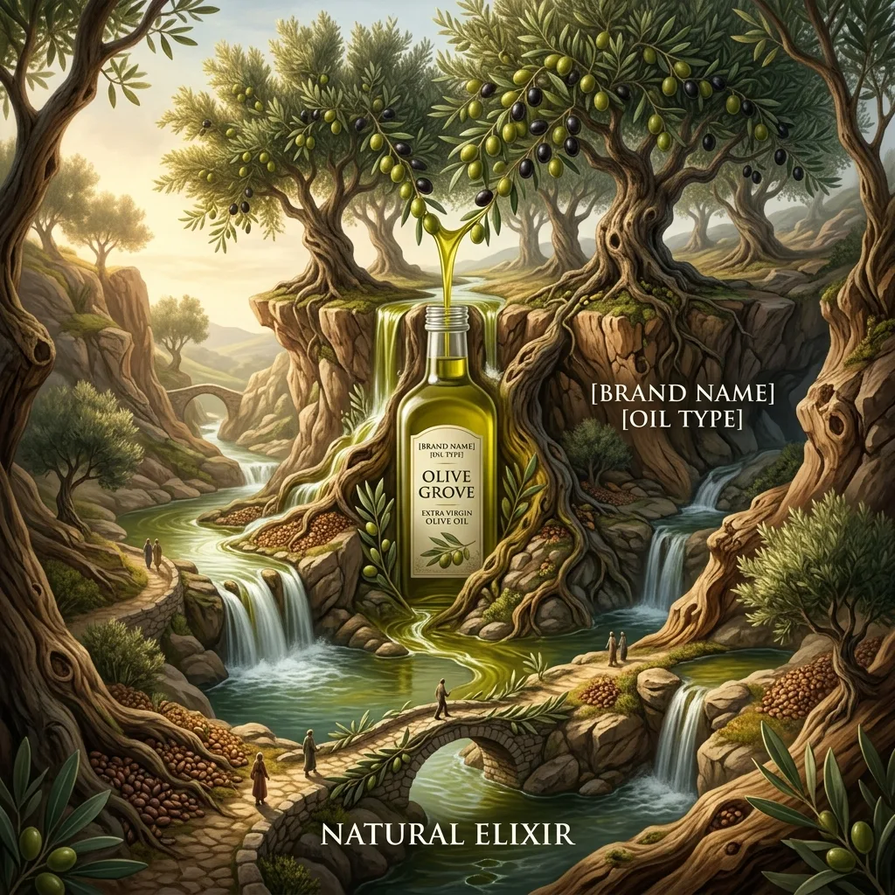

# Surreal premium commercial illustration for BRAND NAME OIL TYPE

[← Back to the collection](../../README.md) · Category: [Product & Brand](../../gallery/product-brand.md) · Model: `Vinano Image Pro` · ID: `vn-01354`

<a href="https://vinano.ai?utm_source=github&utm_medium=readme&utm_campaign=awesome-image-video-prompts-updating&utm_content=prompt-page-image"></a>

<sub>Preview generated with <a href="https://vinano.ai?utm_source=github&utm_medium=readme&utm_campaign=awesome-image-video-prompts-updating&utm_content=prompt-page-caption">vinano.ai</a></sub>

## Prompt

```text
Surreal premium commercial illustration for [BRAND NAME] [OIL TYPE], featuring the product bottle embedded into a massive natural landscape made entirely from the core ingredient. The ingredient appears at the top source, flowing as a natural element into the bottle, then transforming into waterfalls, rivers, or pools below. The environment, terrain, vegetation, textures, and color palette are all inspired by [PRIMARY INGREDIENT]. Small human figures interact naturally the environment to emphasize scale. filmic, cinematic lighting, soft painterly realism, ultra-detailed textures, fantasy-meets-nature aesthetic, vertical poster composition, 8K ultra-high resolution. Preserve realistic proportions and depth for a confident, professional finish.
```

## Try it on vinano.ai

1. Copy the prompt above.
2. Open **[vinano.ai](https://vinano.ai?utm_source=github&utm_medium=readme&utm_campaign=awesome-image-video-prompts-updating&utm_content=prompt-page-try)**, paste it into the image generator and pick a model.
3. Swap any placeholders (brand, product, city, person…) for your own details, then generate.

More prompts like this: [Product & Brand gallery](../../gallery/product-brand.md) · [all categories](../../README.md#contents)
