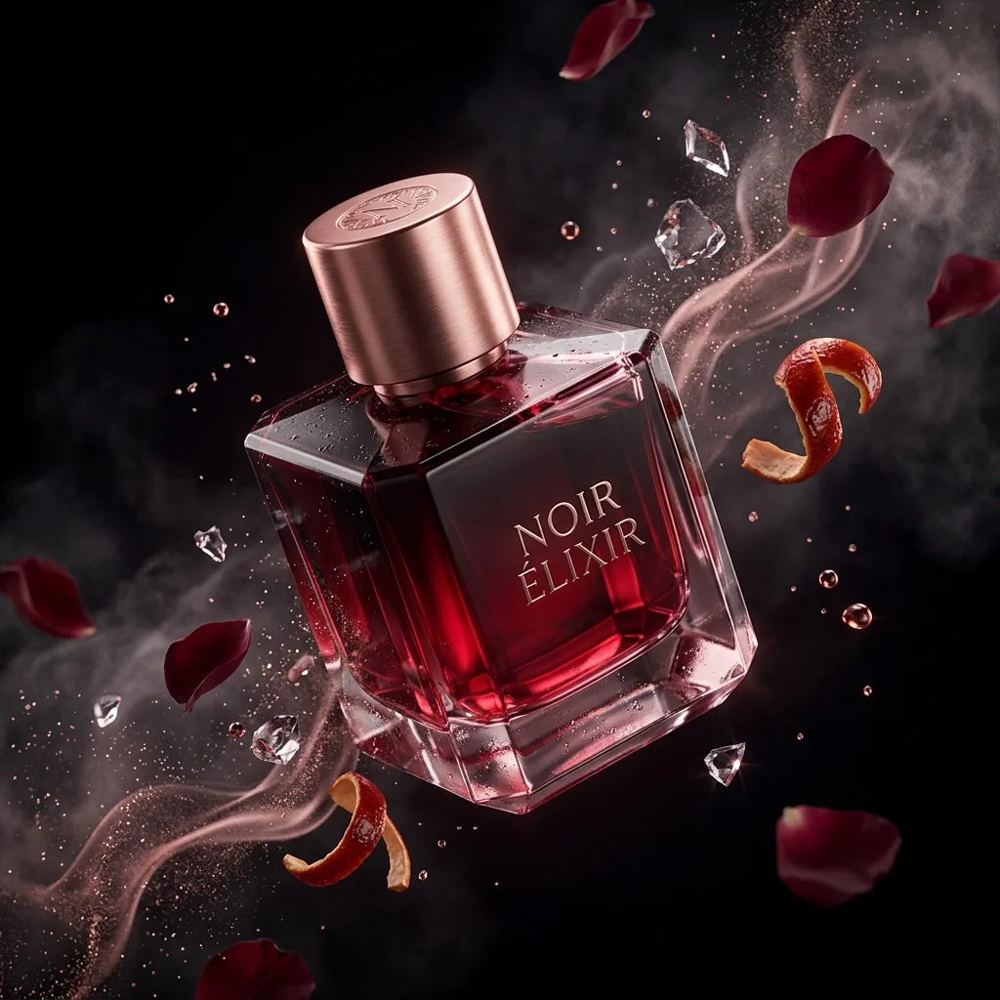

# Luxury perfume bottle

[← Back to the collection](../../README.md) · Category: [Product & Brand](../../gallery/product-brand.md) · Model: `Vinano Image Pro` · ID: `vn-01363`

<a href="https://vinano.ai?utm_source=github&utm_medium=readme&utm_campaign=awesome-image-video-prompts-updating&utm_content=prompt-page-image"></a>

<sub>Preview generated with <a href="https://vinano.ai?utm_source=github&utm_medium=readme&utm_campaign=awesome-image-video-prompts-updating&utm_content=prompt-page-caption">vinano.ai</a></sub>

## Prompt

```text
{
 "master_prompt": {
 "product": {
 "type": "luxury perfume bottle",
 "brand_name": "NOIR ÉLIXIR",
 "fragrance_line": "Crimson Reserve",
 "container_shape": "faceted geometric crystal bottle sharp elegant edges",
 "material": "high-clarity glass deep ruby gradient tint",
 "finish": "polished reflective surfaces subtle matte facets",
 "cap_design": "magnetic cap in brushed rose-gold metal engraved emblem",
 "label_style": "minimal serif typography etched directly into glass metallic inlay",
 "liquid_color": "rich crimson red glowing ruby undertones"
 },
 "composition": {
 "scene_type": "ultra-cinematic luxury fragrance advertising photography",
 "orientation": "vertical",
 "aspect_ratio": "4:5",
 "camera_angle": "dramatic diagonal hero angle",
 "subject_position": "floating mid-air slight forward tilt",
 "motion": "atomized perfume mist trails and fluid fragrance ribbons suspended in motion"
 },
 "environment": {
 "background": "deep black velvet gradient fading into shadow",
 "atmosphere": "volumetric mist delicate fragrance vapor swirling around the bottle",
 "floating_elements": ["atomized perfume droplets suspended mid-air",
 "shattering crystal fragments catching highlights",
 "dark red rose petals drifting slowly",
 "glossy blood-orange peel curls",
 "fine rose-gold dust particles sparkling in light"],
 "surface_effects": "micro condensation beads and polished reflections enhancing realism"
 },
 "lighting": {
 "style": "dramatic low-key studio lighting",
 "key_light": "soft directional light sculpting the glass facets",
 "rim_lights": "strong rim lights outlining silhouette and edges",
 "accent_lights": "warm ruby and rose-gold specular highlights on cap and engraved details",
 "shadow_depth": "deep cinematic shadows for luxury mood",
 "contrast": "high contrast controlled reflections and luminous highlights"
 },
 "color_palette": {
 "primary_colors": ["obsidian black", "deep garnet", "ruby red"],
 "accent_colors": ["rose gold", "warm champagne glow"]
 },
 "camera_settings": {
 "lens": "macro cinema prime lens",
 "depth_of_field": "shallow depth isolating product from background",
 "focus_point": "engraved logo and glass surface textures",
 "bokeh": "smooth cinematic bokeh from reflective particles",
 "detail_capture": "extreme micro-detail clarity"
 },
 "render_quality": {
 "resolution": "8K ultra high definition",
 "render_style": "hyper-realistic luxury commercial render",
 "glass_physics": "accurate refraction and internal reflections",
 "liquid_simulation": "physically accurate fluid dynamics",
 "textures": "ultra-detailed crystal, metal, mist, and micro-droplet textures",
 "sharpness": "tack sharp product focus cinematic background softness",
 "noise": "none",
 "artifacts": "none"
 },
 "mood": {
 "tone": "seductive, passionate, and ultra-premium",
 "emotion": "luxury, desire, elegance, timeless sophistication"
 },
 "final_output": {
 "usage": "high-end perfume campaign and luxury magazine advertising",
 "branding_focus": "hero product dominance strong brand prestige",
 "visual_style": "cinematic fragrance commercial aesthetic"
 }
 }
}

Aim for an editorial, design-driven look with deliberate negative space.
```

## Try it on vinano.ai

1. Copy the prompt above.
2. Open **[vinano.ai](https://vinano.ai?utm_source=github&utm_medium=readme&utm_campaign=awesome-image-video-prompts-updating&utm_content=prompt-page-try)**, paste it into the image generator and pick a model.
3. Swap any placeholders (brand, product, city, person…) for your own details, then generate.

More prompts like this: [Product & Brand gallery](../../gallery/product-brand.md) · [all categories](../../README.md#contents)
