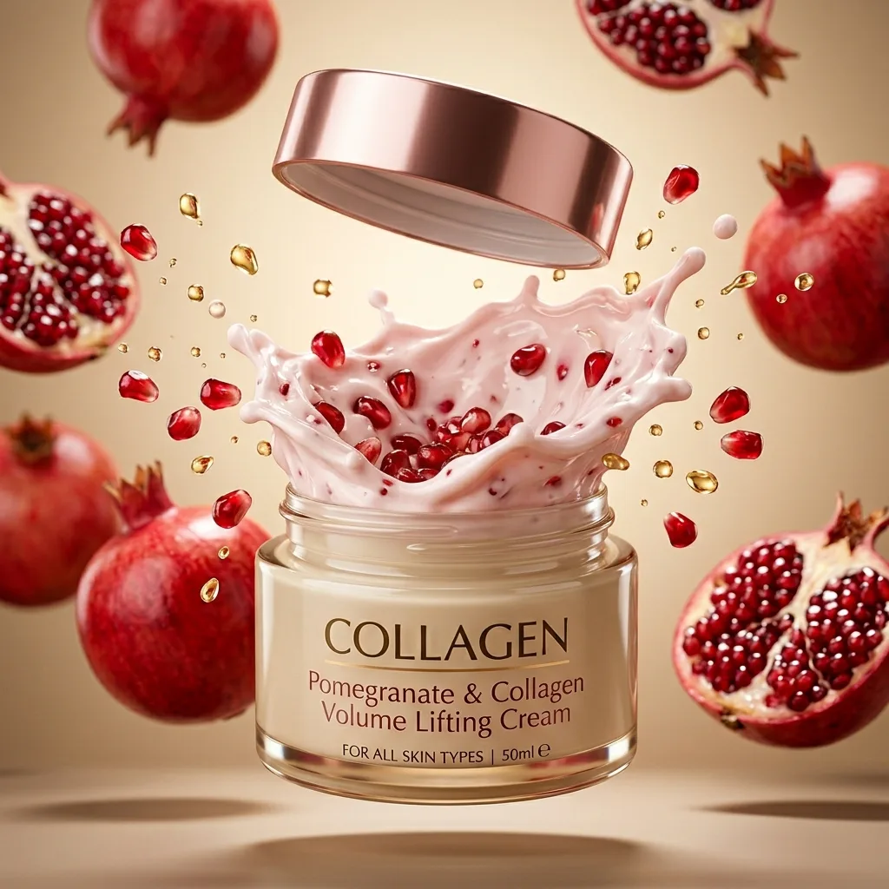

# Hyperrealistic premium product photography scene of a smooth beige

[← Back to the collection](../../README.md) · Category: [Product & Brand](../../gallery/product-brand.md) · Model: `Vinano Image Pro` · ID: `vn-01373`

<a href="https://vinano.ai?utm_source=github&utm_medium=readme&utm_campaign=awesome-image-video-prompts-updating&utm_content=prompt-page-image"></a>

<sub>Preview generated with <a href="https://vinano.ai?utm_source=github&utm_medium=readme&utm_campaign=awesome-image-video-prompts-updating&utm_content=prompt-page-caption">vinano.ai</a></sub>

## Prompt

```text
"A hyperrealistic premium product photography scene of a smooth beige cosmetic jar labeled “Collagen" Pomegranate & Collagen Volume Lifting Cream” exploding open mid-air, the metallic rose-gold lid floating slightly above the jar and a thick, whipped, pale pink cream bursting upward in a dramatic splash, glossy and textured visible red pomegranate seeds, surrounded by suspended whole red pomegranates and halved pomegranates glistening ruby-red arils, golden liquid droplets and creamy splashes frozen in motion around the jar, the container tilted slightly to the right and centered in frame, shot from a straight-on macro perspective, illuminated by soft yet high-contrast studio lighting from above and slightly behind to create glowing highlights on the wet textures and translucent splashes, subtle shadows beneath the floating elements, a smooth warm beige gradient background enhancing the color palette of soft pinks, creams, and deep red fruit tones, ultra-sharp focus on the jar and cream shallow depth of field for the outer fruit, cinematic realism, luxury skincare advertising aesthetic, crisp reflections, 8K true-to-life photorealistic detail, energetic and fresh mood." Preserve realistic proportions and depth for a confident, professional finish.
```

## Try it on vinano.ai

1. Copy the prompt above.
2. Open **[vinano.ai](https://vinano.ai?utm_source=github&utm_medium=readme&utm_campaign=awesome-image-video-prompts-updating&utm_content=prompt-page-try)**, paste it into the image generator and pick a model.
3. Swap any placeholders (brand, product, city, person…) for your own details, then generate.

More prompts like this: [Product & Brand gallery](../../gallery/product-brand.md) · [all categories](../../README.md#contents)
