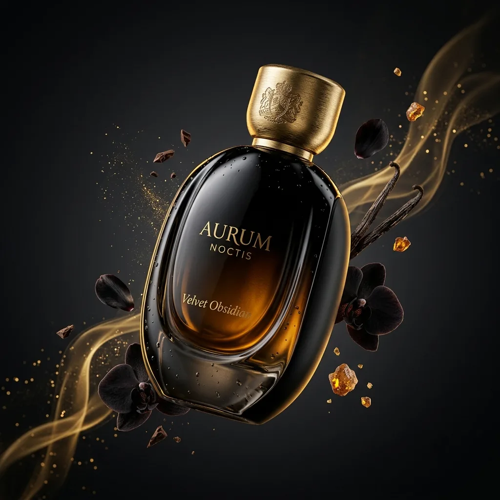

# Luxury perfume bottle

[← Back to the collection](../../README.md) · Category: [Product & Brand](../../gallery/product-brand.md) · Model: `Vinano Image Pro` · ID: `vn-01378`

<a href="https://vinano.ai?utm_source=github&utm_medium=readme&utm_campaign=awesome-image-video-prompts-updating&utm_content=prompt-page-image"></a>

<sub>Preview generated with <a href="https://vinano.ai?utm_source=github&utm_medium=readme&utm_campaign=awesome-image-video-prompts-updating&utm_content=prompt-page-caption">vinano.ai</a></sub>

## Prompt

```text
{
 "master_prompt": {
 "product": {
 "type": "luxury perfume bottle",
 "brand_name": "AURUM NOCTIS",
 "fragrance_line": "Velvet Obsidian",
 "container_shape": "sleek monolithic oval bottle sculpted contours",
 "material": "obsidian-black glass subtle smoked transparency",
 "finish": "high-gloss reflective body satin matte side panels",
 "cap_design": "heavy magnetic cap in brushed antique gold engraved crest",
 "label_style": "minimal gold foil typography floating on glass surface",
 "liquid_color": "dark amber molten gold undertones"
 },
 "composition": {
 "scene_type": "ultra-cinematic luxury fragrance advertising photography",
 "orientation": "vertical",
 "aspect_ratio": "4:5",
 "camera_angle": "low hero angle for power and prestige",
 "subject_position": "floating mid-air elegant slow rotation",
 "motion": "fluid golden fragrance trails and aromatic vapor ribbons suspended in motion"
 },
 "environment": {
 "background": "deep charcoal-to-black gradient fading into shadow",
 "atmosphere": "soft volumetric haze enhancing depth and mystery",
 "floating_elements": ["molten gold dust particles glowing softly",
 "dark cocoa shards catching highlights",
 "black orchid petals drifting slowly",
 "smoked vanilla pods suspended in air",
 "tiny amber resin fragments sparkling"],
 "surface_effects": "micro condensation droplets and polished reflections enhancing realism"
 },
 "lighting": {
 "style": "dramatically sculpted low-key studio lighting",
 "key_light": "soft directional light defining contours and glass curvature",
 "rim_lights": "warm golden rim lights outlining silhouette",
 "accent_lights": "subtle amber highlights emphasizing cap and liquid glow",
 "shadow_depth": "deep shadows for cinematic luxury mood",
 "contrast": "rich contrast controlled highlights and luminous reflections"
 },
 "color_palette": {
 "primary_colors": ["obsidian black", "charcoal shadow", "deep amber"],
 "accent_colors": ["antique gold", "warm bronze glow"]
 },
 "camera_settings": {
 "lens": "macro cinema prime lens",
 "depth_of_field": "shallow depth isolating product",
 "focus_point": "brand crest and glass curvature",
 "bokeh": "soft golden bokeh from reflective particles",
 "detail_capture": "extreme micro-detail clarity"
 },
 "render_quality": {
 "resolution": "8K ultra high definition",
 "render_style": "hyper-realistic luxury commercial render",
 "glass_physics": "accurate refraction and internal reflections",
 "liquid_simulation": "physically accurate fluid glow and viscosity",
 "textures": "ultra-detailed glass, metal, vapor, and dust textures",
 "sharpness": "tack sharp product focus cinematic background softness",
 "noise": "none",
 "artifacts": "none"
 },
 "mood": {
 "tone": "mysterious, opulent, and powerful",
 "emotion": "nighttime luxury, sensual elegance, timeless prestige"
 },
 "final_output": {
 "usage": "luxury fragrance campaign and premium magazine advertising",
 "branding_focus": "hero product dominance elite brand presence",
 "visual_style": "cinematic haute parfumerie commercial aesthetic"
 }
 }
}

Emphasise material texture and natural light so the final frame feels tactile and premium.
```

## Try it on vinano.ai

1. Copy the prompt above.
2. Open **[vinano.ai](https://vinano.ai?utm_source=github&utm_medium=readme&utm_campaign=awesome-image-video-prompts-updating&utm_content=prompt-page-try)**, paste it into the image generator and pick a model.
3. Swap any placeholders (brand, product, city, person…) for your own details, then generate.

More prompts like this: [Product & Brand gallery](../../gallery/product-brand.md) · [all categories](../../README.md#contents)
