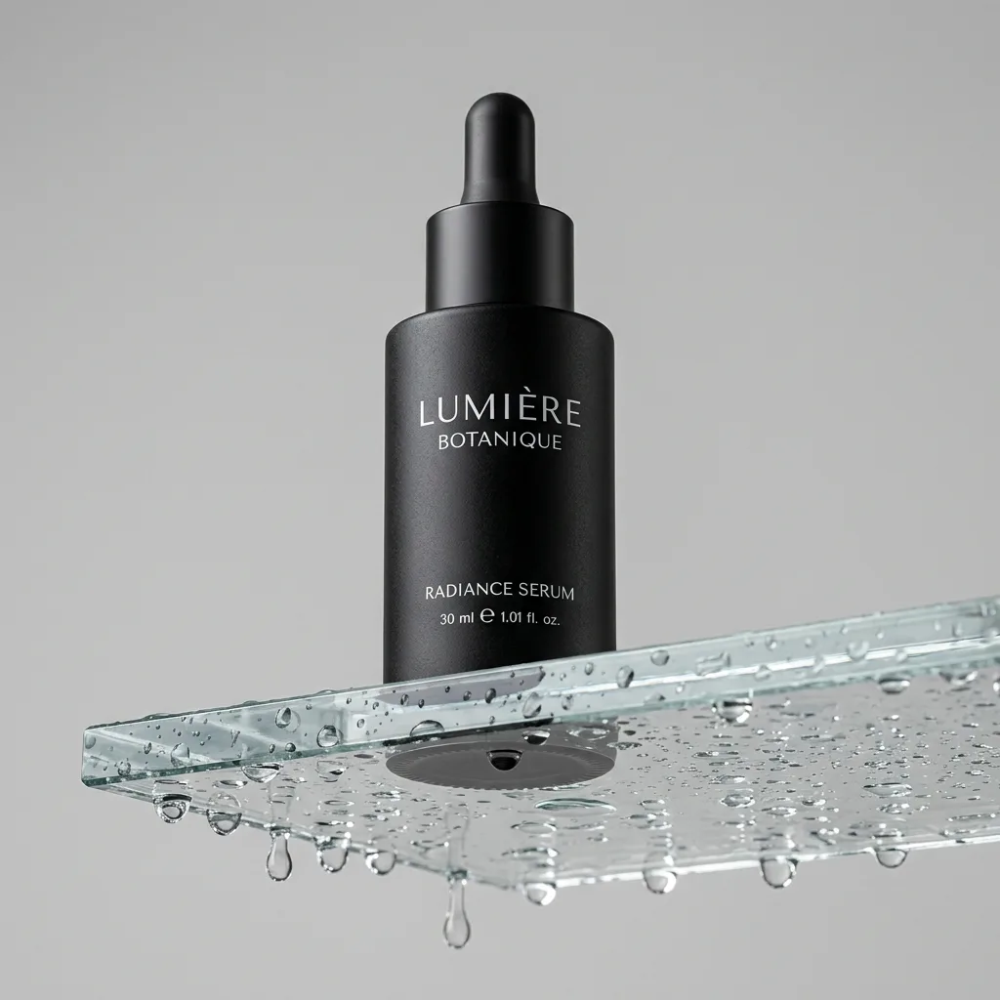

# Commercial luxury product photography, true-to-life photorealistic, ultra high detail

[← Back to the collection](../../README.md) · Category: [Product & Brand](../../gallery/product-brand.md) · Model: `Vinano Image Pro` · ID: `vn-01385`

<a href="https://vinano.ai?utm_source=github&utm_medium=readme&utm_campaign=awesome-image-video-prompts-updating&utm_content=prompt-page-image"></a>

<sub>Preview generated with <a href="https://vinano.ai?utm_source=github&utm_medium=readme&utm_campaign=awesome-image-video-prompts-updating&utm_content=prompt-page-caption">vinano.ai</a></sub>

## Prompt

```text
Commercial luxury product photography, true-to-life photorealistic, ultra high detail, 8K quality. A refined minimalist matte black cosmetic dropper bottle placed on a clear glass podium. Low angle camera view to make the bottle feel tall and powerful. The bottom of the bottle is clearly visible through the transparent glass. The glass surface is wet realistic water droplets, a few drops hanging underneath the glass, frozen mid drip for a time stopped effect. Matte light gray background no texture or gradient. Soft, even studio lighting clean reflections, premium skincare advertising look, sharp focus, realistic materials, no distractions. Maintain consistent colour harmony and crisp focus across the whole frame.
```

## Try it on vinano.ai

1. Copy the prompt above.
2. Open **[vinano.ai](https://vinano.ai?utm_source=github&utm_medium=readme&utm_campaign=awesome-image-video-prompts-updating&utm_content=prompt-page-try)**, paste it into the image generator and pick a model.
3. Swap any placeholders (brand, product, city, person…) for your own details, then generate.

More prompts like this: [Product & Brand gallery](../../gallery/product-brand.md) · [all categories](../../README.md#contents)
