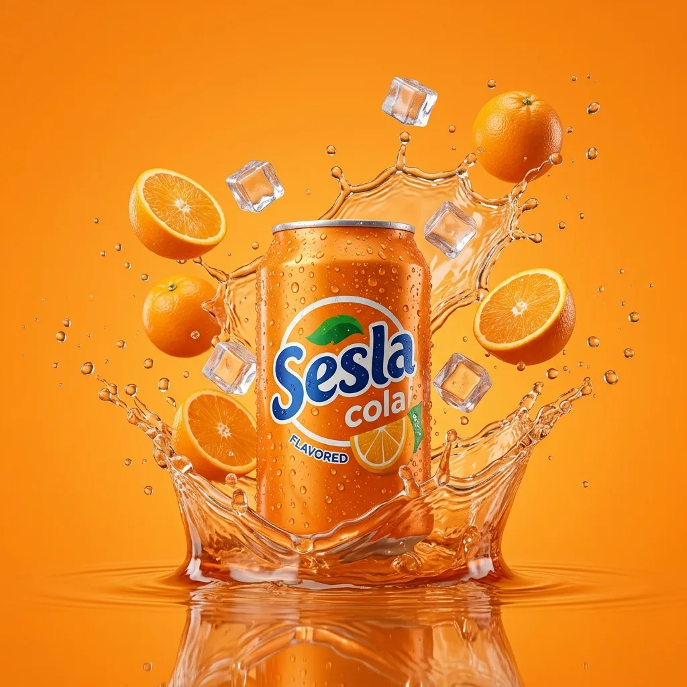

# AI-edited commercial product photography

[← Back to the collection](../../README.md) · Category: [Product & Brand](../../gallery/product-brand.md) · Model: `Vinano Image Pro` · ID: `vn-01386`

<a href="https://vinano.ai?utm_source=github&utm_medium=readme&utm_campaign=awesome-image-video-prompts-updating&utm_content=prompt-page-image"></a>

<sub>Preview generated with <a href="https://vinano.ai?utm_source=github&utm_medium=readme&utm_campaign=awesome-image-video-prompts-updating&utm_content=prompt-page-caption">vinano.ai</a></sub>

## Prompt

```text
{
 "master_prompt": {
 "global_settings": {
 "resolution": "8K ultra-high-definition",
 "aspect_ratio": "3:4 vertical",
 "style": "hyper-realistic AI-edited commercial product photography",
 "sharpness": "extreme clarity, micro-detail visibility",
 "lighting_quality": "cinematic studio lighting controlled highlights and shadows",
 "motion_freeze": "high-speed capture, frozen splashes and particles",
 "noise": "none",
 "artifacts": "none"
 },

"module_1_image_1_style": {
 "subject": {
 "type": "orange-flavored soda can",
 "color": "bright orange",
 "surface_details": "condensation droplets across can",
 "branding_text_visible": ["Sesla",
 "cola"]
 },
 "pose_and_orientation": {
 "position": "upright, slightly embedded in splash",
 "angle": "centered frontal view"
 },
 "liquid_and_motion": {
 "liquid_color": "transparent orange-tinted liquid",
 "motion": "high-energy splash bursting upward and outward",
 "splash_detail": "clear liquid arcs suspended droplets"
 },
 "floating_elements": {
 "oranges": ["whole oranges",
 "halved oranges visible pulp"],
 "ice_cubes": "clear sharp-edged cubes floating mid-air",
 "droplets": "numerous spherical liquid droplets"
 },
 "background": {
 "color": "solid bright orange",
 "lighting": "high-key, evenly lit"
 },
 "surface_and_reflection": {
 "base": "shallow liquid pool",
 "reflection_quality": "strong mirror-like reflection ripples"
 }
 }
 }
}

Aim for an editorial, design-driven look with deliberate negative space.
```

## Try it on vinano.ai

1. Copy the prompt above.
2. Open **[vinano.ai](https://vinano.ai?utm_source=github&utm_medium=readme&utm_campaign=awesome-image-video-prompts-updating&utm_content=prompt-page-try)**, paste it into the image generator and pick a model.
3. Swap any placeholders (brand, product, city, person…) for your own details, then generate.

More prompts like this: [Product & Brand gallery](../../gallery/product-brand.md) · [all categories](../../README.md#contents)
