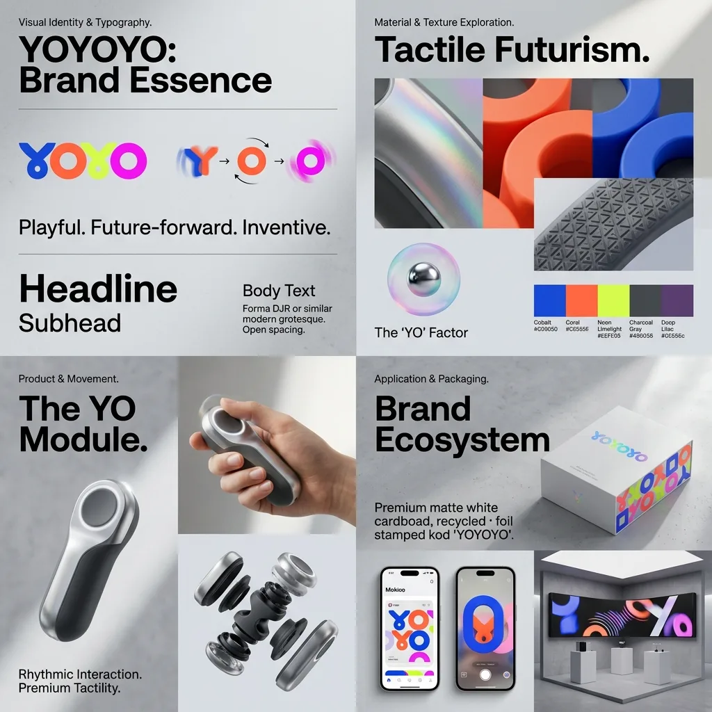

# Product & Brand prompt #1433

[← Back to the collection](../../README.md) · Category: [Product & Brand](../../gallery/product-brand.md) · Model: `Vinano Image Pro` · ID: `vn-01433`

<a href="https://vinano.ai?utm_source=github&utm_medium=readme&utm_campaign=awesome-image-video-prompts-updating&utm_content=prompt-page-image"></a>

<sub>Preview generated with <a href="https://vinano.ai?utm_source=github&utm_medium=readme&utm_campaign=awesome-image-video-prompts-updating&utm_content=prompt-page-caption">vinano.ai</a></sub>

## Prompt

```text
Create a polished multi-page (multiple images) brand kit for a company called [YOYOYO]. The brand should feel playful, futuristic, vibrant, and design-forward, blending the energy of a toy-inspired product the sophistication of a premium creative tech brand. Use a bold, experimental visual identity bright color, clean geometry, modern typography, dynamic motion cues, and slightly surreal imagery. The overall mood should feel inventive, youthful, rhythmic, tactile, and high-concept, a balance of fun consumer product culture, fashionlike presentation, and contemporary digital design.

Include a sense of product obsession, visual experimentation, packaging exploration, editorial photography, immersive retail, and cross-platform brand application. Make it feel like a confident, contemporary brand world that is both accessible and art-directed, strong graphic cohesion and a premium creative-studio aesthetic.

Emphasise material texture and natural light so the final frame feels tactile and premium.
```

## Try it on vinano.ai

1. Copy the prompt above.
2. Open **[vinano.ai](https://vinano.ai?utm_source=github&utm_medium=readme&utm_campaign=awesome-image-video-prompts-updating&utm_content=prompt-page-try)**, paste it into the image generator and pick a model.
3. Swap any placeholders (brand, product, city, person…) for your own details, then generate.

More prompts like this: [Product & Brand gallery](../../gallery/product-brand.md) · [all categories](../../README.md#contents)
