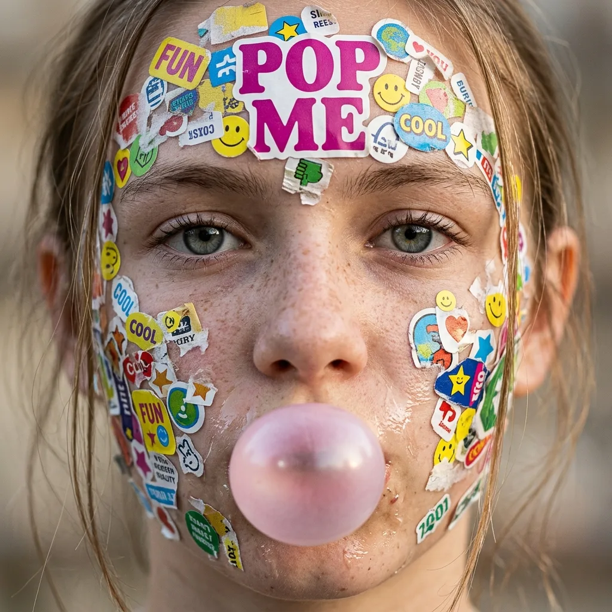

# Portrait, Ai Art

[← Back to the collection](../../README.md) · Category: [Product & Brand](../../gallery/product-brand.md) · Model: `Vinano Image Pro` · ID: `vn-01464`

<a href="https://vinano.ai?utm_source=github&utm_medium=readme&utm_campaign=awesome-image-video-prompts-updating&utm_content=prompt-page-image"></a>

<sub>Preview generated with <a href="https://vinano.ai?utm_source=github&utm_medium=readme&utm_campaign=awesome-image-video-prompts-updating&utm_content=prompt-page-caption">vinano.ai</a></sub>

## Prompt

```text
{
 "meta": {
 "image_quality": "High",
 "image_type": "Photo"
 },
 "global_context": {
 "scene_description": "Close-up portrait of a young person's face covered colorful paper stickers and glossy adhesive residue. Central focus on eyes, nose, lips; subject blowing a pink bubblegum bubble. Stickers vary in size, text, icons and layered overlap; hair strands frame face at edges. Skin shows freckles, pores, and sheen from adhesive or moisture.",
 "time_of_day": "Neutral/studio lighting",
 "weather_atmosphere": "Indoors/controlled",
 "lighting": {
 "source": "Artificial",
 "direction": "Frontal slight top",
 "quality": "Soft",
 "color_temp": "Neutral"
 }
 },
 "color_palette": {
 "dominant_hex_estimates": ["#E7B1B6", "#F6C0D0", "#C9A38C"],
 "accent_colors": ["Pink","Magenta"],
 "contrast_level": "Medium"
 },
 "composition": {
 "camera_angle": "Eye-level",
 "framing": "Extreme close-up (face fills frame)",
 "depth_of_field": "Shallow (background indistinct)",
 "focal_point": "Eyes and central bubble"
 },
 "objects": [{
 "id": "obj_001",
 "label": "Face",
 "category": "Person (head)",
 "location": "Center",
 "prominence": "Foreground",
 "visual_attributes": {
 "color": "Light beige skin pink undertones and freckles",
 "texture": "Smooth visible pores, glossy adhesive patches",
 "material": "Skin",
 "state": "Sticker-covered, slightly wet/glossy",
 "dimensions_relative": "Large relative to frame"
 },
 "micro_details": ["Freckles concentrated on nose and cheeks",
 "Shiny adhesive residue streaks on forehead and cheeks",
 "Fine vellus hairs visible",
 "Pores visible on nose and cheeks"],
 "pose_or_orientation": "Frontal",
 "text_content": null
 },
 {
 "id": "obj_002",
 "label": "Eyes (pair)",
 "category": "Facial feature",
 "location": "Upper-center",
 "prominence": "Foreground",
 "visual_attributes": {
 "color": "Gray-green irises dark limbal ring",
 "texture": "Wet/glossy cornea, visible eyelashes",
 "material": "Biological",
 "state": "Open, neutral expression",
 "dimensions_relative": "Medium"
 },
 "micro_details": ["Tiny specular highlights on each cornea",
 "Sparse lower lashes, fuller upper lashes",
 "Slight shadow under lower lids"],
 "pose_or_orientation": "Facing camera",
 "text_content": null
 },
 {
 "id": "obj_003",
 "label": "Pink bubble",
 "category": "Object (gum)",
 "location": "Lower-center",
 "prominence": "Foreground",
 "visual_attributes": {
 "color": "Pastel pink",
 "texture": "Smooth, slightly translucent",
 "material": "Gum",
 "state": "Inflated/intact",
 "dimensions_relative": "Large relative to mouth"
 },
 "micro_details": ["Two bright specular reflections on sphere",
 "Seamless edge against lips"],
 "pose_or_orientation": "Centered over mouth",
 "text_content": null
 },
 {
 "id": "obj_004",
 "label": "Stickers (assorted)",
 "category": "Adhesive stickers",
 "location": "Entire face and neck, concentrated forehead and cheeks",
 "prominence": "Foreground",
 "visual_attributes": {
 "color": "Multicolor: magenta, yellow, blue, white",
 "texture": "Paper/plastic glossy varnish, torn edges",
 "material": "Paper/plastic adhesive",
 "state": "Layered, partially torn, some wrinkled",
 "dimensions_relative": "Varied small-to-medium"
 },
 "micro_details": ["Large 'POP ME' magenta sticker on forehead",
 "Partial torn sticker fragments near nasolabial fold",
 "Small rectangular stickers tiny printed text",
 "Edges lifting, adhesive shine around perimeters"],
 "pose_or_orientation": "Affixed flat or slightly peeled",
 "text_content": "Multiple small logos and words (e.g., 'POP ME')"
 },
 {
 "id": "obj_005",
 "label": "Hair strands",
 "category": "Hair",
 "location": "Left and right edges framing face",
 "prominence": "Background/foreground overlap",
 "visual_attributes": {
 "color": "Light brown",
 "texture": "Fine, slightly wet",
 "material": "Hair",
 "state": "Loose strands",
 "dimensions_relative": "Thin relative to face"
 },
 "micro_details": ["Individual strands crossing forehead edges",
 "Slight adhesive sheen on some strands"],
 "pose_or_orientation": "Hanging down"
 }],
 "text_ocr": {
 "present": true,
 "content": [{
 "text": "POP ME",
 "location": "Forehead",
 "font_style": "Bold/Decorative",
 "legibility": "Clear"
 }]
 },
 "semantic_relationships": ["Stickers are affixed to Face",
 "Bubble covers mouth, partially obscuring lips",
 "Adhesive residue creates glossy highlights on skin",
 "Hair strands frame and partly overlay stickers"]
}

Keep edges clean and the overall composition balanced for a polished, gallery-ready result.
```

## Try it on vinano.ai

1. Copy the prompt above.
2. Open **[vinano.ai](https://vinano.ai?utm_source=github&utm_medium=readme&utm_campaign=awesome-image-video-prompts-updating&utm_content=prompt-page-try)**, paste it into the image generator and pick a model.
3. Swap any placeholders (brand, product, city, person…) for your own details, then generate.

More prompts like this: [Product & Brand gallery](../../gallery/product-brand.md) · [all categories](../../README.md#contents)
