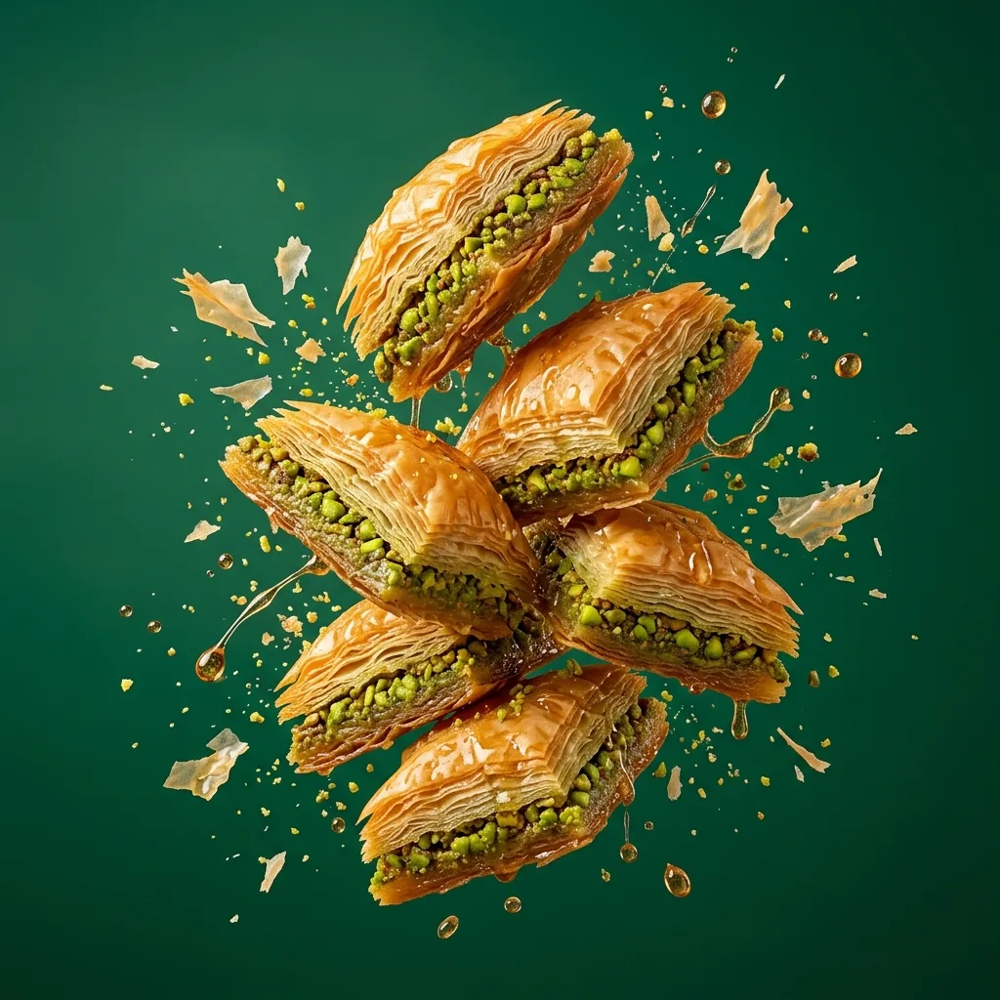

# Realistic, Cinematic

[← Back to the collection](../../README.md) · Category: [Product & Brand](../../gallery/product-brand.md) · Model: `Vinano Image Pro` · ID: `vn-01465`

<a href="https://vinano.ai?utm_source=github&utm_medium=readme&utm_campaign=awesome-image-video-prompts-updating&utm_content=prompt-page-image"></a>

<sub>Preview generated with <a href="https://vinano.ai?utm_source=github&utm_medium=readme&utm_campaign=awesome-image-video-prompts-updating&utm_content=prompt-page-caption">vinano.ai</a></sub>

## Prompt

```text
{
 "resolution": "8K UHD",
 "aspect_ratio": "3:4",
 "image_style": "hyper-realistic commercial dessert photography",
 "global_settings": {
 "quality": "Ultra-high detail, razor-sharp focus, luxury dessert clarity",
 "lighting": "Controlled studio lighting emphasizing texture, layers, and syrup highlights",
 "motion": "Frozen mid-air elements subtle gravity realism",
 "background_style": "Solid or smooth gradient background, color varies per module",
 "camera": "High-speed photography look, shallow to medium depth of field",
 "post_processing": "Rich contrast, warm tones, natural shine, no artificial glow"
 },
 "modules": { "module_1_classic_baklava_stack_explosion": {
 "scene_description": "A dramatic stack of classic pistachio baklava flying syrup droplets",
 "baklava": {
 "type": "Traditional pistachio baklava",
 "layers": "Ultra-thin phyllo layers clearly visible",
 "cut": "Diamond-shaped pieces",
 "position": "Stacked and floating mid-air"
 },
 "details": {
 "nuts": "Finely ground bright green pistachios between layers",
 "syrup": "Golden sugar syrup glistening on edges"
 },
 "motion_effects": {
 "syrup": "Small syrup droplets splashing outward",
 "crumbs": "Tiny phyllo flakes suspended in air"
 },
 "background": {
 "color": "Deep emerald green",
 "texture": "Smooth, seamless"
 }
 }, "module_2_minimal_baklava_plate_floating": {
 "scene_description": "refined minimalist premium baklava presentation controlled floating crumbs",
 "baklava": {
 "type": "Single-layer pistachio baklava pieces",
 "arrangement": "Neatly aligned rectangular cuts",
 "surface": "Glossy light syrup sheen"
 },
 "accent_elements": {
 "nuts": "Crushed pistachio dust lightly floating",
 "syrup": "Thin syrup drizzle frozen mid-air"
 },
 "motion_effects": {
 "particles": "Subtle floating crumbs and nut dust"
 },
 "background": {
 "color": "Warm beige",
 "gradient": "Very soft tonal gradient"
 }
 }, "module_3_baklava_syrup_pour_drama": {
 "scene_description": "Cinematic syrup pour over baklava stack",
 "baklava": {
 "type": "Thick stacked baklava slices",
 "texture": "Highly detailed crispy layers"
 },
 "additional_elements": {
 "syrup": {
 "state": "Thick golden syrup pouring from above",
 "motion": "Frozen in elegant flowing strands"
 },
 "nuts": ["Whole pistachio kernels",
 "Crushed pistachio fragments"]
 },
 "motion_effects": {
 "splashes": "Micro syrup splashes on impact points",
 "particles": "Floating nut fragments"
 },
 "background": {
 "color": "Dark chocolate brown",
 "tone": "High contrast, luxury feel"
 }
 }, "module_4_modern_baklava_floating_composition": {
 "scene_description": "Modern deconstructed baklava composition in mid-air",
 "elements": {
 "phyllo": "Crispy golden phyllo sheets floating separately",
 "nuts": "Pistachio layers suspended between sheets",
 "syrup": "Glossy syrup threads connecting elements"
 },
 "motion_effects": {
 "flakes": "Ultra-fine pastry flakes suspended",
 "drops": "Minimal syrup droplets"
 },
 "background": {
 "color": "Muted olive green",
 "texture": "Smooth, seamless"
 }
 }
 },
 "negative_prompt": ["text",
 "logos",
 "branding",
 "hands",
 "people",
 "utensils",
 "plates",
 "tables",
 "cartoon style",
 "excessive syrup pooling",
 "burnt pastry",
 "overexposure",
 "artificial glow",
 "low detail textures"]
}

Emphasise material texture and natural light so the final frame feels tactile and premium.
```

## Try it on vinano.ai

1. Copy the prompt above.
2. Open **[vinano.ai](https://vinano.ai?utm_source=github&utm_medium=readme&utm_campaign=awesome-image-video-prompts-updating&utm_content=prompt-page-try)**, paste it into the image generator and pick a model.
3. Swap any placeholders (brand, product, city, person…) for your own details, then generate.

More prompts like this: [Product & Brand gallery](../../gallery/product-brand.md) · [all categories](../../README.md#contents)
