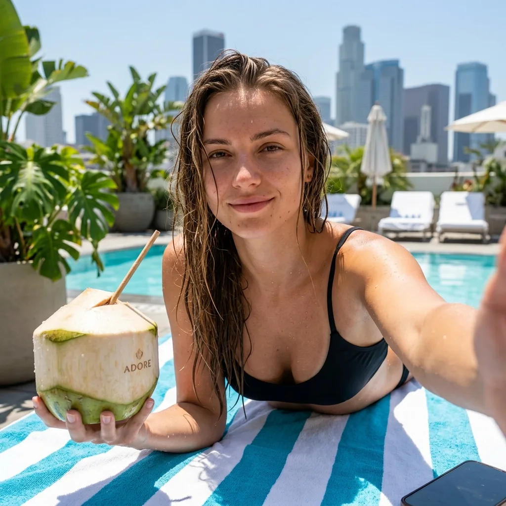

# Realistic, Cinematic

[← Back to the collection](../../README.md) · Category: [Product & Brand](../../gallery/product-brand.md) · Model: `Vinano Image Pro` · ID: `vn-01475`

<a href="https://vinano.ai?utm_source=github&utm_medium=readme&utm_campaign=awesome-image-video-prompts-updating&utm_content=prompt-page-image"></a>

<sub>Preview generated with <a href="https://vinano.ai?utm_source=github&utm_medium=readme&utm_campaign=awesome-image-video-prompts-updating&utm_content=prompt-page-caption">vinano.ai</a></sub>

## Prompt

```text
{

 "title": "LA Rooftop Poolside Selfie",
 "style_attributes": ["Ultra-realistic cinematic lifestyle photography",
 "8K resolution",
 "Hyper-detailed",
 "true-to-life photorealistic",
 "iPhone-style casual shot",
 "Cinematic photographic quality"],
 "subject": {
 "demographics": "Female, 20 years old, Slavic appearance",
 "facial_features": {
 "structure": "Naturally beautiful, well-balanced face, realistic proportions",
 "eyes": "Large expressive green-hazel, calm confident gaze",
 "lips": "Naturally full, soft, unexaggerated",
 "makeup": "Light natural daytime, not heavy"
 },
 "skin_texture": {
 "quality": "Sun-kissed, highly realistic, visible pores, subtle micro-imperfections",
 "effects": "Wet skin, water and oil droplets catching sunlight, no plastic texture"
 },
 "hair": "Long, wet, slightly messy, strands sticking naturally to cheek and forehead",
 "body": {
 "pose": "Lying on stomach, legs gently bent at knees and lifted, feet together, arm extended for selfie",
 "physique": "Slim waist, natural back line, realistic anatomy without exaggeration"
 },
 "clothing": "Small classic black bikini top thin straps and deep plunge"
 },
 "props": ["Fresh coconut straw and subtle ADORE logo",
 "Bright blue-and-white striped beach towel",
 "Smartphone (partial visibility)"],
 "environment": {
 "location": "Luxurious rooftop pool, high-rise building, Los Angeles",
 "background": "Modern downtown LA skyscrapers, slight atmospheric haze, white sun loungers and umbrellas",
 "elements": "Turquoise pool water, lush tropical greenery (banana palms, monstera plants)",
 "weather": "Bright sunny day, clear blue sky, no clouds"
 },
 "technical_specs": {
 "lighting": "Harsh midday sunlight, strong contrast, deep natural shadows, bright specular highlights",
 "camera_settings": "50–85mm lens look, shallow depth of field, high dynamic range (HDR)",
 "color_grading": "Realistic, true-to-life skin tones"
 },
 "full_prompt_string": "Ultra-realistic cinematic lifestyle photography, 8K, hyper-detailed, true-to-life photorealistic, An attractive woman aged 20, Slavic appearance. A naturally beautiful, well-balanced face realistic proportions, no artificial perfection. Large expressive green-hazel eyes, calm confident gaze toward the camera. Naturally full lips, soft and unexaggerated. Light, natural daytime makeup emphasizing her features without looking heavy. Her skin is sun-kissed and wet, highly realistic visible pores, subtle micro-imperfections, fine highlights, and water and oil droplets catching the sunlight. No plastic or overly smooth texture. Long wet hair, slightly messy after swimming, a few strands sticking naturally to her cheek and forehead. She is lying on her stomach on a bright blue-and-white striped beach towel. The pose feels relaxed and spontaneous, like a real vacation moment: legs gently bent at the knees and lifted upward, feet together; a natural back line, slim waist, realistic body anatomy without exaggeration. She wears a small classic black bikini top thin straps and a deep plunge — minimalistic, clean design, naturally fitting the body. One arm is extended forward as she takes a selfie — part of her arm and the edge of a small smartphone are visible in frame, reinforcing a casual iPhone-style shot. In her other hand, she holds a fresh coconut a straw and a subtle ADORE logo; water droplets run down the shell. Environment: a luxurious rooftop pool atop a high-rise building in Los Angeles. Bright sunny day, clear blue sky no clouds, turquoise pool water. Lush tropical greenery (banana palms, monstera plants), white sun loungers and umbrellas. Modern downtown LA skyscrapers in the background a slight atmospheric haze on the horizon.

Emphasise material texture and natural light so the final frame feels tactile and premium.
```

## Try it on vinano.ai

1. Copy the prompt above.
2. Open **[vinano.ai](https://vinano.ai?utm_source=github&utm_medium=readme&utm_campaign=awesome-image-video-prompts-updating&utm_content=prompt-page-try)**, paste it into the image generator and pick a model.
3. Swap any placeholders (brand, product, city, person…) for your own details, then generate.

More prompts like this: [Product & Brand gallery](../../gallery/product-brand.md) · [all categories](../../README.md#contents)
