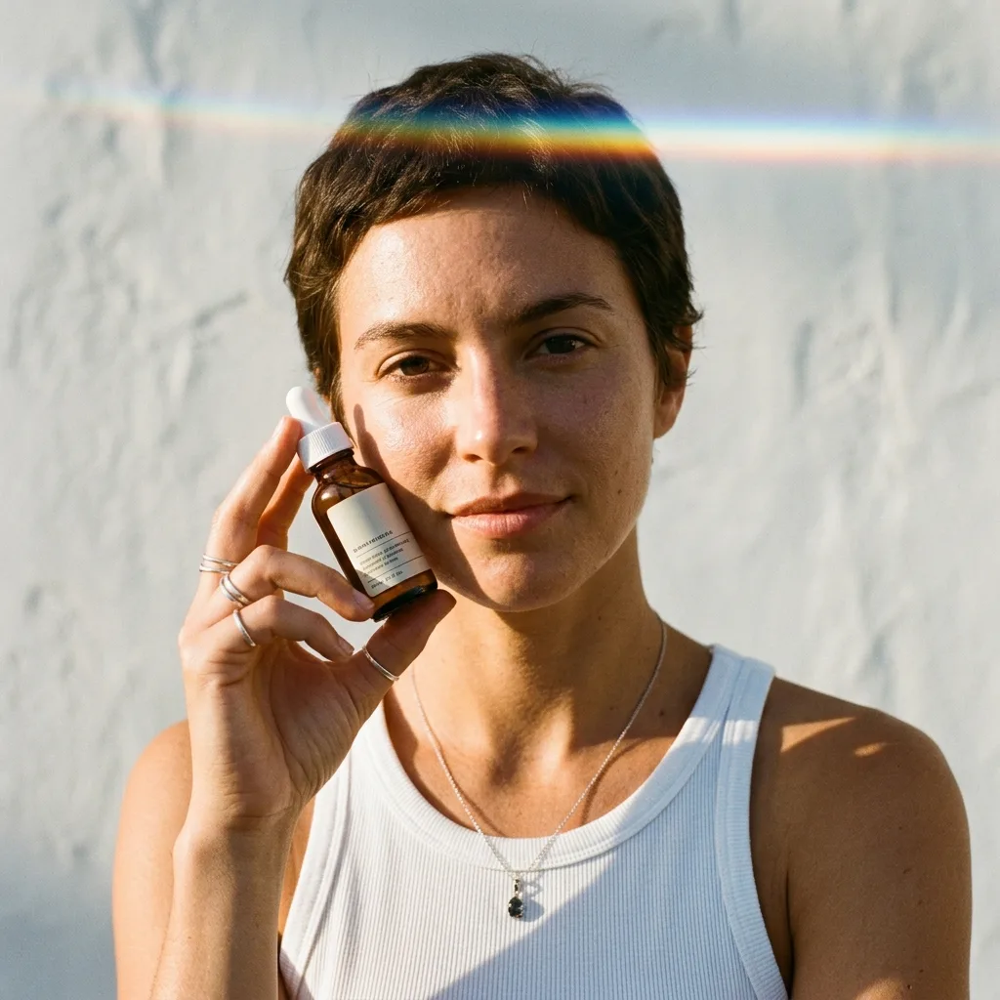

# Realistic, Portrait

[← Back to the collection](../../README.md) · Category: [Product & Brand](../../gallery/product-brand.md) · Model: `Vinano Image Pro` · ID: `vn-01477`

<a href="https://vinano.ai?utm_source=github&utm_medium=readme&utm_campaign=awesome-image-video-prompts-updating&utm_content=prompt-page-image"></a>

<sub>Preview generated with <a href="https://vinano.ai?utm_source=github&utm_medium=readme&utm_campaign=awesome-image-video-prompts-updating&utm_content=prompt-page-caption">vinano.ai</a></sub>

## Prompt

```text
Use the attached reference sheet as the absolute ground truth for the subject's facial features, skin texture, and body proportions. The output must be a 1:1 match of the character provided.
The subject is the woman from the reference image. She is wearing a white ribbed tank top and the delicate silver necklace a small dark pendant.
true-to-life photorealistic medium close-up portrait. She is holding the attached product in her hand, positioned near her cheek. Her fingers are visible, showing rings. The focus is sharp on the subject and the held object.
The scene is illuminated by intense, warm golden hour sunlight striking from the left, creating strong highlights and shadows on her skin and clothing. A prominent rainbow prism lens flare effect streaks horizontally across the upper section of the textured white wall background.

Preserve realistic proportions and depth for a confident, professional finish.
```

## Try it on vinano.ai

1. Copy the prompt above.
2. Open **[vinano.ai](https://vinano.ai?utm_source=github&utm_medium=readme&utm_campaign=awesome-image-video-prompts-updating&utm_content=prompt-page-try)**, paste it into the image generator and pick a model.
3. Swap any placeholders (brand, product, city, person…) for your own details, then generate.

More prompts like this: [Product & Brand gallery](../../gallery/product-brand.md) · [all categories](../../README.md#contents)
