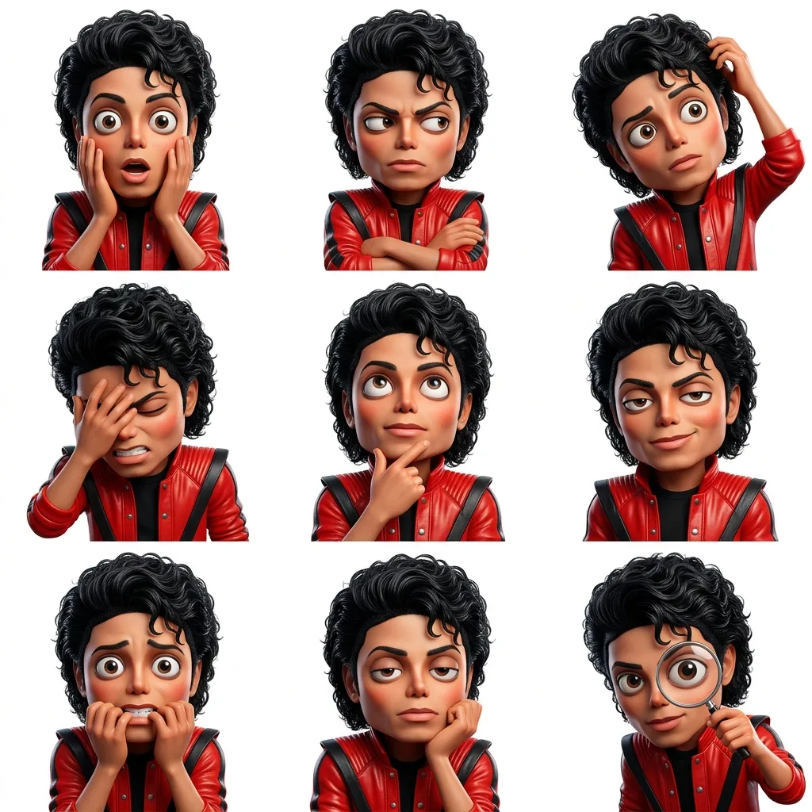

# Character, Ai Art

[← Back to the collection](../../README.md) · Category: [Product & Brand](../../gallery/product-brand.md) · Model: `Vinano Image Pro` · ID: `vn-01490`

<a href="https://vinano.ai?utm_source=github&utm_medium=readme&utm_campaign=awesome-image-video-prompts-updating&utm_content=prompt-page-image"></a>

<sub>Preview generated with <a href="https://vinano.ai?utm_source=github&utm_medium=readme&utm_campaign=awesome-image-video-prompts-updating&utm_content=prompt-page-caption">vinano.ai</a></sub>

## Prompt

```text
{
 "project_metadata": {
 "title": "Michael Jackson Pixar Sticker Set",
 "output_format": "3x3 Grid Collage",
 "total_cells": 9,
 "target_aspect_ratio": "4:5",
 "rendering_engine": "Unreal Engine 5 / Octane Render Style"
 },
 "global_character_assets": {
 "identity": "Michael Jackson (Pixar-Style 3D Caricature)",
 "facial_base": "Reference provided selfie for bone structure and likeness",
 "hair_definition": "High-poly black curls, signature 'wet-look' sheen, high volume",
 "wardrobe": {
 "jacket": "Iconic Red Thriller Jacket",
 "details": "Black V-shaped straps, high-gloss leather texture, silver buttons",
 "undershirt": "Black crew neck"
 },
 "anatomical_proportions": {
 "head_to_body_ratio": "1:3 (Chibi-influenced Pixar scale)",
 "eye_scale": "Exaggerated/Large for high readability",
 "skin_shader": "Subsurface scattering, warm peach tones, polished finish"
 }
 },
 "grid_layout_definition": {
 "row_1": {
 "cell_1": { "emotion": "Surprised", "pose": "Hands touching cheeks, wide eyes, O-shaped mouth" },
 "cell_2": { "emotion": "Annoyed", "pose": "Arms crossed, sharp side-eye, furrowed brow" },
 "cell_3": { "emotion": "Confused", "pose": "Head tilted 45 degrees, one hand scratching head" }
 },
 "row_2": {
 "cell_4": { "emotion": "Frustrated", "pose": "Facepalming one hand, clenched jaw" },
 "cell_5": { "emotion": "Thoughtful", "pose": "Finger on chin, looking up, dreaming expression" },
 "cell_6": { "emotion": "Sarcastic", "pose": "Raised eyebrow, smirk, one eye slightly squinted" }
 },
 "row_3": {
 "cell_7": { "emotion": "Worried", "pose": "Biting nails, hunched shoulders, dilated pupils" },
 "cell_8": { "emotion": "Bored", "pose": "Chin resting in palm, heavy eyelids, neutral mouth" },
 "cell_9": { "emotion": "Curious", "pose": "Leaning toward camera, magnifying glass gesture" }
 }
 },
 "environment_and_lighting": {
 "background": "Solid pure white, zero shadows, isolated for PNG extraction",
 "lighting_setup": "Three-point studio lighting, high-contrast rim light, soft key light",
 "negative_constraints": ["No text", "No logos", "No background elements", "No speech bubbles", "No UI"]
 }
}

Emphasise material texture and natural light so the final frame feels tactile and premium.
```

## Try it on vinano.ai

1. Copy the prompt above.
2. Open **[vinano.ai](https://vinano.ai?utm_source=github&utm_medium=readme&utm_campaign=awesome-image-video-prompts-updating&utm_content=prompt-page-try)**, paste it into the image generator and pick a model.
3. Swap any placeholders (brand, product, city, person…) for your own details, then generate.

More prompts like this: [Product & Brand gallery](../../gallery/product-brand.md) · [all categories](../../README.md#contents)
