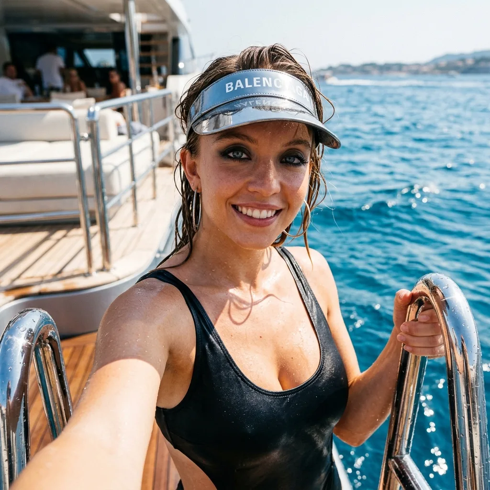

# Realistic, Ai Art

[← Back to the collection](../../README.md) · Category: [Product & Brand](../../gallery/product-brand.md) · Model: `Vinano Image Pro` · ID: `vn-01516`

<a href="https://vinano.ai?utm_source=github&utm_medium=readme&utm_campaign=awesome-image-video-prompts-updating&utm_content=prompt-page-image"></a>

<sub>Preview generated with <a href="https://vinano.ai?utm_source=github&utm_medium=readme&utm_campaign=awesome-image-video-prompts-updating&utm_content=prompt-page-caption">vinano.ai</a></sub>

## Prompt

```text
{
 "style": "hyper-realistic, ultra-detailed photography",
 "subject": {
 "identity": "Sydney Sweeney",
 "description": "Do not alter facial features, preserve Sydney Sweeney’s recognizable appearance",
 "pose": "selfie perspective, handheld, eye-level"
 },
 "physical_features": {
 "hair": "dark blonde to light brown, wet hair",
 "skin": "sun-kissed, wet skin",
 "face": "soft facial features, full lips, expressive eyes",
 "makeup": "dark eye makeup, long expressive eyelashes"
 },
 "clothing_and_accessories": {
 "outfit": "black glossy one-piece swimsuit side cutouts, synthetic shiny fabric",
 "accessories": ["silver reflective visor BALENCIAGA logo",
 "large silver hoop earrings"]
 },
 "scene_and_location": {
 "location": "luxury yacht in open water",
 "objects": ["polished metal yacht ladder",
 "sparkling blue water"],
 "background": "blurred luxury yacht, distant shore or marina"
 },
 "composition": {
 "foreground": "woman’s face, upper body, right arm and hand holding the metal ladder",
 "background": "softly blurred yacht and water",
 "shot_type": "close-up selfie, upper body",
 "lens": "wide-angle lens"
 },
 "lighting_and_color": {
 "lighting": "bright natural sunlight",
 "contrast": "high contrast",
 "effects": "strong water highlights, reflections on metal and plastic",
 "colors": "vivid, saturated colors"
 },
 "camera_settings": {
 "depth_of_field": "shallow depth of field",
 "focus": "subject in sharp focus, background softly blurred",
 "style_notes": "fashion photography, luxury lifestyle"
 },
 "material_textures": {
 "fabric": "synthetic shiny swimsuit fabric",
 "metal": "polished reflective metal (ladder, earrings)",
 "plastic": "reflective plastic visor",
 "water": "clear, sparkling water"
 },
 "final_touches": {
 "weather": "sunny weather",
 "skin": "light skin smoothing",
 "overall_feel": "luxury, summer, glamorous yacht aesthetic"
 }
}

Emphasise material texture and natural light so the final frame feels tactile and premium.
```

## Try it on vinano.ai

1. Copy the prompt above.
2. Open **[vinano.ai](https://vinano.ai?utm_source=github&utm_medium=readme&utm_campaign=awesome-image-video-prompts-updating&utm_content=prompt-page-try)**, paste it into the image generator and pick a model.
3. Swap any placeholders (brand, product, city, person…) for your own details, then generate.

More prompts like this: [Product & Brand gallery](../../gallery/product-brand.md) · [all categories](../../README.md#contents)
