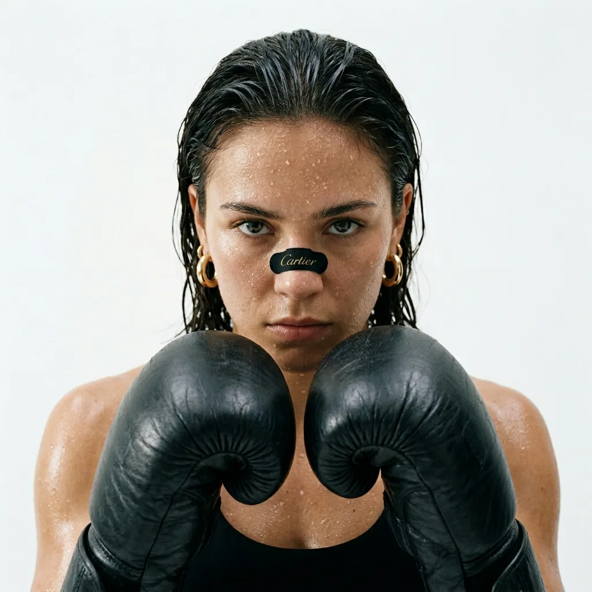

# Character, Cinematic

[← Back to the collection](../../README.md) · Category: [Product & Brand](../../gallery/product-brand.md) · Model: `Vinano Image Pro` · ID: `vn-01519`

<a href="https://vinano.ai?utm_source=github&utm_medium=readme&utm_campaign=awesome-image-video-prompts-updating&utm_content=prompt-page-image"></a>

<sub>Preview generated with <a href="https://vinano.ai?utm_source=github&utm_medium=readme&utm_campaign=awesome-image-video-prompts-updating&utm_content=prompt-page-caption">vinano.ai</a></sub>

## Prompt

```text
{
"shot": {
"composition": "Cinematic close-up, 50mm lens, shot on ARRI Alexa LF, center-framed, symmetrical head-on angle",
"camera_motion": "static camera",
"frame_rate": "24fps",
"film_grain": "clean digital subtle texture"
},
"subject": {
"description": "A young female boxer a piercing gaze, wet dark hair slicked back, skin glistening sweat. A black sports sticker the Cartier logo on her nose, gold hoop earrings on her ears, and black boxing gloves raised in front of her face in a fighting stance.",
"wardrobe": "refined minimalist athletic look: gold Cartier earrings, black leather boxing gloves, dewy skin without makeup."
},
"scene": {
"location": "a studio a clean White background",
"time_of_day": "neutral daylight",
"environment": "a smooth white background without shadows or unnecessary details—the focus is on the face and brand"
},
"visual_details": {
"action": "A woman looks directly into the camera cool concentration. Beads of sweat are on her face. She remains motionless, her gaze intense and purposeful.",
"props": "A black sticker on the nose the Cartier inscription, boxing gloves"
},
"cinematography": {
"lighting": "bright directional light from the front, highlighting beads of sweat and skin texture",
"tone": "a glamorous and austere style, a balance of strength and style"
},
"audio": {
"ambient": "a dull heartbeat, breathing, the short sound of gloves stretching as a fist is clenched"
},
"color_palette": "Black and white contrast gold accents, leather in natural, warm tones,"
"dialogue": {
"character": "Boxer,"
"line": "You either take a punch... or jewelry is just a mask for you.",
"subtitles": false
}
}

Keep edges clean and the overall composition balanced for a polished, gallery-ready result.
```

## Try it on vinano.ai

1. Copy the prompt above.
2. Open **[vinano.ai](https://vinano.ai?utm_source=github&utm_medium=readme&utm_campaign=awesome-image-video-prompts-updating&utm_content=prompt-page-try)**, paste it into the image generator and pick a model.
3. Swap any placeholders (brand, product, city, person…) for your own details, then generate.

More prompts like this: [Product & Brand gallery](../../gallery/product-brand.md) · [all categories](../../README.md#contents)
