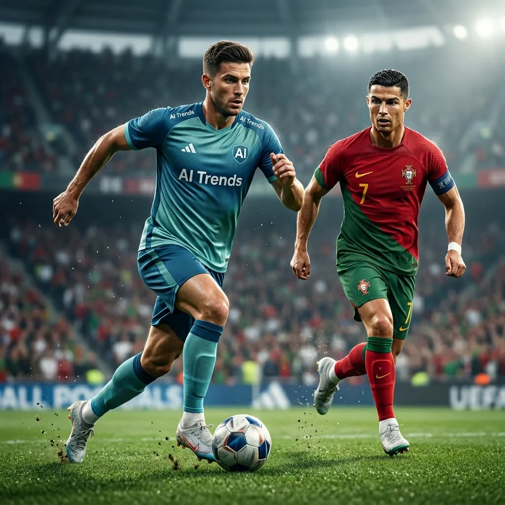

# Realistic, Cinematic

[← Back to the collection](../../README.md) · Category: [Product & Brand](../../gallery/product-brand.md) · Model: `Vinano Image Pro` · ID: `vn-01523`

<a href="https://vinano.ai?utm_source=github&utm_medium=readme&utm_campaign=awesome-image-video-prompts-updating&utm_content=prompt-page-image"></a>

<sub>Preview generated with <a href="https://vinano.ai?utm_source=github&utm_medium=readme&utm_campaign=awesome-image-video-prompts-updating&utm_content=prompt-page-caption">vinano.ai</a></sub>

## Prompt

```text
{
A hyper-realistic, ultra-detailed 8K cinematic wide-shot of a football scene, captured from a dramatic low-angle perspective a wide-angle lens and shallow depth of field, emphasizing speed, power, and realism.

The scene features only two players on a professional football pitch.
The primary player, positioned slightly ahead and in control of the ball, is dribbling explosive movement and confident body language. His face is generated the uploaded face as reference (100% likeness).

He wears an ultra-realistic AI Trends football kit, designed like a top-tier international club jersey. The kit has a blue-green gradient finish, breathable performance fabric, and subtle geometric textures. “AI Trends” branding is printed boldly on the chest and both shoulders in premium sports typography. The fabric reacts naturally to motion, showing realistic folds, tension, and subtle sweat details, giving a luxury global campaign aesthetic.

Running beside him is Cristiano Ronaldo, wearing his iconic classic football kit, instantly recognizable by its design, colors, and number. Cristiano is not holding the ball. He matches pace powerfully, positioned slightly to the side, ready for a decisive run or finish.

No other players are on the field.

The grass pitch is extremely detailed, visible blades, dirt particles, and subtle turf displacement beneath their feet. Water droplets and dust rise each step, enhancing motion realism.
The background features a massive stadium a softly blurred crowd, cinematic depth, and powerful volumetric lighting creating dramatic rim light around both players. Subtle motion blur enhances speed while both faces remain sharp and detailed.
The mood is powerful and cinematic, resembling a high-budget sports film still and a premium AI Trends global campaign, natural color grading, hyper-realistic textures, and professional sports photography aesthetics.

Preserve realistic proportions and depth for a confident, professional finish.
```

## Try it on vinano.ai

1. Copy the prompt above.
2. Open **[vinano.ai](https://vinano.ai?utm_source=github&utm_medium=readme&utm_campaign=awesome-image-video-prompts-updating&utm_content=prompt-page-try)**, paste it into the image generator and pick a model.
3. Swap any placeholders (brand, product, city, person…) for your own details, then generate.

More prompts like this: [Product & Brand gallery](../../gallery/product-brand.md) · [all categories](../../README.md#contents)
