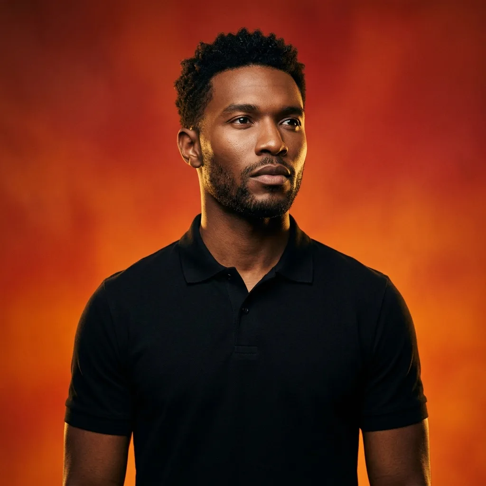

# Realistic, Portrait

[← Back to the collection](../../README.md) · Category: [Product & Brand](../../gallery/product-brand.md) · Model: `Vinano Image Pro` · ID: `vn-01529`

<a href="https://vinano.ai?utm_source=github&utm_medium=readme&utm_campaign=awesome-image-video-prompts-updating&utm_content=prompt-page-image"></a>

<sub>Preview generated with <a href="https://vinano.ai?utm_source=github&utm_medium=readme&utm_campaign=awesome-image-video-prompts-updating&utm_content=prompt-page-caption">vinano.ai</a></sub>

## Prompt

```text
Ultra-realistic studio portrait photography, confident fashion model wearing a plain black polo shirt, waist-up composition, looking slightly upward and away from camera, strong cinematic expression, vibrant fiery orange-to-red gradient background, intense golden rim light glowing around hair and shoulders, dramatic backlighting, soft beauty key light on face, high contrast lighting, flawless skin texture, sharp facial details, luxury commercial advertising style, premium apparel campaign, clean minimal composition, warm color grading, professional studio setup, shallow depth of field, 85mm lens, f/2.0, ultra-detailed, HDR, true-to-life photorealistic, magazine-quality, symmetrical framing, bold and powerful mood, high-end fashion editorial, 8K resolution.

Negative Prompt:

blurry, low resolution, noisy image, overexposed highlights, underexposed shadows, distorted face, extra limbs, bad anatomy, duplicate features, watermark, logo, text, cropped head, messy background, unrealistic skin, cartoon, painting, CGI, oversaturated colors, motion blur, out of focus, poor lighting.

Aim for an editorial, design-driven look with deliberate negative space.
```

## Try it on vinano.ai

1. Copy the prompt above.
2. Open **[vinano.ai](https://vinano.ai?utm_source=github&utm_medium=readme&utm_campaign=awesome-image-video-prompts-updating&utm_content=prompt-page-try)**, paste it into the image generator and pick a model.
3. Swap any placeholders (brand, product, city, person…) for your own details, then generate.

More prompts like this: [Product & Brand gallery](../../gallery/product-brand.md) · [all categories](../../README.md#contents)
