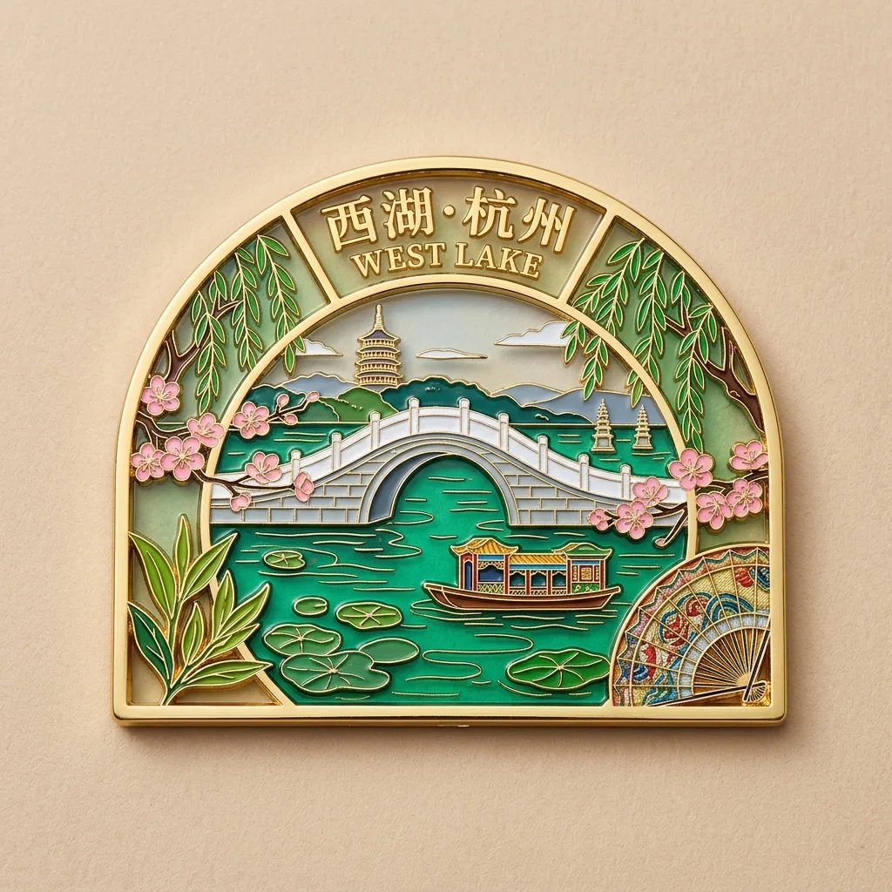

# 珐琅彩琉璃艺术风格

[← Back to the collection](../../README.md) · Category: [Product & Brand](../../gallery/product-brand.md) · Model: `Vinano Image Pro` · ID: `vn-01533`

<a href="https://vinano.ai?utm_source=github&utm_medium=readme&utm_campaign=awesome-image-video-prompts-updating&utm_content=prompt-page-image"></a>

<sub>Preview generated with <a href="https://vinano.ai?utm_source=github&utm_medium=readme&utm_campaign=awesome-image-video-prompts-updating&utm_content=prompt-page-caption">vinano.ai</a></sub>

## Prompt

```text
珐琅彩琉璃艺术风格，金属质感，制作一枚冰箱贴，写着"西湖·杭州 WEST LAKE"字样。冰箱贴以断桥拱形轮廓为基底外形，金色金属边框包边。画面描绘西湖经典风景：断桥残雪、湖面莲叶、楼外楼画舫、雷峰塔剪影、三潭印月石灯、粉色桃花与垂柳。左侧点缀龙井茶叶图案，右侧装饰杭绣扇面。采用珐琅彩填色工艺：湖水呈透明翠绿，金属线勾勒波纹细节。浅咖色背景，正面展示，所有元素严格控制在基底轮廓范围内，布局美观协调，产品摄影质感，8K细节 追求杂志编辑式的设计感，刻意安排留白与视觉重心。
```

## Try it on vinano.ai

1. Copy the prompt above.
2. Open **[vinano.ai](https://vinano.ai?utm_source=github&utm_medium=readme&utm_campaign=awesome-image-video-prompts-updating&utm_content=prompt-page-try)**, paste it into the image generator and pick a model.
3. Swap any placeholders (brand, product, city, person…) for your own details, then generate.

More prompts like this: [Product & Brand gallery](../../gallery/product-brand.md) · [all categories](../../README.md#contents)
