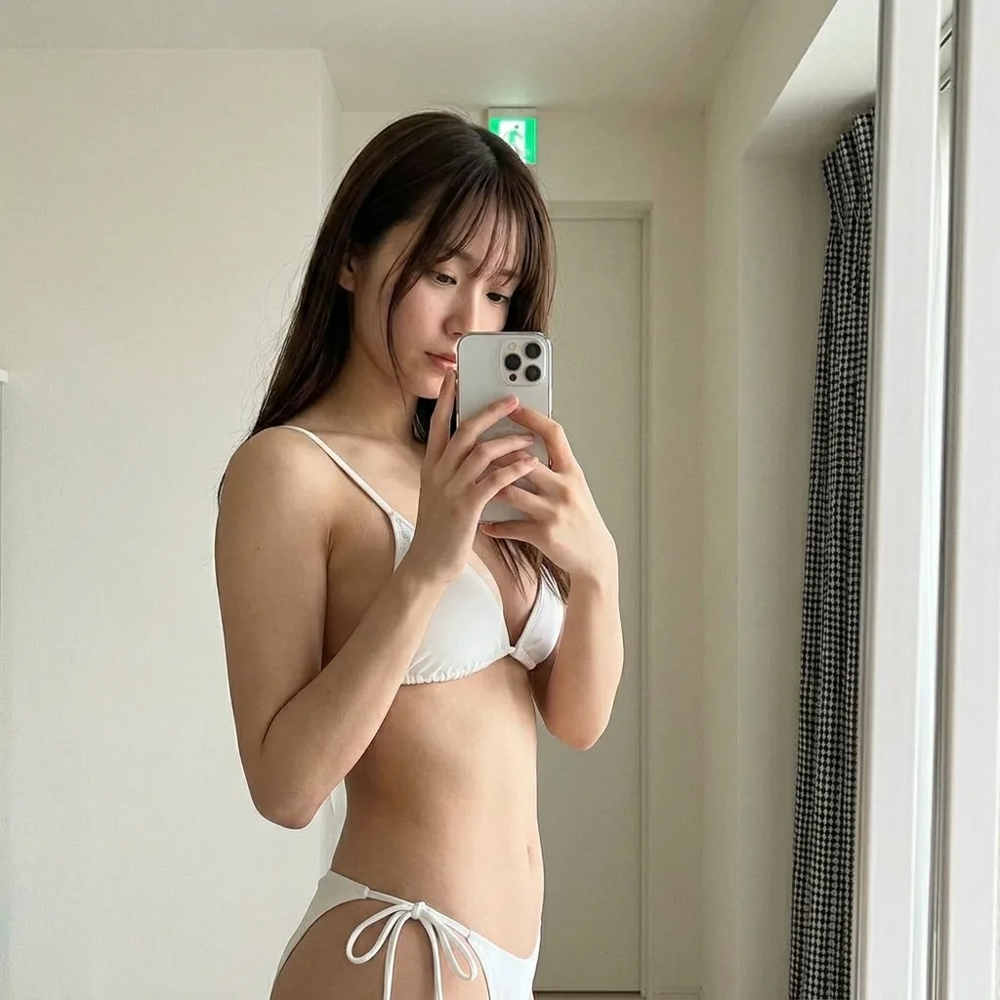

# Anime, Realistic

[← Back to the collection](../../README.md) · Category: [Product & Brand](../../gallery/product-brand.md) · Model: `Vinano Image Pro` · ID: `vn-01535`

<a href="https://vinano.ai?utm_source=github&utm_medium=readme&utm_campaign=awesome-image-video-prompts-updating&utm_content=prompt-page-image"></a>

<sub>Preview generated with <a href="https://vinano.ai?utm_source=github&utm_medium=readme&utm_campaign=awesome-image-video-prompts-updating&utm_content=prompt-page-caption">vinano.ai</a></sub>

## Prompt

```text
{ "subject": { "description": "A young adult woman taking a soft-lit mirror selfie in a refined minimalist bright room, wearing a white string bikini, holding her phone close so it partially covers her face.", "mirror_rules": ["Mirror selfie reflection; keep the scene as a reflection, not a front-facing camera look.", "Any readable text should appear normal (not reversed), and avoid adding random letters.", "No extra phones, no duplicated hands, no warped mirror edges."], "age": "early 20s", "expression": { "eyes": { "look": "focused on the phone screen", "energy": "gentle, calm", "direction": "downward" }, "mouth": { "position": "small closed-lip smile", "energy": "soft, slightly shy" }, "overall": "quiet confidence, intimate and casual" }, "face": { "preserve_original": true, "makeup": "natural makeup, light blush, soft pink lips, subtle eyeliner" }, "hair": { "color": "dark brown to black", "style": "long straight hair wispy bangs", "effect": "smooth, slightly glossy strands framing the cheeks" }, "body": { "frame": "slim soft curves", "waist": "narrow waist", "chest": "full bust natural gravity", "legs": "soft feminine upper thighs visible", "skin": { "visible_areas": ["shoulders", "arms", "chest", "torso", "hips", "upper thighs"], "tone": "light warm ivory", "texture": "smooth, velvety, natural pores barely visible", "lighting_effect": "diffused highlights and gentle shadow gradients, slight skin-smoothing but not plastic" } }, "pose": { "position": "standing close to the mirror, torso angled slightly to one side", "base": "weight shifted onto one leg, shoulders subtly drawn forward", "overall": "both hands holding the phone near the face, elbows bent, relaxed intimate selfie posture" }, "clothing": { "top": { "type": "white triangle string bikini top", "color": "white", "details": "thin straps, minimal seams, clean edges", "effect": "slightly matte fabric gentle stretch" }, "bottom": { "type": "white tie-side bikini bottom", "color": "white", "details": "side bows, high-cut silhouette, thin strings", "effect": "minimal, clean, softly tensioned fabric" } } }, "accessories": { "device": "a silver smartphone a triple rear camera module in a clear or neutral case" }, "photography": { "camera_style": "smartphone mirror selfie, social media realism, soft beauty smoothing", "angle": "eye-level to slightly above, mirror reflection composition", "shot_type": "three-quarter body portrait (head to upper thighs), subject centered", "aspect_ratio": "9:16 vertical", "texture": "clean digital look, subtle grain, gentle sharpening on hair, soft skin rendering", "lighting": "soft diffused indoor ambient light, minimal harsh shadows, mild frontal fill from the room", "depth_of_field": "moderate depth of field, subject sharper than the background" }, "background": { "setting": "bright refined minimalist interior room white walls and a glossy light floor", "wall_color": "off-white", "elements": ["open doorway leading to a dimmer space", "black-and-white patterned curtain on the right", "glass display case or cabinet on the left", "small cardboard box near the floor edge", "green exit sign mounted on the left wall"], "atmosphere": "quiet, tidy, slightly hotel-like, everyday realism", "lighting": "even indoor ambient lighting soft falloff" }, "the_vibe": { "energy": "soft and private", "mood": "shy confidence, gentle sensuality", "aesthetic": "clean minimal, intimate mirror selfie", "authenticity": "casual unposed feel small real-life imperfections", "intimacy": "close distance to the mirror, phone hides part of the face, a moment kept to herself", "story": "as if she had just gotten ready for a swim; the room stays quiet and warm, and the mirror catches a fleeting, honest pause", "caption_energy": "a quiet flex, like a warm whisper" }, "constraints": { "must_keep": ["white string bikini tie-sides", "long dark hair wispy bangs", "phone held both hands covering part of the face", "soft diffused indoor lighting", "minimal bright room patterned curtain on the right", "9:16 vertical mirror selfie framing", "gentle smile, eyes looking down at the screen"], "avoid": ["heavy glam makeup", "dramatic filmic, cinematic lighting", "anime or illustration styles", "visible brand logos or readable product names", "exaggerated or unrealistic body proportions", "explicit nudity", "lace-heavy lingerie styling"] }, "negative_prompt": ["lowres", "blurry", "overexposed", "harsh shadows", "strong vignette", "text", "watermark", "logo", "bad hands", "extra fingers", "missing fingers", "deformed anatomy", "duplicate body", "warped mirror", "random letters", "uncanny face", "plastic skin", "nipples", "areola", "explicit nudity"] } Render with rich micro-detail while keeping the layout uncluttered and intentional.
```

## Try it on vinano.ai

1. Copy the prompt above.
2. Open **[vinano.ai](https://vinano.ai?utm_source=github&utm_medium=readme&utm_campaign=awesome-image-video-prompts-updating&utm_content=prompt-page-try)**, paste it into the image generator and pick a model.
3. Swap any placeholders (brand, product, city, person…) for your own details, then generate.

More prompts like this: [Product & Brand gallery](../../gallery/product-brand.md) · [all categories](../../README.md#contents)
