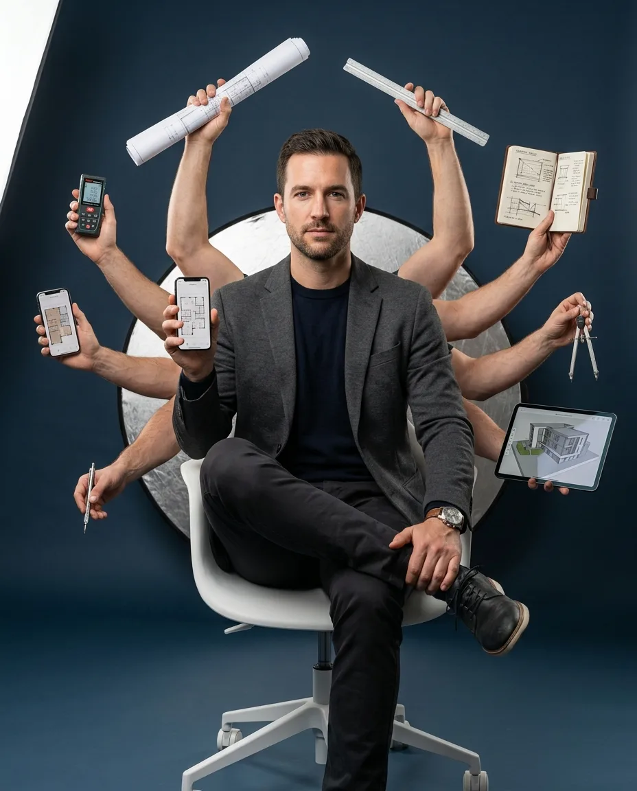

# Realistic, Portrait

[← Back to the collection](../../README.md) · Category: [Product & Brand](../../gallery/product-brand.md) · Model: `Vinano Image Pro` · ID: `vn-01542`

<a href="https://vinano.ai?utm_source=github&utm_medium=readme&utm_campaign=awesome-image-video-prompts-updating&utm_content=prompt-page-image"></a>

<sub>Preview generated with <a href="https://vinano.ai?utm_source=github&utm_medium=readme&utm_campaign=awesome-image-video-prompts-updating&utm_content=prompt-page-caption">vinano.ai</a></sub>

## Prompt

```text
Create a hyper-real, studio portrait [USER_PHOTO] as the exact identity reference (same face, hairstyle, skin texture, and age). Depict the person as a confident [PROFESSION] sitting casually on a modern white ergonomic office chair, legs crossed, centered in frame. Add a stylized “multi-arm” illusion (6–8 arms total) radiating behind the torso like a modern Shiva/Vishnu-inspired silhouette, but true-to-life photorealistic: each extra arm must have correct anatomy, believable joints, tendons, skin pores, and natural shadowing; no warped fingers.

PROPS (must be profession-relevant): Automatically choose and place different tools that a real [PROFESSION] would use, one per hand/arm, all clearly readable and accurate in design. Examples of categories: primary tool, secondary tool, communication device, measurement/diagnostic tool, accessory, and a “hero” prop. Keep one real smartphone in the main/front hand. Avoid generic random objects—every prop must logically belong to [PROFESSION]. If [PROFESSION] is digital/tech: include items like laptop, tablet, camera/monitor, light meter, stylus, keyboard, mic, etc. If [PROFESSION] is medical: stethoscope, clipboard, otoscope, syringe (safe/clinical), etc. If [PROFESSION] is culinary: chef knife, tongs, plating tweezers, recipe tablet, etc. (Always match [PROFESSION].)

BACKGROUND COLOR (topic-matched): Use a seamless paper studio backdrop a single dominant color that matches the profession theme (e.g., warm mustard for creative/media, cool teal for healthcare, graphite/steel for engineering, rich olive for outdoors, deep burgundy for luxury). The color should complement skin tones and wardrobe. Add subtle gradient falloff and soft bounce for depth (no flat background).

LIGHTING & SET: High-end commercial studio look. One large soft key light from camera-left, controlled fill from right, crisp rim light to separate subject, and realistic specular highlights on props. Include a large circular silver reflector disk behind the subject (partially visible) for visual punch. Add a subtle shadow on the floor consistent light direction.

WARDROBE & STYLING: Outfit must be believable for a top-tier [PROFESSION] (clean, modern, slightly stylized), texture detail (fabric weave, seams). Add minimal accessories (watch/bracelet) that feel premium. Expression: focused, slightly intense, “in the zone.”

COMPOSITION & CAMERA: Full-body vertical portrait (4:5), 50mm lens look, eye-level camera, sharp focus on face, shallow depth of field but props still readable. Ultra-detailed skin, natural color grading, high dynamic range, crisp micro-contrast.

REALISM RULES: No cartoon, no CGI look. No extra faces, no duplicated heads. Hands must be anatomically correct (5 fingers), no melted objects, no unreadable text logos unless naturally present. Keep the scene clean and premium.

Output: hyper-real editorial photograph, 8K detail, studio-quality retouching, natural skin texture preserved.

Render with rich micro-detail while keeping the layout uncluttered and intentional.
```

## Try it on vinano.ai

1. Copy the prompt above.
2. Open **[vinano.ai](https://vinano.ai?utm_source=github&utm_medium=readme&utm_campaign=awesome-image-video-prompts-updating&utm_content=prompt-page-try)**, paste it into the image generator and pick a model.
3. Swap any placeholders (brand, product, city, person…) for your own details, then generate.

More prompts like this: [Product & Brand gallery](../../gallery/product-brand.md) · [all categories](../../README.md#contents)
