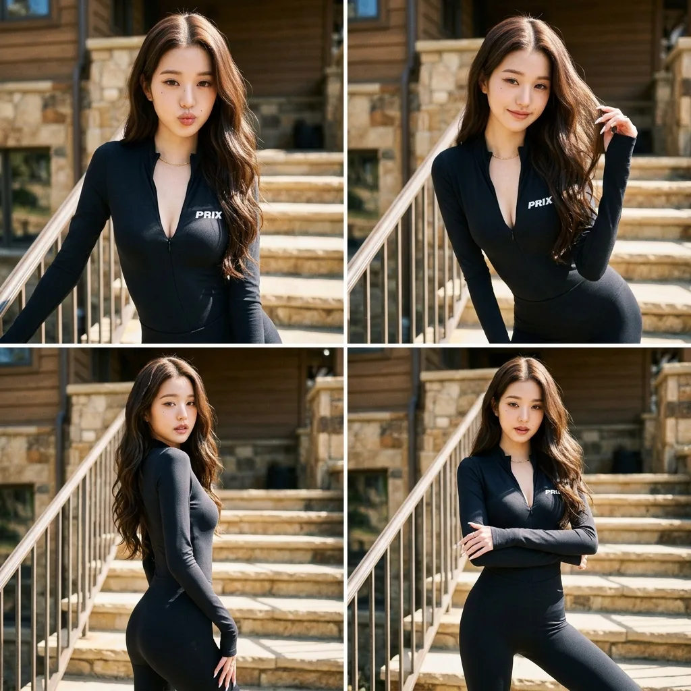

# Portrait, Ai Art

[← Back to the collection](../../README.md) · Category: [Product & Brand](../../gallery/product-brand.md) · Model: `Vinano Image Pro` · ID: `vn-01577`

<a href="https://vinano.ai?utm_source=github&utm_medium=readme&utm_campaign=awesome-image-video-prompts-updating&utm_content=prompt-page-image"></a>

<sub>Preview generated with <a href="https://vinano.ai?utm_source=github&utm_medium=readme&utm_campaign=awesome-image-video-prompts-updating&utm_content=prompt-page-caption">vinano.ai</a></sub>

## Prompt

```text
{
  "subject": {
    "description": "Jang Wonyoung of IVE in a 4-panel collage grid.",
    "mirror_rules": "N/A",
    "age": "early 20s",
    "expression": {
      "eyes": {
        "look": "confident",
        "energy": "direct",
        "direction": "at camera"
      },
      "mouth": {
        "position": "closed, slight pout or subtle smile",
        "energy": "playful"
      },
      "overall": "casual confidence"
    },
    "face": {
      "preserve_original": true,
      "features": "extremely slender face, doll-like features, prominent beauty marks under her eye and on her cheek, delicate nose, heart-shaped lips",
      "makeup": "soft matte, rosy blush, winged liner, warm aesthetic"
    }
  },
  "hair": {
    "color": "dark brown",
    "style": "long, loose waves, middle part",
    "effect": "natural volume, catching sunlit highlights"
  },
  "body": {
    "frame": "tall, incredibly slender and leggy narrow proportions",
    "waist": "extremely narrow",
    "chest": "subtle",
    "legs": "very long and slim",
    "skin": {
      "visible_areas": "face, neck, upper chest",
      "tone": "pale porcelain",
      "texture": "smooth, supple",
      "lighting_effect": "direct physical sunlight creating sharp but flattering highlights on the chest and face"
    }
  },
  "pose": {
    "position": "standing on stairs",
    "base": "shifting weight, dynamic",
    "overall": "varied across panels: arms crossed, leaning forward, side profile, and looking over shoulder"
  },
  "clothing": {
    "top": {
      "type": "long-sleeve bodysuit",
      "color": "black",
      "details": "deep V-neck front zipper unzipped, white 'PRIX' logo on left chest",
      "effect": "tight, form-fitting, seamless"
    },
    "bottom": {
      "type": "bodysuit leggings",
      "color": "black",
      "details": "seamless extension of top"
    }
  },
  "accessories": {
    "jewelry": "thin gold necklace, rings",
    "prop": "long white manicured nails"
  },
  "photography": {
    "camera_style": "casual influencer portrait, smartphone aesthetic",
    "angle": "eye-level to slightly low angle",
    "shot_type": "4-panel grid, medium and cowboy shots",
    "aspect_ratio": "9:16",
    "texture": "digital crispness, slight natural offset",
    "lighting": "bright outdoor daylight, strong directional sun, natural shadows",
    "depth_of_field": "shallow, slightly blurred background"
  },
  "background": {
    "setting": "outdoor staircase",
    "wall_color": "warm stone, brown wood",
    "elements": ["stone steps",
      "metal railing",
      "rustic wooden exterior"],
    "atmosphere": "sunny daytime",
    "lighting": "natural bright sunlight"
  },
  "the_vibe": {
    "energy": "confident",
    "mood": "playful",
    "aesthetic": "Instagram baddie, athleisure",
    "authenticity": "casual social media photo dump",
    "intimacy": "parasocial directness",
    "story": "Jang Wonyoung poses dynamically for a quick sunny fit check.",
    "caption_energy": "effortless"
  },
  "constraints": {
    "must_keep": ["4-panel collage",
      "black PRIX bodysuit",
      "deep unzipped cleavage"],
    "avoid": ["flat studio lighting",
      "baggy clothes",
      "perfect symmetry"]
  },
  "negative_prompt": ["ugly",
    "deformed",
    "studio lighting",
    "flat lighting",
    "baggy clothing",
    "low resolution"]
}

Emphasise material texture and natural light so the final frame feels tactile and premium.
```

## Try it on vinano.ai

1. Copy the prompt above.
2. Open **[vinano.ai](https://vinano.ai?utm_source=github&utm_medium=readme&utm_campaign=awesome-image-video-prompts-updating&utm_content=prompt-page-try)**, paste it into the image generator and pick a model.
3. Swap any placeholders (brand, product, city, person…) for your own details, then generate.

More prompts like this: [Product & Brand gallery](../../gallery/product-brand.md) · [all categories](../../README.md#contents)
