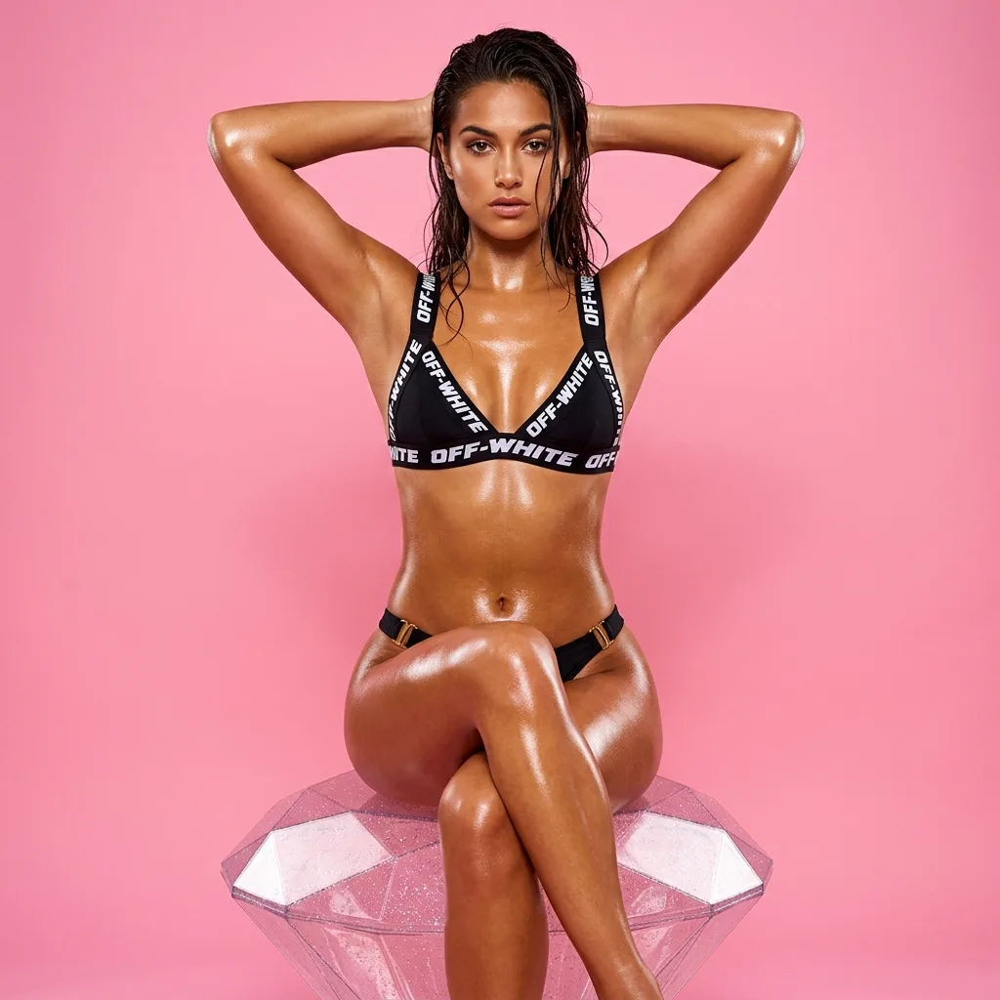

# Portrait, Ai Art

[← Back to the collection](../../README.md) · Category: [Product & Brand](../../gallery/product-brand.md) · Model: `Vinano Image Pro` · ID: `vn-01587`

<a href="https://vinano.ai?utm_source=github&utm_medium=readme&utm_campaign=awesome-image-video-prompts-updating&utm_content=prompt-page-image"></a>

<sub>Preview generated with <a href="https://vinano.ai?utm_source=github&utm_medium=readme&utm_campaign=awesome-image-video-prompts-updating&utm_content=prompt-page-caption">vinano.ai</a></sub>

## Prompt

```text
{ "subject": { "description": "A confident and glamorous woman posing sensually in a high-fashion studio setting, heavily oiled skin, wearing branded strap lingerie.", "mirror_rules": null, "age": "20s, "expression": { "eyes": { "look": "piercing, direct eye contact", "energy": "confident, seductive, powerful", "direction": "looking straight at the camera" }, "mouth": { "position": "lips slightly parted", "energy": "relaxed but alluring" }, "overall": "bold, unapologetic editorial glamour" }, "face": { "preserve_original": true, "makeup": "dewy foundation, nude glossy lips, subtle smoky eyeshadow, contoured cheeks" }, "hair": { "color": "dark brunette", "style": "wet hair look, slicked back but messy strands falling onto the neck and shoulders", "effect": "damp, clinging to the skin, chaotic against the clean lines of the outfit" }, "body": { "frame": "toned, fit, athletic curves", "waist": "exposed, sculpted abdomen", "chest": "partially exposed, prominent underboob and cleavage created by tight straps", "legs": "crossed tightly together, facing the camera", "skin": { "visible_areas": "arms, shoulders, torso, stomach, thighs", "tone": "warm tanned olive skin", "texture": "slick, heavily oiled, slippery to the touch, wet appearance", "lighting_effect": "stark spectral highlights bouncing off the oiled epidermis on shoulders, chest, and thighs" } }, "pose": { "position": "sitting astride", "base": "perched on a giant oversized translucent sparkly diamond-shaped prop", "overall": "arms raised hands resting behind the head, back slightly arched, chest pushed forward" }, "clothing": { "top": { "type": "harness strap bikini top", "color": "black straps bold white text", "details": "thick horizontal and over-shoulder straps 'OFF-WHITE' written in bold typography, creating extreme cutouts", "effect": "tight, graphic, streetwear meets swimwear, industrial vibe" }, "bottom": { "type": "bikini bottom", "color": "black", "details": "gold D-ring hardware on the side straps" } } }, "accessories": { "prop": "a large, oversized, translucent, sparkling diamond-shaped stool" }, "photography": { "camera_style": "high-fashion editorial studio portrait, medium format camera", "angle": "straight-on, slightly below eye level", "shot_type": "three-quarter length shot", "aspect_ratio": "9:16", "texture": "ultra-sharp, hyper-detailed, glossy, high fidelity magazine cover quality", "lighting": "hard studio strobes, frontal beauty dish lighting creating sharp wet reflections", "depth_of_field": "deep depth of field, f/8, keeping both subject and prop perfectly sharp" }, "background": { "setting": "professional photography studio", "wall_color": "solid vibrant bubblegum pink", "elements": [], "atmosphere": "pop-art, sterile yet intensely vibrant, bold color blocking", "lighting": "flat, brightly lit seamless cyclorama backdrop" }, "the_vibe": { "energy": "powerful, fierce, unapologetically sexy", "mood": "hyper-glamorous, high tension", "aesthetic": "hypebeast streetwear fashion merged sultry editorial", "authenticity": "highly staged, polished studio perfection", "intimacy": "confrontational gaze, breaking the fourth wall", "story": "A high-profile fashion campaign capturing the tension between raw, oiled skin and rigid, hyper-branded industrial streetwear elements.", "caption_energy": "dripping confidence and undeniable presence" }, "constraints": { "must_keep": ["clear OFF-WHITE text on straps", "wet hair look", "heavily oiled skin texture", "solid pink background", "diamond prop"], "avoid": ["mirror reflection", "natural sunlight", "matte skin", "cluttered environment", "soft focus"] }, "negative_prompt": ["blurry", "low resolution", "matte skin", "dry hair", "natural outdoor lighting", "cluttered background", "misspelled text", "casual daily clothes", "soft, diffused lighting"] } Maintain consistent colour harmony and crisp focus across the whole frame.
```

## Try it on vinano.ai

1. Copy the prompt above.
2. Open **[vinano.ai](https://vinano.ai?utm_source=github&utm_medium=readme&utm_campaign=awesome-image-video-prompts-updating&utm_content=prompt-page-try)**, paste it into the image generator and pick a model.
3. Swap any placeholders (brand, product, city, person…) for your own details, then generate.

More prompts like this: [Product & Brand gallery](../../gallery/product-brand.md) · [all categories](../../README.md#contents)
