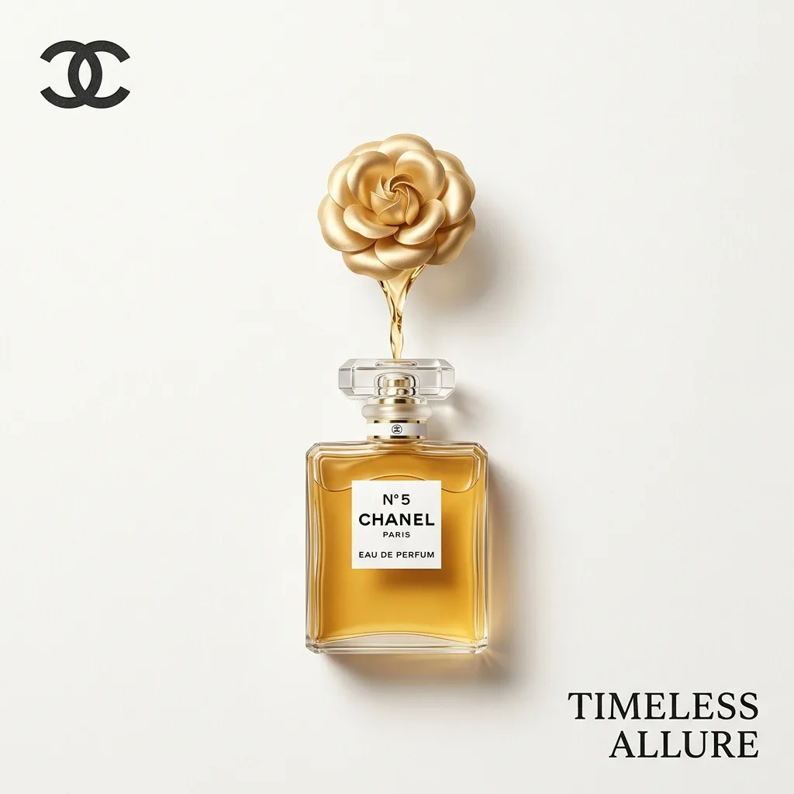

# Minimalist, Ai Art

[← Back to the collection](../../README.md) · Category: [Product & Brand](../../gallery/product-brand.md) · Model: `Vinano Image Pro` · ID: `vn-01593`

<a href="https://vinano.ai?utm_source=github&utm_medium=readme&utm_campaign=awesome-image-video-prompts-updating&utm_content=prompt-page-image"></a>

<sub>Preview generated with <a href="https://vinano.ai?utm_source=github&utm_medium=readme&utm_campaign=awesome-image-video-prompts-updating&utm_content=prompt-page-caption">vinano.ai</a></sub>

## Prompt

```text
Visualize INPUT: [PRODUCT/BRAND]
Create a surreal refined minimalist photoreal print-ad the INPUT only. Auto-detect the brand from the INPUT and add the brand’s REAL official logo (not a generic wordmark), high fidelity, correct proportions, clean vector/print look, placed top-left subtle ink-like texture. Use one bold visual metaphor, 1 hero + 1 accent max, huge negative space, studio lighting, 8K ultra-sharp, premium print-ad composition. Add a two-word slogan bottom-right that matches the brand tone. No clutter, no watermark, no extra text. Aspect ratio 1:1

Keep edges clean and the overall composition balanced for a polished, gallery-ready result.
```

## Try it on vinano.ai

1. Copy the prompt above.
2. Open **[vinano.ai](https://vinano.ai?utm_source=github&utm_medium=readme&utm_campaign=awesome-image-video-prompts-updating&utm_content=prompt-page-try)**, paste it into the image generator and pick a model.
3. Swap any placeholders (brand, product, city, person…) for your own details, then generate.

More prompts like this: [Product & Brand gallery](../../gallery/product-brand.md) · [all categories](../../README.md#contents)
