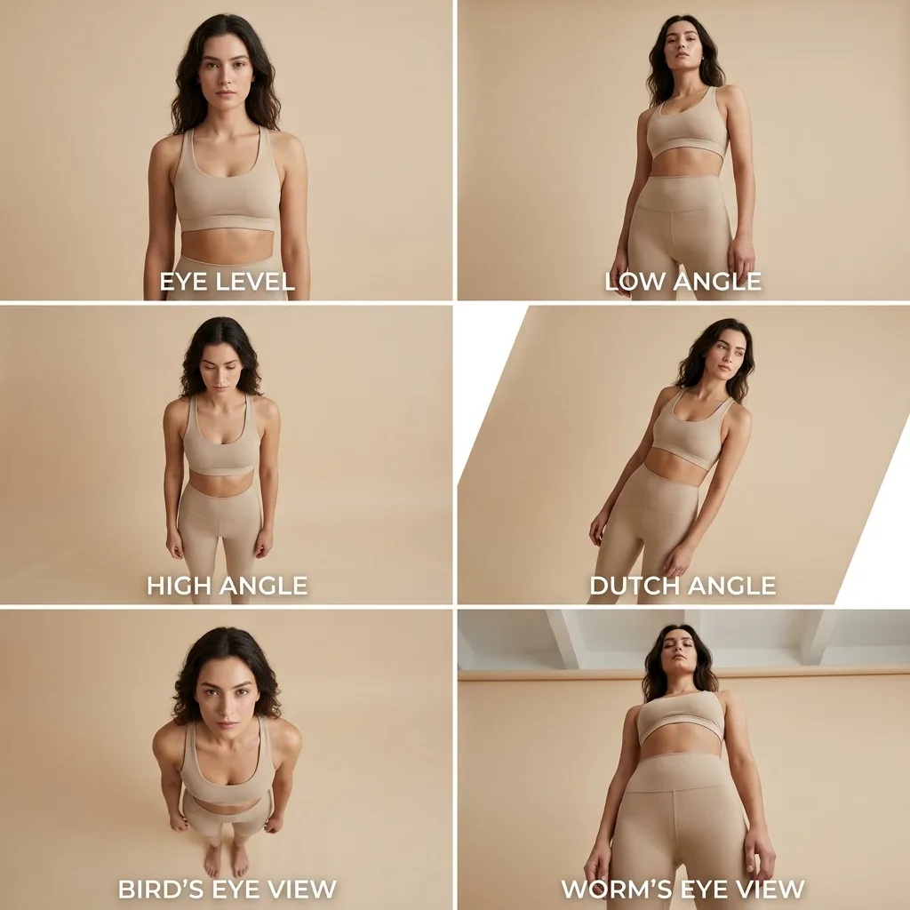

# Realistic, Portrait

[← Back to the collection](../../README.md) · Category: [Product & Brand](../../gallery/product-brand.md) · Model: `Vinano Image Pro` · ID: `vn-01602`

<a href="https://vinano.ai?utm_source=github&utm_medium=readme&utm_campaign=awesome-image-video-prompts-updating&utm_content=prompt-page-image"></a>

<sub>Preview generated with <a href="https://vinano.ai?utm_source=github&utm_medium=readme&utm_campaign=awesome-image-video-prompts-updating&utm_content=prompt-page-caption">vinano.ai</a></sub>

## Prompt

```text
Ultra-realistic fashion editorial composite image, 6-panel grid layout (3 rows, 2 columns), each panel clearly labeled minimal clean typography: “EYE LEVEL”, “LOW ANGLE”, “HIGH ANGLE”, “DUTCH ANGLE”, “BIRD’S EYE VIEW”, “WORM’S EYE VIEW”.

Same professional female model in all panels, consistent face identity, sharp jawline, natural makeup, slightly wavy dark hair, neutral expression.

Outfit: minimal beige sports bra and matching high-waist leggings, clean luxury athleisure fashion style.

Studio setting soft beige seamless background, high-end fashion photography lighting, soft shadows, ultra-clean aesthetic.

Each panel demonstrates different camera angle:

Eye Level: straight-on balanced portrait
Low Angle: camera below looking upward, strong presence
High Angle: camera above looking down
Dutch Angle: tilted frame, dynamic diagonal composition
Bird’s Eye View: top-down view, model looking up
Worm’s Eye View: extreme low ground perspective, dramatic upward shot

Cinematic fashion magazine quality, ultra realistic skin texture, 8k detail, sharp focus, symmetrical grid alignment, premium editorial layout, clean borders between panels, modern luxury look.

NEGATIVE PROMPT

blurry, low quality, extra limbs, distorted face, different person, inconsistent identity, text errors, watermark, logo, cartoon, CGI, oversaturated, bad anatomy

Aim for an editorial, design-driven look with deliberate negative space.
```

## Try it on vinano.ai

1. Copy the prompt above.
2. Open **[vinano.ai](https://vinano.ai?utm_source=github&utm_medium=readme&utm_campaign=awesome-image-video-prompts-updating&utm_content=prompt-page-try)**, paste it into the image generator and pick a model.
3. Swap any placeholders (brand, product, city, person…) for your own details, then generate.

More prompts like this: [Product & Brand gallery](../../gallery/product-brand.md) · [all categories](../../README.md#contents)
