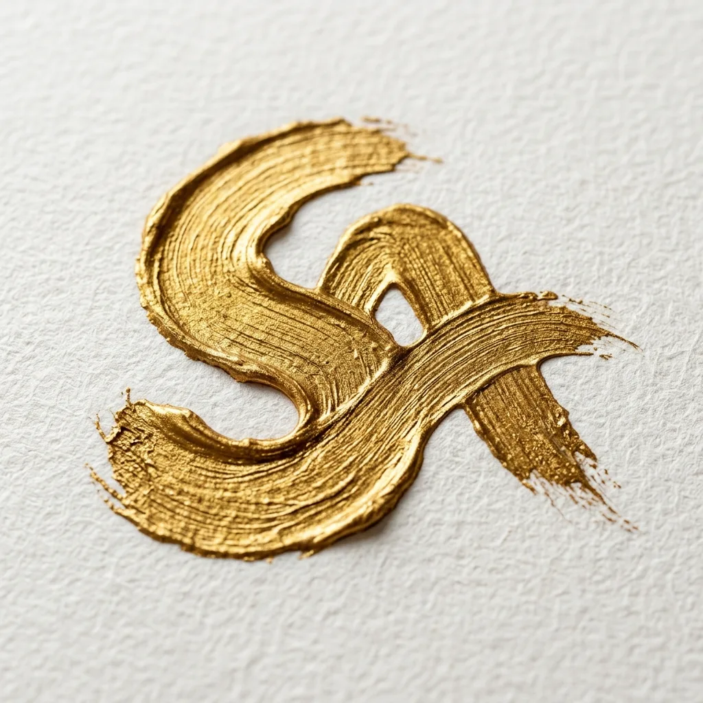

# Realistic, Minimalist

[← Back to the collection](../../README.md) · Category: [Product & Brand](../../gallery/product-brand.md) · Model: `Vinano Image Pro` · ID: `vn-01610`

<a href="https://vinano.ai?utm_source=github&utm_medium=readme&utm_campaign=awesome-image-video-prompts-updating&utm_content=prompt-page-image"></a>

<sub>Preview generated with <a href="https://vinano.ai?utm_source=github&utm_medium=readme&utm_campaign=awesome-image-video-prompts-updating&utm_content=prompt-page-caption">vinano.ai</a></sub>

## Prompt

```text
Ultra-realistic macro photograph of a [logo] created from a single bold metallic paint brushstroke on textured white paper, sculpted thick impasto paint, visible brush bristles, layered pigment density, rich metallic sheen, smooth curved stroke flow, natural handcrafted imperfections, tapered stroke endings, subtle smudged edges, raised paint thickness casting delicate shadows, premium editorial art direction, refined minimalist white background, soft diffused studio lighting, sharp focus, true-to-life photorealistic, 8k, no watermark, no extra text Emphasise material texture and natural light so the final frame feels tactile and premium.
```

## Try it on vinano.ai

1. Copy the prompt above.
2. Open **[vinano.ai](https://vinano.ai?utm_source=github&utm_medium=readme&utm_campaign=awesome-image-video-prompts-updating&utm_content=prompt-page-try)**, paste it into the image generator and pick a model.
3. Swap any placeholders (brand, product, city, person…) for your own details, then generate.

More prompts like this: [Product & Brand gallery](../../gallery/product-brand.md) · [all categories](../../README.md#contents)
