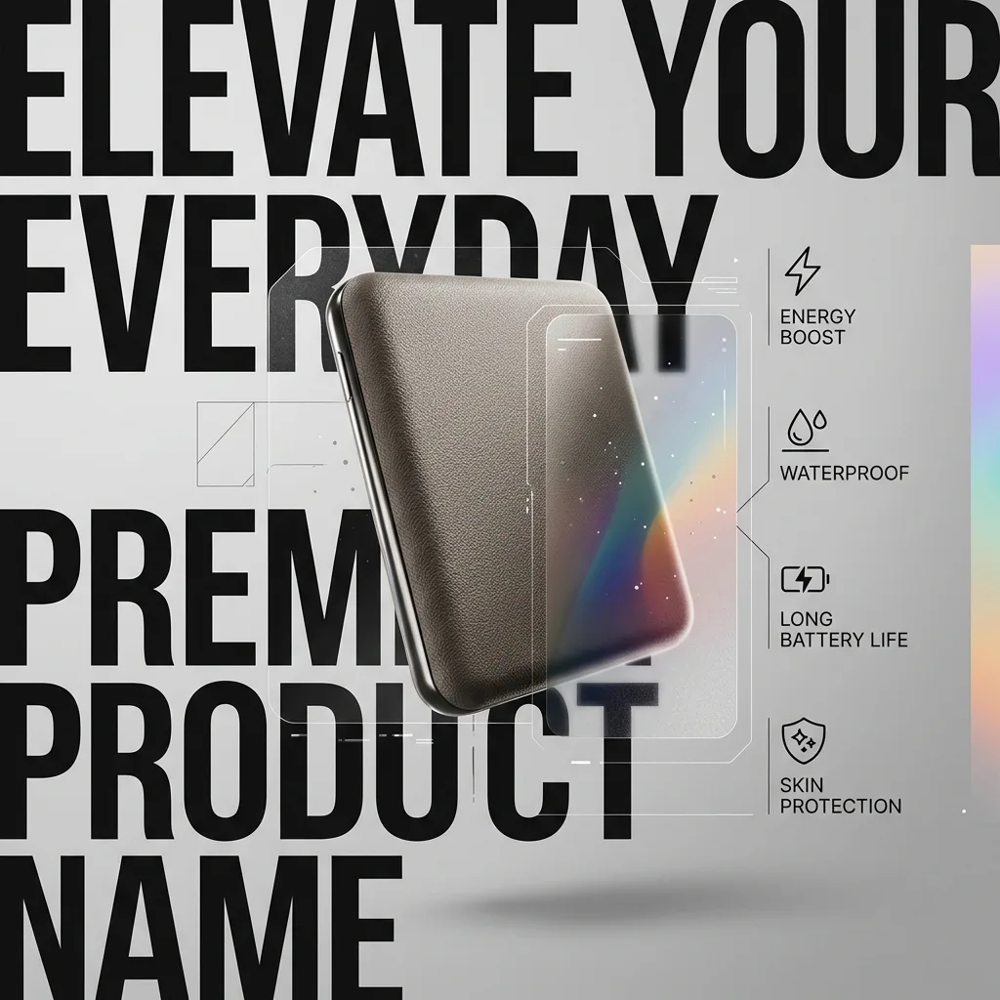

# Realistic, Cinematic

[← Back to the collection](../../README.md) · Category: [Product & Brand](../../gallery/product-brand.md) · Model: `Vinano Image Pro` · ID: `vn-01613`

<a href="https://vinano.ai?utm_source=github&utm_medium=readme&utm_campaign=awesome-image-video-prompts-updating&utm_content=prompt-page-image"></a>

<sub>Preview generated with <a href="https://vinano.ai?utm_source=github&utm_medium=readme&utm_campaign=awesome-image-video-prompts-updating&utm_content=prompt-page-caption">vinano.ai</a></sub>

## Prompt

```text
Use uploaded product image as the MAIN PRODUCT REFERENCE and preserve the exact product identity extremely high accuracy. Maintain original shape, proportions, materials, colors, logo placement, textures, packaging details, labels, typography, reflections, and overall product design language exactly as shown in the reference image. Do not redesign, simplify, distort, or alter the original product appearance.

Create a modern premium social media advertising campaign for:

“[PRODUCT NAME]”

Style: modern clean editorial aesthetic mixed premium Instagram advertising, luxury commercial branding, trendy streetwear-inspired layout, and high-end product campaign visuals.

Background: clean white, light gray, or soft neutral gradient background subtle studio lighting, premium negative space, soft shadows, polished reflections, and minimal futuristic atmosphere.

Composition: balanced asymmetrical composition the product as the main hero object positioned prominently in the layout. Add cinematic visual depth layered composition techniques, floating graphic accents, transparent overlays, geometric elements, and modern editorial spacing.

Typography: huge oversized bold typography integrated naturally into the composition: “[PRODUCT NAME]” or “[CUSTOM SLOGAN]”

Typography should: — partially extend outside frame — overlap naturally behind the product — use bold modern sans-serif fonts — create strong visual hierarchy — feel premium, trendy, futuristic, and commercial — blend naturally the layout like modern Instagram ads

Design Elements: — minimal geometric shapes — futuristic UI-inspired graphics — thin technical lines — abstract gradients — floating particles — subtle texture overlays — glossy reflections — premium shadows — modern infographic icons — product feature callouts — clean editorial spacing — luxury advertising composition — trendy social media campaign styling

Optional Feature Section: Add 3–5 minimal feature icons or short product highlights depending on the product category automatically.

Examples: — energy boost — waterproof — long battery life — skin protection — premium ingredients — fast charging — cooling effect — performance enhancement

Lighting: soft cinematic studio lighting realistic highlights, subtle reflections, clean shadows, glossy edges, and ultra-realistic commercial rendering.

Color Palette: automatically adapt the entire visual palette from the uploaded product colors for cohesive branding and premium visual consistency.

Final Look: ultra-realistic premium commercial advertisement, luxury Instagram carousel aesthetic, modern product campaign design, polished editorial quality, visually striking but clean and minimal, high-end branding presentation suitable for premium social media marketing.

Emphasise material texture and natural light so the final frame feels tactile and premium.
```

## Try it on vinano.ai

1. Copy the prompt above.
2. Open **[vinano.ai](https://vinano.ai?utm_source=github&utm_medium=readme&utm_campaign=awesome-image-video-prompts-updating&utm_content=prompt-page-try)**, paste it into the image generator and pick a model.
3. Swap any placeholders (brand, product, city, person…) for your own details, then generate.

More prompts like this: [Product & Brand gallery](../../gallery/product-brand.md) · [all categories](../../README.md#contents)
