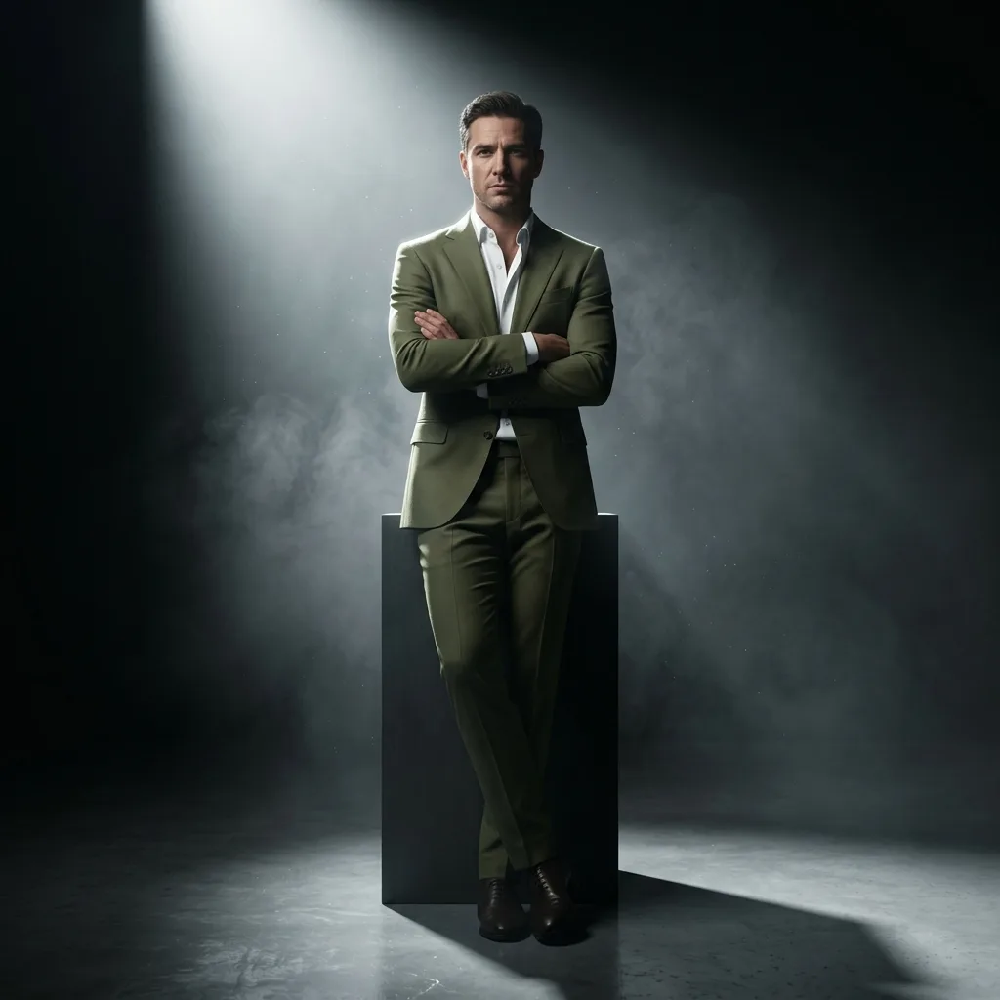

# Realistic, Portrait

[← Back to the collection](../../README.md) · Category: [Product & Brand](../../gallery/product-brand.md) · Model: `Vinano Image Pro` · ID: `vn-01622`

<a href="https://vinano.ai?utm_source=github&utm_medium=readme&utm_campaign=awesome-image-video-prompts-updating&utm_content=prompt-page-image"></a>

<sub>Preview generated with <a href="https://vinano.ai?utm_source=github&utm_medium=readme&utm_campaign=awesome-image-video-prompts-updating&utm_content=prompt-page-caption">vinano.ai</a></sub>

## Prompt

```text
{
 "prompt": "Cinematic full-body studio portrait of a subject the uploaded face as exact reference (preserve identity, facial structure, and proportions). Slightly low-angle perspective a 35mm lens for a commanding, sophisticated presence. Subject leaning casually against a dark refined minimalist plinth, arms crossed. Wearing a perfectly tailored slim-fit olive green suit and a crisp white dress shirt, top buttons undone. Intense chiaroscuro lighting a single powerful volumetric spotlight from the upper-left, cutting through subtle atmospheric haze swirling smoke and micro-dust particles. Sharp rim highlights along shoulders and silhouette, deep velvety shadows across the body, high-contrast moody aesthetic. Hyper-realistic textures, visible fabric weave, subtle reflections on a polished studio floor, professional filmic, cinematic lighting, ultra-detailed, 8K resolution, no text, no watermark.",
 "resolution": "7680x4320",
 "camera": {
 "lens": "35mm",
 "angle": "slightly low-angle",
 "aperture": "f/2.0",
 "iso": "100",
 "shutter_speed": "1/125"
 },
 "quality": "ultra-high",
 "style": "cinematic, hyper-realistic, studio photography",
 "negative_prompt": "blurry, low-resolution, overexposed, underexposed, flat lighting, cartoon, CGI, plastic skin, extra limbs, distorted hands, bad anatomy, asymmetry, watermark, logo, text"
}

Aim for an editorial, design-driven look with deliberate negative space.
```

## Try it on vinano.ai

1. Copy the prompt above.
2. Open **[vinano.ai](https://vinano.ai?utm_source=github&utm_medium=readme&utm_campaign=awesome-image-video-prompts-updating&utm_content=prompt-page-try)**, paste it into the image generator and pick a model.
3. Swap any placeholders (brand, product, city, person…) for your own details, then generate.

More prompts like this: [Product & Brand gallery](../../gallery/product-brand.md) · [all categories](../../README.md#contents)
