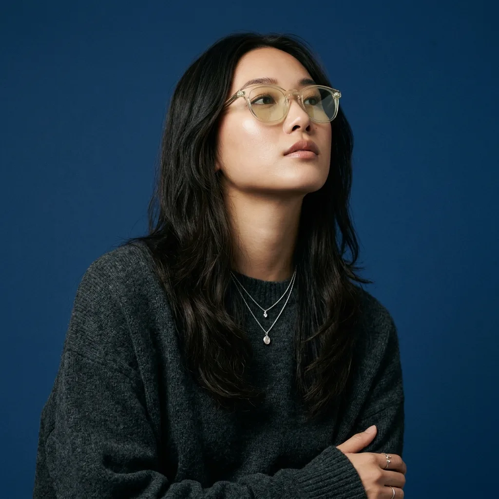

# Anime, Realistic

[← Back to the collection](../../README.md) · Category: [Product & Brand](../../gallery/product-brand.md) · Model: `Vinano Image Pro` · ID: `vn-01626`

<a href="https://vinano.ai?utm_source=github&utm_medium=readme&utm_campaign=awesome-image-video-prompts-updating&utm_content=prompt-page-image"></a>

<sub>Preview generated with <a href="https://vinano.ai?utm_source=github&utm_medium=readme&utm_campaign=awesome-image-video-prompts-updating&utm_content=prompt-page-caption">vinano.ai</a></sub>

## Prompt

```text
Create image Create a high-end studio fashion portrait inspired by the uploaded blue-background reference photograph. Recreate the original composition matching framing, focal length feel, camera position, subject scale, perspective, and overall visual balance while maintaining a realistic photographic appearance.

Replace the reference model a beautiful young Japanese/Korean woman. Preserve authentic East Asian facial features, natural proportions, realistic skin texture, eye shape, facial structure, and cultural authenticity. Avoid exaggerated beauty filters, unrealistic facial modifications, or doll-like features. Maintain a natural, believable fashion-model appearance.

Match the original body language closely: upper torso visible, shoulders relaxed, chin slightly elevated, eyes directed upward beyond the camera, conveying quiet confidence, sophistication, and contemplation. Maintain the same sense of presence and spatial positioning within the frame.

Retain the rich cobalt-blue studio backdrop and the refined editorial atmosphere. Reproduce the original lighting setup soft directional illumination, subtle facial highlights, realistic reflections on eyewear and jewelry, and smooth shadow transitions around the jawline, neck, and clothing folds. Preserve depth, dimensionality, and professional studio realism.

Appearance:

Young Japanese/Korean woman in her early-to-mid 20s

Clear luminous skin natural texture

Soft almond-shaped eyes

Elegant facial structure

Healthy natural makeup subtle editorial refinement

Glossy neutral lips

Long dark hair styled in soft layers or gentle waves

Sophisticated yet approachable expression

Style the model in contemporary luxury street-fashion apparel. Use an oversized premium knit sweater, relaxed-fit sweatshirt, or fashion-forward refined minimalist streetwear silhouette natural fabric draping. Layer a delicate silver necklace, subtle rings, and lightly tinted translucent eyewear. Wardrobe should feel premium, modern, and suitable for a luxury fashion campaign.

Keep the image tightly composed the same portrait crop and subject placement. Ensure identical camera-to-subject distance and visual weight in the frame. The final result should feel indistinguishable from a genuine professional fashion photoshoot captured in this exact studio environment.

true-to-life photorealistic editorial photography, luxury fashion campaign, premium Korean/Japanese streetwear styling, deep monochromatic blue backdrop, realistic skin texture, subtle film-grade contrast, detailed fabric rendering, natural lighting falloff, commercial advertising quality, shallow depth of field, magazine-cover aesthetics, fashion-editorial realism, luxury street-fashion branding.

Negative Prompt:

Do not alter the background color or studio environment. Do not change the framing, crop, perspective, subject distance, or lighting direction. Avoid anime styling, illustration effects, CGI appearance, excessive retouching, artificial skin smoothing, exaggerated facial features, unrealistic eye size, porcelain skin effect, text overlays, logos, watermarks, duplicate subjects, distorted anatomy, extra limbs, or unrealistic clothing physics.

Preserve realistic proportions and depth for a confident, professional finish.
```

## Try it on vinano.ai

1. Copy the prompt above.
2. Open **[vinano.ai](https://vinano.ai?utm_source=github&utm_medium=readme&utm_campaign=awesome-image-video-prompts-updating&utm_content=prompt-page-try)**, paste it into the image generator and pick a model.
3. Swap any placeholders (brand, product, city, person…) for your own details, then generate.

More prompts like this: [Product & Brand gallery](../../gallery/product-brand.md) · [all categories](../../README.md#contents)
