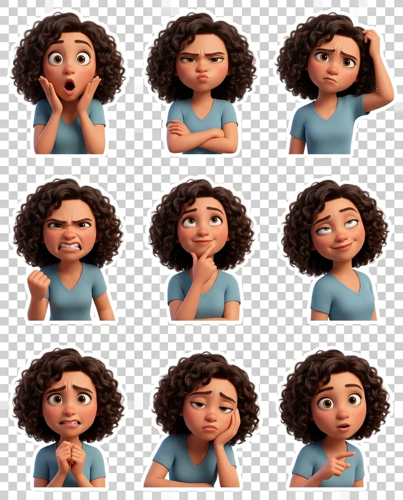

# Character, Ai Art

[← Back to the collection](../../README.md) · Category: [Product & Brand](../../gallery/product-brand.md) · Model: `Vinano Image Pro` · ID: `vn-01640`

<a href="https://vinano.ai?utm_source=github&utm_medium=readme&utm_campaign=awesome-image-video-prompts-updating&utm_content=prompt-page-image"></a>

<sub>Preview generated with <a href="https://vinano.ai?utm_source=github&utm_medium=readme&utm_campaign=awesome-image-video-prompts-updating&utm_content=prompt-page-caption">vinano.ai</a></sub>

## Prompt

```text
the uploaded selfie as the ONLY and exclusive face reference, generate a Pixar-style 3D character sticker set. The character must be clearly recognizable as the person from the selfie. Create a neat 3×3 grid collage (nine stickers total). Final aspect ratio is strictly 4:5. Each cell shows a distinct pose and facial expression. Style and tone: Pixar-style 3D animation a meme-oriented feel. Exaggerated, slightly absurd emotions, playful overacting.

Highly readable expressions at small sizes, expressive eyes, eyebrows, and mouth. Subtle hand gestures where appropriate. Background and output: Fully transparent background (PNG). No backdrop, no background shadows. No text, captions, logos, or UI elements. Stickers must be ready for direct use in messengers. Consistency: Same hairstyle, clothing, colors, and character proportions across all nine stickers. Only facial expression and pose change.

Clean, polished 3D sticker look. Emotions (one per sticker, 3×3 grid): Surprised, Annoyed, Confused, Frustrated, Thoughtful, Sarcastic, Worried, Bored, Curious.

Render with rich micro-detail while keeping the layout uncluttered and intentional.
```

## Try it on vinano.ai

1. Copy the prompt above.
2. Open **[vinano.ai](https://vinano.ai?utm_source=github&utm_medium=readme&utm_campaign=awesome-image-video-prompts-updating&utm_content=prompt-page-try)**, paste it into the image generator and pick a model.
3. Swap any placeholders (brand, product, city, person…) for your own details, then generate.

More prompts like this: [Product & Brand gallery](../../gallery/product-brand.md) · [all categories](../../README.md#contents)
