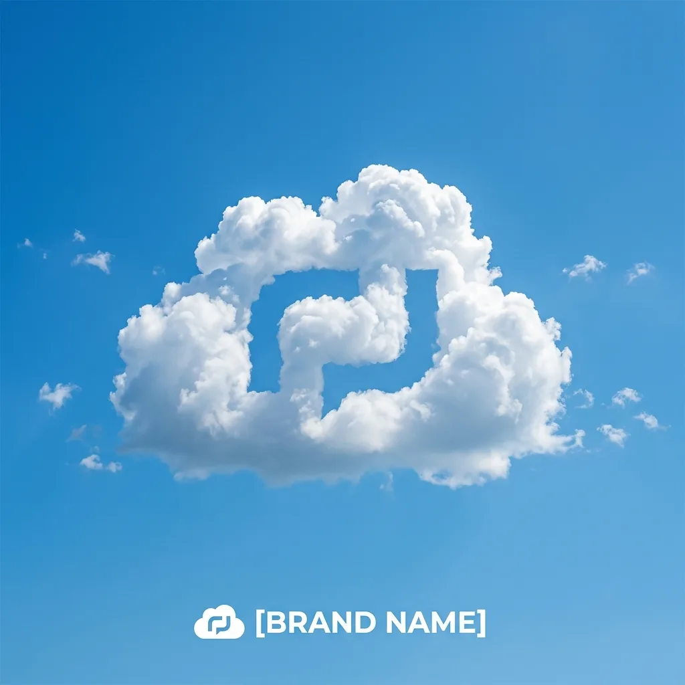

# Realistic, Cinematic

[← Back to the collection](../../README.md) · Category: [Product & Brand](../../gallery/product-brand.md) · Model: `Vinano Image Pro` · ID: `vn-01647`

<a href="https://vinano.ai?utm_source=github&utm_medium=readme&utm_campaign=awesome-image-video-prompts-updating&utm_content=prompt-page-image"></a>

<sub>Preview generated with <a href="https://vinano.ai?utm_source=github&utm_medium=readme&utm_campaign=awesome-image-video-prompts-updating&utm_content=prompt-page-caption">vinano.ai</a></sub>

## Prompt

```text
[BRAND NAME]: The name of the brand.
Goal: Generate a single, refined minimalist, and surreal image where a cloud is shaped like the brand's logo.

1. THE LOGO CLOUD
- **Subject**: A massive, true-to-life photorealistic cumulus cloud in the exact geometric shape of the [BRAND NAME] logo.
- **Texture**: Puffy, soft, and voluminous natural sunlight illuminating the edges.
- **Volume**: 3D sculptural appearance realistic shadows within the cloud folds to show depth.

2. ENVIRONMENT & BACKGROUND
- **Sky**: A vast, clear, vibrant blue summer sky.
- **Secondary Elements**: A few small, wispy, natural clouds scattered far in the background to enhance the sense of scale and realism.
- **Lighting**: Bright, direct daylight coming from the side to create high-contrast highlights and shadows.

3. INTEGRATED BRANDING
- **Text**: The word "[BRAND NAME]" written in a clean, bold white sans-serif font.
- **Icon**: A small, flat white version of the brand's logo placed next to the text.
- **Positioning**: The branding (text + logo) is centered at the bottom of the frame, acting as a subtle anchor to the giant cloud above.

4. STYLE
- Surrealist photography, ultra-refined minimalist composition, high resolution, 8k, cinematic look, clean and airy vibe.

Maintain consistent colour harmony and crisp focus across the whole frame.
```

## Try it on vinano.ai

1. Copy the prompt above.
2. Open **[vinano.ai](https://vinano.ai?utm_source=github&utm_medium=readme&utm_campaign=awesome-image-video-prompts-updating&utm_content=prompt-page-try)**, paste it into the image generator and pick a model.
3. Swap any placeholders (brand, product, city, person…) for your own details, then generate.

More prompts like this: [Product & Brand gallery](../../gallery/product-brand.md) · [all categories](../../README.md#contents)
