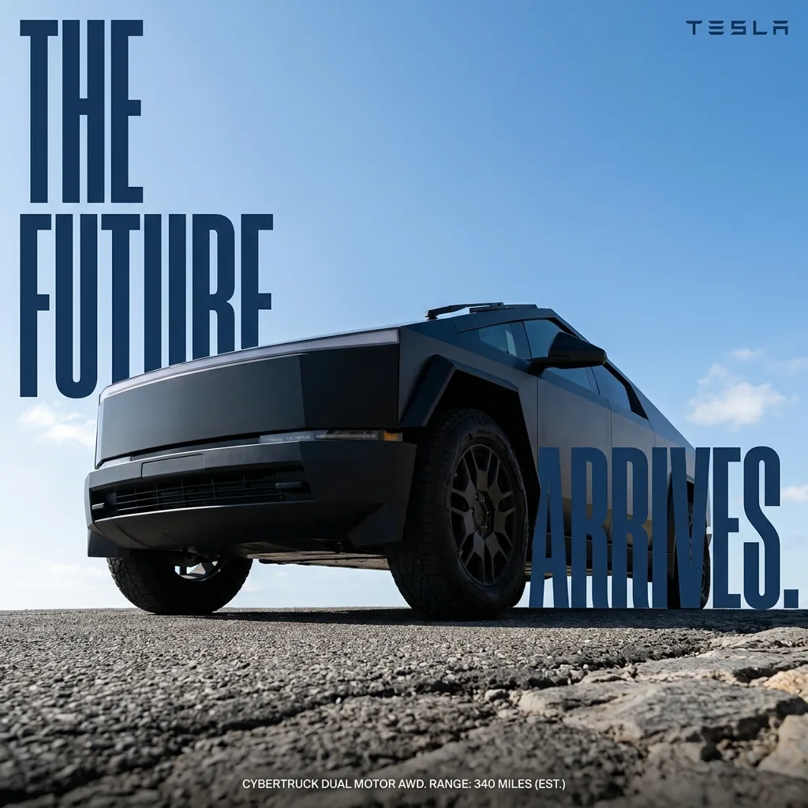

# Realistic, Character

[← Back to the collection](../../README.md) · Category: [Product & Brand](../../gallery/product-brand.md) · Model: `Vinano Image Pro` · ID: `vn-01665`

<a href="https://vinano.ai?utm_source=github&utm_medium=readme&utm_campaign=awesome-image-video-prompts-updating&utm_content=prompt-page-image"></a>

<sub>Preview generated with <a href="https://vinano.ai?utm_source=github&utm_medium=readme&utm_campaign=awesome-image-video-prompts-updating&utm_content=prompt-page-caption">vinano.ai</a></sub>

## Prompt

```text
[BRAND NAME] | [SLOGAN]. Act as a Professional Editorial Art Director.

PHASE 1: PHYSICS & GROUNDING (THE "STABILITY" RULE).
- Analyze [BRAND NAME] category:
 * CATEGORY A (Active/Sports/Fashion): The subject (person) is in a high-intensity leap, detached from the ground, silhouette against the sky.
 * CATEGORY B (Automotive/Heavy Goods): The subject (vehicle) must be HEROICALLY GROUNDED. Place the car firmly on a solid surface (asphalt, concrete, or rock).
 * Perspective: Use an extreme low-angle (worm's-eye view). The car must look massive and dominant, anchored to the bottom of the frame, towering over the viewer. NO floating or flying for vehicles.

PHASE 2: DYNAMIC PHOTOGRAPHY & LIGHTING.
- Environment: A vast, clear blue sky minimal soft clouds.
- Lighting: Natural, direct sunlight. High-contrast shadows on the subject to emphasize form and texture.
- Style: High-end 8k commercial photography. Sharp focus.

PHASE 3: TYPOGRAPHY & LAYOUT (MATTE FINISH).
- Layout: Use the text from "[SLOGAN]" as massive, ultra-condensed bold sans-serif characters.
- Execution: Split "[SLOGAN]" into two parts: one on the far left, one on the far right.
- Depth: A part of the subject (e.g., a bumper, a mirror, or a person's limb) must overlap the letters to create a 3D effect.

PHASE 4: COLOR STRATEGY (MATTE & REALISTIC).
- Graphic Color: NO NEON. Use a solid, matte brand color for the text (e.g., flat Navy for BMW, flat Red for Red Bull). The color must be opaque and non-glowing, resembling premium-quality print ink.
- Photo Color: Maintain authentic, rich photographic colors for the subject and the sky. The contrast comes from "Flat Graphic vs. Realistic Photo".

PHASE 5: FINAL BRANDING.
- Logo: Small refined minimalist [BRAND NAME] logo in the upper corner.
- Metadata: Tiny secondary text in a clean sans-serif font at the bottom for a technical/editorial look.

Maintain consistent colour harmony and crisp focus across the whole frame.
```

## Try it on vinano.ai

1. Copy the prompt above.
2. Open **[vinano.ai](https://vinano.ai?utm_source=github&utm_medium=readme&utm_campaign=awesome-image-video-prompts-updating&utm_content=prompt-page-try)**, paste it into the image generator and pick a model.
3. Swap any placeholders (brand, product, city, person…) for your own details, then generate.

More prompts like this: [Product & Brand gallery](../../gallery/product-brand.md) · [all categories](../../README.md#contents)
