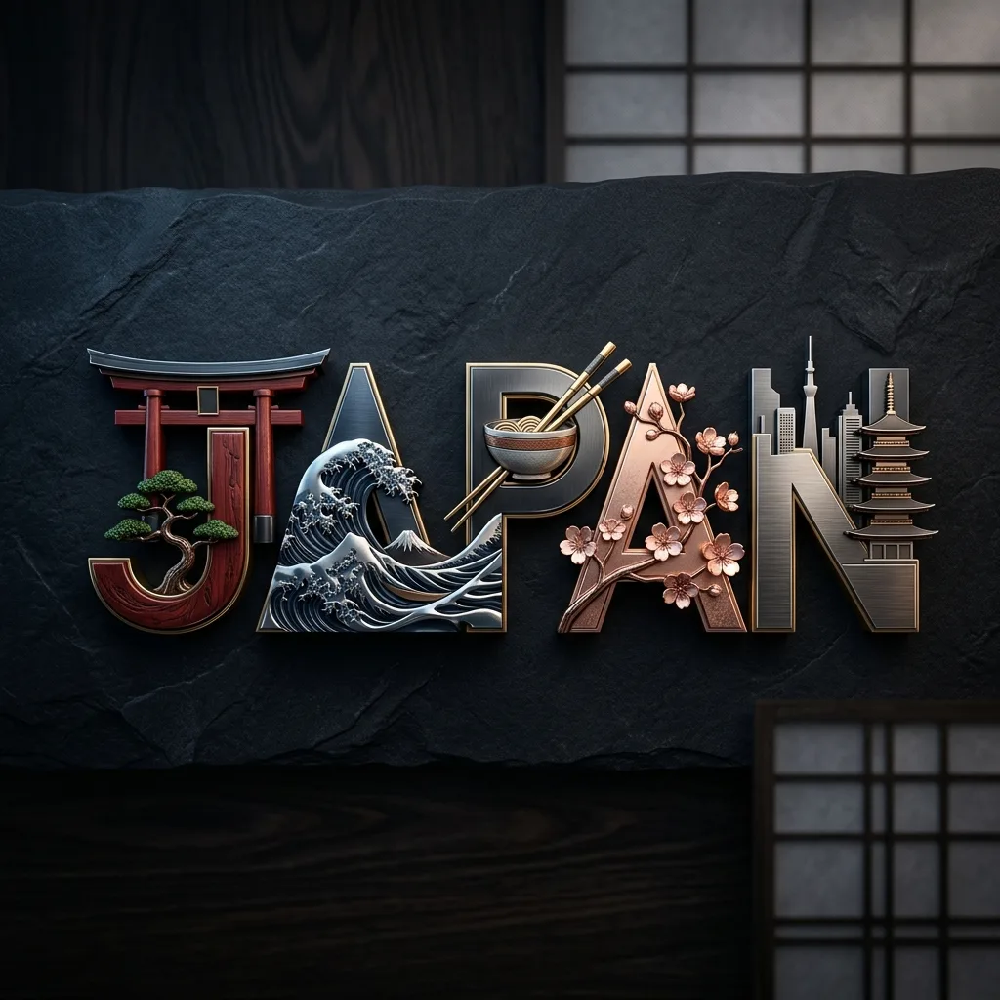

# Realistic, Cinematic

[← Back to the collection](../../README.md) · Category: [Product & Brand](../../gallery/product-brand.md) · Model: `Vinano Image Pro` · ID: `vn-01671`

<a href="https://vinano.ai?utm_source=github&utm_medium=readme&utm_campaign=awesome-image-video-prompts-updating&utm_content=prompt-page-image"></a>

<sub>Preview generated with <a href="https://vinano.ai?utm_source=github&utm_medium=readme&utm_campaign=awesome-image-video-prompts-updating&utm_content=prompt-page-caption">vinano.ai</a></sub>

## Prompt

```text
A premium-quality 3D metallic typography design of the word [COUNTRY NAME], set against a dark, textured background that complements the identity of [COUNTRY], creating a cinematic, premium visual tone.

Each individual letter is uniquely designed to represent a distinct cultural element, tradition, landmark, or national symbol from [COUNTRY], intelligently adapted to the letter’s shape while maintaining perfect readability.

Cultural elements may include (but are not limited to):
– iconic architecture or monuments
– traditional patterns, textiles, or crafts
– national sports or tools
– folklore, heritage symbols, or historical motifs
– nature elements strongly associated the country

No two letters repeat the same cultural reference — every letter tells a different cultural story.

The typography features polished metallic material (gold, silver, or [COLOR]), realistic reflections, fine engravings, and subtle surface wear for authenticity.

Dramatic studio lighting soft rim highlights and deep shadows enhances depth and form.

Ultra-sharp focus, premium 3D render quality, cinematic depth, luxury branding aesthetic, ultra-high resolution.

Maintain consistent colour harmony and crisp focus across the whole frame.
```

## Try it on vinano.ai

1. Copy the prompt above.
2. Open **[vinano.ai](https://vinano.ai?utm_source=github&utm_medium=readme&utm_campaign=awesome-image-video-prompts-updating&utm_content=prompt-page-try)**, paste it into the image generator and pick a model.
3. Swap any placeholders (brand, product, city, person…) for your own details, then generate.

More prompts like this: [Product & Brand gallery](../../gallery/product-brand.md) · [all categories](../../README.md#contents)
