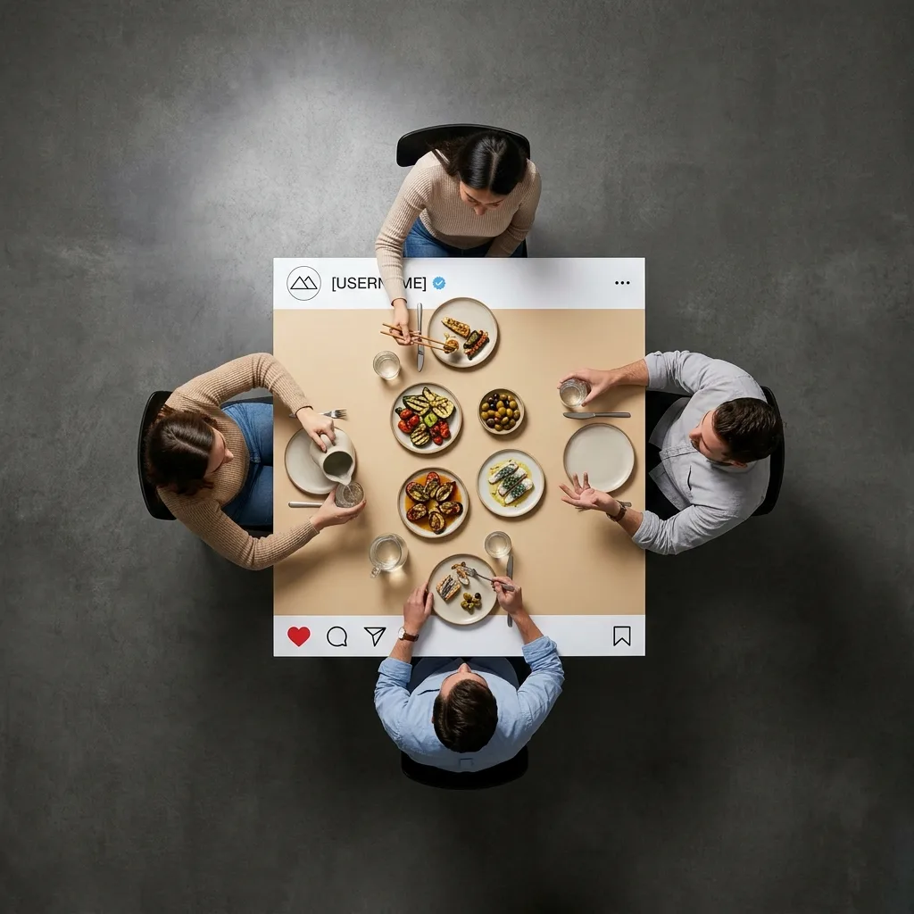

# Realistic, Minimalist

[← Back to the collection](../../README.md) · Category: [Product & Brand](../../gallery/product-brand.md) · Model: `Vinano Image Pro` · ID: `vn-01681`

<a href="https://vinano.ai?utm_source=github&utm_medium=readme&utm_campaign=awesome-image-video-prompts-updating&utm_content=prompt-page-image"></a>

<sub>Preview generated with <a href="https://vinano.ai?utm_source=github&utm_medium=readme&utm_campaign=awesome-image-video-prompts-updating&utm_content=prompt-page-caption">vinano.ai</a></sub>

## Prompt

```text
Ultra-wide-angle hyper-realistic shooting in top-down mode. A group of 4 real people sitting at a square dining table. The camera is pushed far back, creating a significant negative space (empty floor area) around the people and the table, which provides a clear, minimalistic composition. Scene [ATMOSPHERE AND CLOTHING]: Four people are dressed in [STYLE OF CLOTHING]. Their interaction is specific: [DESCRIBE EACH PERSON'S ACTIONS]. The table is a custom-made physical prop, designed as an Instagram post: it has a solid white stripe ONLY along the top and bottom edges (no white frames on the left or right). - The upper white stripe shows a drawn profile photo [LOGO DESCRIPTION], the username "[USERNAME]", followed by a small blue icon a confirmed check mark, and "..." on the right. - Red hearts, comment and share icons are painted on the bottom white stripe on the left, and a Bookmarks icon on the right. The center of the table is filled in [THE EXACT COLOR OF THE CENTER and the hexadecimal CODE]. The table shows [FOOD ITEMS/ITEM DESCRIPTIONS]. important: ALL food, beverages, objects, and hands that interact them must be located strictly within this central area, colored in [COLOR]. NOTHING should go beyond the white stripes or beyond the table. The background of the floor is [THE COLOR OF THE FLOOR] to create a visual separation. Professional studio lighting clear shadows. 8k, clear focus. Aim for an editorial, design-driven look with deliberate negative space.
```

## Try it on vinano.ai

1. Copy the prompt above.
2. Open **[vinano.ai](https://vinano.ai?utm_source=github&utm_medium=readme&utm_campaign=awesome-image-video-prompts-updating&utm_content=prompt-page-try)**, paste it into the image generator and pick a model.
3. Swap any placeholders (brand, product, city, person…) for your own details, then generate.

More prompts like this: [Product & Brand gallery](../../gallery/product-brand.md) · [all categories](../../README.md#contents)
