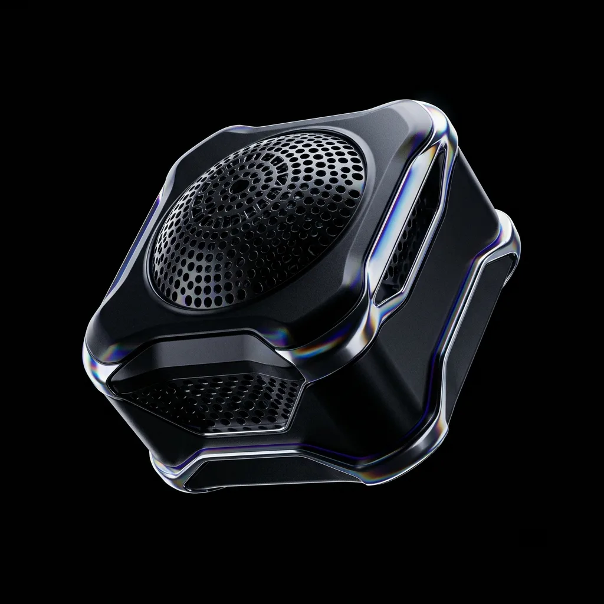

# Realistic, Cinematic

[← Back to the collection](../../README.md) · Category: [Product & Brand](../../gallery/product-brand.md) · Model: `Vinano Image Pro` · ID: `vn-01703`

<a href="https://vinano.ai?utm_source=github&utm_medium=readme&utm_campaign=awesome-image-video-prompts-updating&utm_content=prompt-page-image"></a>

<sub>Preview generated with <a href="https://vinano.ai?utm_source=github&utm_medium=readme&utm_campaign=awesome-image-video-prompts-updating&utm_content=prompt-page-caption">vinano.ai</a></sub>

## Prompt

```text
{
 "image_generation_request": {
 "subject_settings": {
 "product_placeholder": "[INSERT PRODUCT NAME HERE]",
 "positioning": "absolute center, floating, levitating, suspended in mid-air",
 "framing": "full view, no cropping, product must be entirely within frame, generous padding around edges"
 },
 "environment_and_background": {
 "background_color": "#000000",
 "background_type": "pure void, infinite black depth",
 "elements_to_exclude": ["lighting boxes",
 "softboxes",
 "stands",
 "pedestals",
 "platforms",
 "text",
 "watermarks",
 "props",
 "surface reflections",
 "studio equipment"]
 },
 "texture_and_material_blending": {
 "primary_finish": "anodized obsidian metal microscopic grit",
 "secondary_finish": "high-gloss fluid chrome",
 "accent_texture": "Mac Pro inspired precision-machined hemispherical lattice, 3D lattice venting pattern",
 "optical_effects": "monatomic light dispersion, prismatic diffraction on edges, ethereal holographic sheen"
 },
 "lighting_and_color_palette": {
 "key_colors": [{ "name": "Pure Black", "hex": "#000000" },
 { "name": "Electric Indigo", "hex": "#4B0082" },
 { "name": "Phthalo Blue", "hex": "#000F89" },
 { "name": "Spectral Iridescence", "description": "Thin-film interference rainbow highlights" }],
 "lighting_style": "hard rim lighting, chiaroscuro, high contrast, sharp specular highlights, no ambient fill"
 },
 "negative_constraints": {
 "strict_exclusion": "out of frame, cut off product, blurry edges, tripod, light stand, floor, table, shadows on floor, light flare icons, glowing boxes, copyright text, logo, cluttered background, grey tones, messy geometry"
 },
 "technical_specs": {
 "style": "Hyper-realistic 3D render",
 "engine_hints": "Octane Render, Raytraced, 8k, Unreal Engine 5, filmic, cinematic lighting"
 }
 }
}

Preserve realistic proportions and depth for a confident, professional finish.
```

## Try it on vinano.ai

1. Copy the prompt above.
2. Open **[vinano.ai](https://vinano.ai?utm_source=github&utm_medium=readme&utm_campaign=awesome-image-video-prompts-updating&utm_content=prompt-page-try)**, paste it into the image generator and pick a model.
3. Swap any placeholders (brand, product, city, person…) for your own details, then generate.

More prompts like this: [Product & Brand gallery](../../gallery/product-brand.md) · [all categories](../../README.md#contents)
