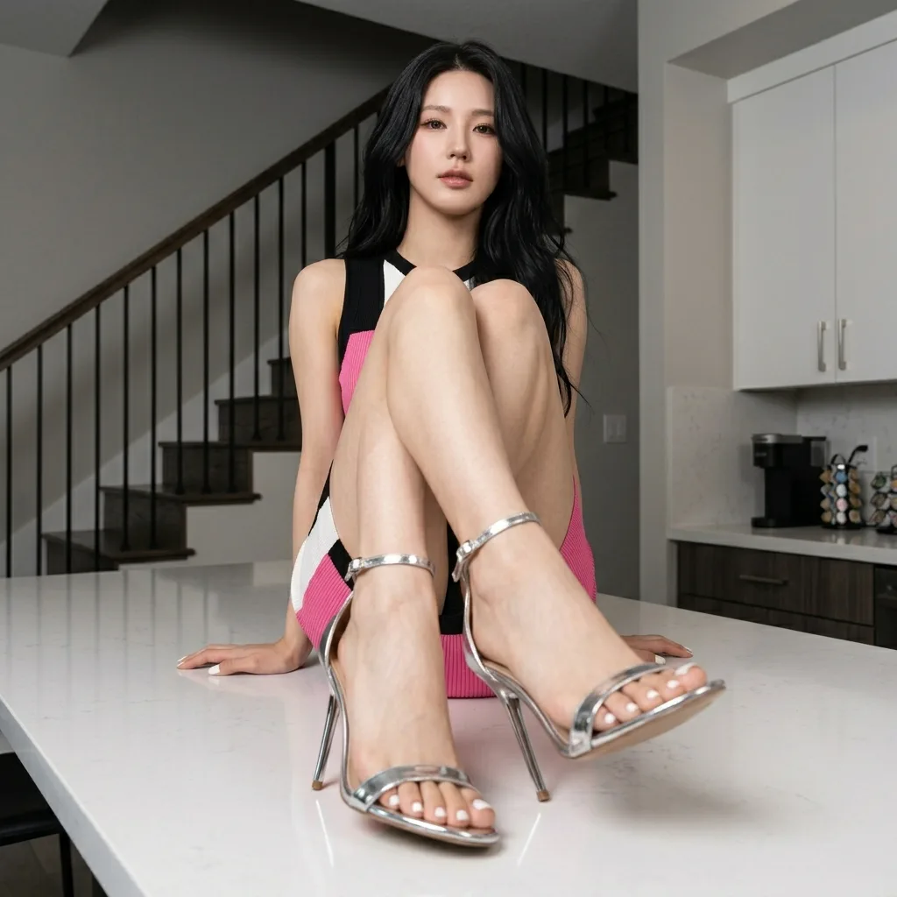

# Realistic, Minimalist

[← Back to the collection](../../README.md) · Category: [Product & Brand](../../gallery/product-brand.md) · Model: `Vinano Image Pro` · ID: `vn-01707`

<a href="https://vinano.ai?utm_source=github&utm_medium=readme&utm_campaign=awesome-image-video-prompts-updating&utm_content=prompt-page-image"></a>

<sub>Preview generated with <a href="https://vinano.ai?utm_source=github&utm_medium=readme&utm_campaign=awesome-image-video-prompts-updating&utm_content=prompt-page-caption">vinano.ai</a></sub>

## Prompt

```text
{
"subject": {
"identity": {
"biometric_reference": "Cho Miyeon of (G)I-DLE",
"facial_morphology": "Elegant oval face, prominent high straight nasal bridge, soft refined jawline, and full lips. Smooth forehead and delicate features.",
"dentition": "Natural dental alignment, maxillary central incisors slight dominance, bright white enamel finish, visible buccal corridor during a neutral or slight parting of lips.",
"iris_pattern": "Heterogeneous iris texture radial furrows, distinct pupillary zone, and a deep dark brown hue darker limbal rings.",
"hair": "Long, straight, and voluminous dark black hair subtle warm undertones, fine follicle texture, and natural scalp integration."
},
"body": {
"somatotype": "Petite mesomorph high muscle-to-fat ratio and defined bone structure.",
"morphology": "Accurate 0.7 waist-to-hip ratio, slender waistline, toned rectus abdominis, and defined quadricep/patellar anatomy. Natural soft tissue distribution over the iliac crest.",
"skin_texture": "High-fidelity dermis visible pores, subtle subcutaneous vascularity in extremities, and a warm fair porcelain finish. HEX: #FDF1EA.",
"limbs": "Slender upper and lower extremities, articulated phalanges, clear nail bed definition white polish. Feet in extreme plantar flexion visible metatarsal alignment."
},
"wardrobe": {
"apparel": "Mini-length bodycon dress in a sleek color-blocked design of black, white, and vibrant pink. Fabric: Fine-knit stretch silk micro-ribbing texture and subtle specular highlights.",
"footwear": "Metallic silver stiletto sandals slender ankle straps and chrome-finished heels. Material: Polished calfskin leather high reflectivity. HEX: #C0C0C0."
},
"pose_action": {
"description": "Seated atop a polished kitchen counter in a low-angle perspective. Knees are acutely flexed and pulled toward the chest, creating a compact triangular composition. Hands are positioned laterally on the counter surface for support. Head is slightly tilted a direct, neutral gaze toward the lens.",
"anatomical_tension": "Weight distribution focused on the gluteal region, visible tension in the gastrocnemius muscles due to high-heel elevation."
},
"scene": {
"environment": "Modern refined minimalist kitchen interior. Primary surface is a white quartz countertop high gloss finish. Background features a dark-toned staircase vertical railings and neutral grey walls.",
"atmosphere": "Clean, spacious, and upscale domestic setting."
},
"lighting": {
"setup": "Three-point studio lighting adapted for an interior setting. Primary softbox (Key) from 45-degree angle, subtle rim lighting to define hair and shoulder silhouettes. High subsurface scattering on skin surfaces.",
"effects": "Specular highlights on the metallic footwear and quartz countertop. Soft ambient occlusion in the folds of the dress."
},
"camera": {
"technical": "3:4 aspect ratio, 35mm wide-angle lens, f/2.8 aperture for slight depth-of-field separation, low-angle 'worm's eye' perspective (30cm from floor level), ISO 100 for zero digital noise.",
"render_quality": "8K true-to-life photorealistic, 1.2 raytracing depth, high-fidelity texture mapping."
},
"negative_constraints": ["no logos",
"no text",
"no watermarks",
"no extra limbs",
"no distorted fingers",
"no beautify smoothing",
"no anatomical anomalies",
"no clothing clipping",
"no floating objects"],
"reflection_integrity_rules": ["Accurate ray-traced reflections on the quartz counter and metallic heels",
"Inversion of the subject's lower legs and dress hem in the reflective surface",
"Consistent light bounce between the black, white, and pink fabric and skin surfaces"]
}
}

Maintain consistent colour harmony and crisp focus across the whole frame.
```

## Try it on vinano.ai

1. Copy the prompt above.
2. Open **[vinano.ai](https://vinano.ai?utm_source=github&utm_medium=readme&utm_campaign=awesome-image-video-prompts-updating&utm_content=prompt-page-try)**, paste it into the image generator and pick a model.
3. Swap any placeholders (brand, product, city, person…) for your own details, then generate.

More prompts like this: [Product & Brand gallery](../../gallery/product-brand.md) · [all categories](../../README.md#contents)
