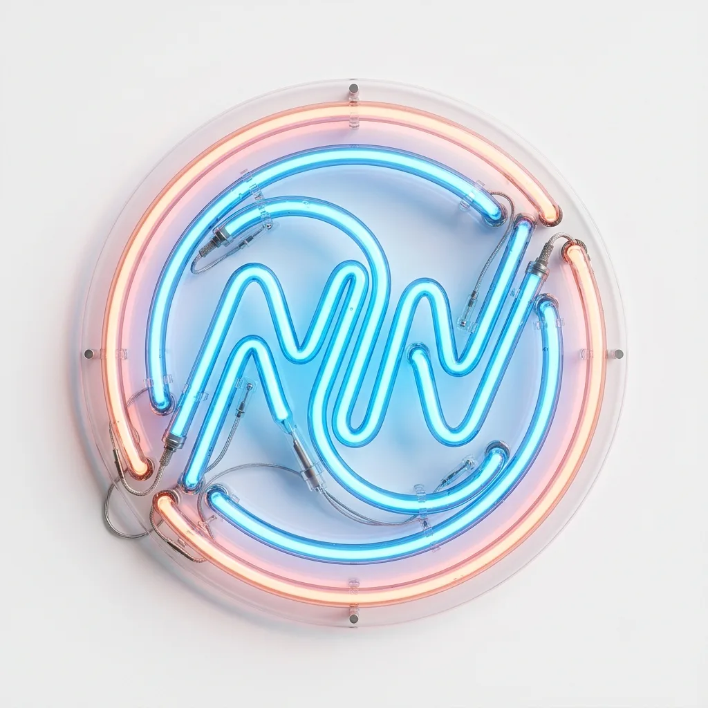

# Realistic, Ai Art

[← Back to the collection](../../README.md) · Category: [Product & Brand](../../gallery/product-brand.md) · Model: `Vinano Image Pro` · ID: `vn-01735`

<a href="https://vinano.ai?utm_source=github&utm_medium=readme&utm_campaign=awesome-image-video-prompts-updating&utm_content=prompt-page-image"></a>

<sub>Preview generated with <a href="https://vinano.ai?utm_source=github&utm_medium=readme&utm_campaign=awesome-image-video-prompts-updating&utm_content=prompt-page-caption">vinano.ai</a></sub>

## Prompt

```text
Create an ultra-detailed hyper-realistic 3D render of [logo], constructed from expertly bent neon tubing a clean contemporary sign-making aesthetic, continuous luminous glass tubes following the exact logo shape, smooth curves, realistic tube thickness, bright internal glow, subtle colored bloom, delicate reflections on the glass surface, visible electrode detailing at connection points, refined mounting structure kept minimal, premium commercial signage look, isolated on a pure white seamless background, soft studio lighting balanced the neon emission, gentle shadowing, macro detail, razor-sharp focus, true-to-life photorealistic, 8k, 1:1, no watermark, no extra text Maintain consistent colour harmony and crisp focus across the whole frame.
```

## Try it on vinano.ai

1. Copy the prompt above.
2. Open **[vinano.ai](https://vinano.ai?utm_source=github&utm_medium=readme&utm_campaign=awesome-image-video-prompts-updating&utm_content=prompt-page-try)**, paste it into the image generator and pick a model.
3. Swap any placeholders (brand, product, city, person…) for your own details, then generate.

More prompts like this: [Product & Brand gallery](../../gallery/product-brand.md) · [all categories](../../README.md#contents)
