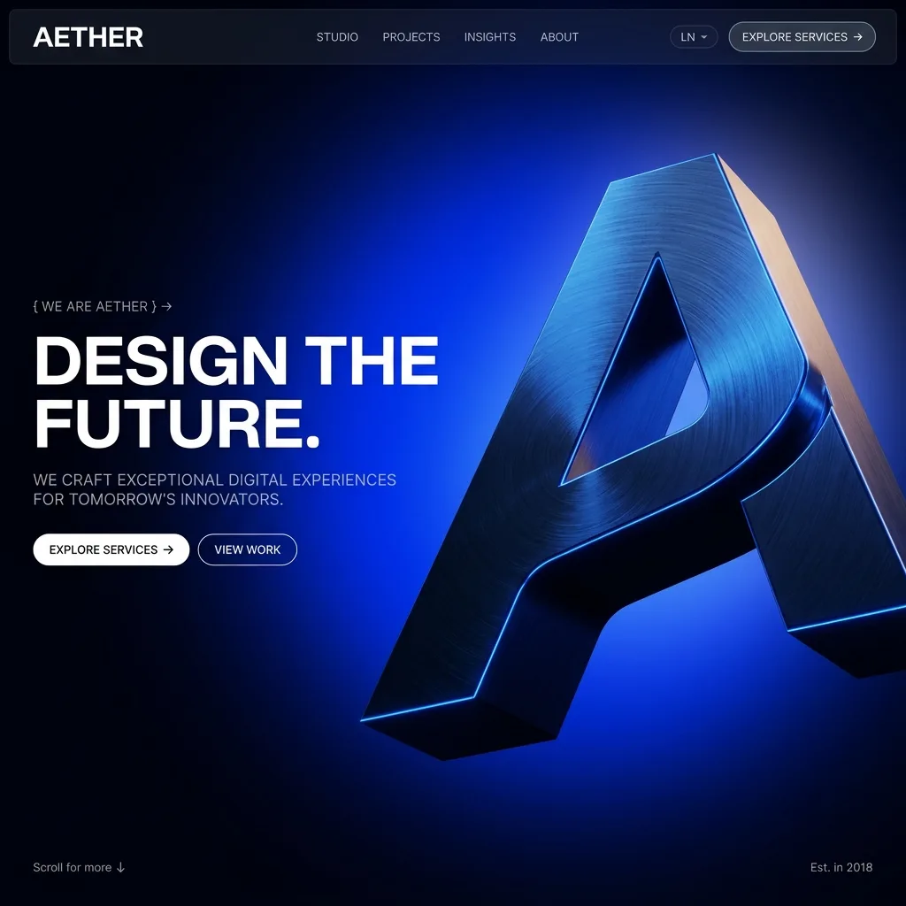

# Realistic, Landscape

[← Back to the collection](../../README.md) · Category: [Product & Brand](../../gallery/product-brand.md) · Model: `Vinano Image Pro` · ID: `vn-01740`

<a href="https://vinano.ai?utm_source=github&utm_medium=readme&utm_campaign=awesome-image-video-prompts-updating&utm_content=prompt-page-image"></a>

<sub>Preview generated with <a href="https://vinano.ai?utm_source=github&utm_medium=readme&utm_campaign=awesome-image-video-prompts-updating&utm_content=prompt-page-caption">vinano.ai</a></sub>

## Prompt

```text
[BRAND NAME] | [HEADLINE = user text or AUTO] | [SUBHEADLINE = user text or AUTO] | [BUTTON TEXT = user text or AUTO] | [COLOR = your color or AUTO]

Act as a Senior Web Art Director and CGI Artist creating a true-to-life photorealistic hero section of a premium brand website — a single wide-format image showing the full above-the-fold view of a hero webpage. The composition combines a dramatic 3D sculptural logo object editorial typography and minimal UI elements. References: Stökt agency website, Apple product launch pages, high-end creative agency hero sections, Awwwards-winning website design.

---

PHASE 0: BRAND INTELLIGENCE — AUTONOMOUS EXTRACTION

Perform a complete brand decode of [BRAND NAME] from training data before generating anything. Every visual decision in the image is derived from this phase.

COLOR SYSTEM — PRIMARY COLOR DETERMINATION: if [COLOR] is provided by the user — use that exact color as the primary driver for the entire image color system. Do not override it brand colors. If [COLOR] is AUTO — identify the exact primary brand color of [BRAND NAME] from their official guidelines — the single most iconic, most documented color associated the brand. In both cases: this one color drives the entire image's color system — background gradient, 3D object material, atmospheric lighting, all derived from this single color.

BACKGROUND GRADIENT DERIVATION: from the determined primary color derive exactly two gradient stops. Inner stop: the most saturated vivid version of the primary color at full intensity — this is the atmospheric glow behind the object. Outer stop: the darkest possible version of the same hue — near black but a visible trace of the color's hue remaining (#0A to #12 lightness range). Both stops are derived exclusively from the primary color. No neutral black. No grey. The darkness has color in it — it is a very dark tinted black, not a neutral one. Examples: red primary → inner #CC0000, outer #1A0000. Green primary → inner #1DB954, outer #001A0A. Blue primary → inner #0057FF, outer #00060F. Orange primary → inner #FF6600, outer #1A0500.

3D OBJECT MATERIAL DERIVATION: from the primary color derive the metal material — base/shadow color: the darkest near-black version of the color hue (same as gradient outer stop). Highlight color: the most vivid saturated version of the color (same as gradient inner stop), appearing on edges and high points facing the light source. Mid-tone: a medium value of the color on surfaces at 45° to the light. The entire metal object is one color family — dark in shadow, vivid and bright in highlight, all derived from the same hue. No neutral grey metal. No silver. The metal has the brand or user color in its DNA.

TYPOGRAPHY: identify [BRAND NAME]'s official typeface character — the visual weight, width, and style used in their brand communications. Apply consistently to all text elements.

BRAND SYMBOL: identify the single most iconic reduced form of [BRAND NAME]'s logo — the symbol, monogram, or letterform most recognizable as the brand. This becomes the 3D sculptural object. If [BRAND NAME] has no standalone symbol — use the first letter of the wordmark as the 3D form.

BRAND LANGUAGE: if [HEADLINE] is AUTO — extract the most powerful real brand statement or campaign headline associated [BRAND NAME]. If [SUBHEADLINE] is AUTO — extract a real brand descriptor sentence describing what [BRAND NAME] does or stands for. If [BUTTON TEXT] is AUTO — identify the primary CTA phrase [BRAND NAME] uses in their marketing. If any variable has user-provided text — use that exact text, do not override it.

FOUNDING INFORMATION: extract [BRAND NAME]'s founding year for the bottom corner attribution.

---

PHASE 1: BACKGROUND

Full-bleed background filling the entire image. A radial gradient emanating from the center-right zone where the 3D object sits — not a flat color, not a linear gradient, a circular atmospheric glow. Inner zone: the saturated vivid color derived in PHASE 0 — deep, rich, atmospheric, occupying approximately 40 to 50% of the total background area. Outer zone: the very dark tinted black derived in PHASE 0 — envelops the composition at all edges. The transition is soft and organic — a gradual atmospheric fade, not a hard edge. The gradient creates the sensation of a warm spotlight behind and to the right of the 3D object — as if the object itself is the source of this atmospheric light.

---

PHASE 2: 3D LOGO SCULPTURE — HERO ELEMENT

The brand symbol from PHASE 0 rendered as a massive three-dimensional sculptural object. Occupies the right 55 to 65% of total image width — monumental, partially cropped by the right and bottom frame edges. The cropping is deliberate — we see most but not all of the object, implying it extends beyond the frame. Rotated approximately 20 to 35° on the vertical axis and 10 to 20° on the horizontal axis — a dynamic three-quarter view revealing multiple faces simultaneously. Camera angle: 5 to 10° below center — adds imposing low-angle presence.

MATERIAL SYSTEM — DERIVED FROM PRIMARY COLOR: the object is premium dark brushed metal. All material colors derived exclusively from the primary color as determined in PHASE 0. Base/shadow color: very dark near-black color-tinted metal on faces away from the light. Brushed texture: fine parallel directional micro-scratches on each face following the face geometry — industrial brushed metal quality. Highlight zones: faces angled toward the primary light source catch the vivid saturated color as warm bright highlights — ranging from mid-tone color to near-white at absolute specular peaks. Edge highlights: every sharp edge of the object catches a thin continuous bright specular line tracing the full logo geometry — this edge glow defines the form against the background. The contrast between near-black shadowed faces and bright vivid-colored highlighted edges is the defining visual characteristic. Scale feel: monumental — as if 3 to 5 meters tall in physical space.

---

PHASE 3: NAVIGATION BAR

Minimal navbar at the very top — height approximately 4 to 5% of total image height. Background: very dark semi-transparent — the tinted dark color from PHASE 0 at 85 to 90% opacity. Left: [BRAND NAME] wordmark or logomark in correct official form, small white type. Center: 4 to 6 navigation categories in small all-caps tracked white type — autonomously determine relevant categories based on [BRAND NAME]'s business. Right: language switcher pill and primary CTA button — dark background, light border, small caps "[BUTTON TEXT]" right arrow →. All navbar elements small, precise, minimal — do not compete hero elements.

---

PHASE 4: TEXT BLOCK — LEFT SIDE

Positioned in the left 35 to 40% of the image, vertically centered, left-aligned appropriate margin. The left side is in the darker zone of the background gradient — white text is fully legible without additional treatment.

Label line: small bracketed label above the headline — "{ WE ARE [BRAND NAME] } →" or brand-appropriate equivalent. Very small type, white, tracked out, thin weight.

Headline: [HEADLINE] — set in [BRAND NAME]'s typographic character, bold, uppercase or sentence case per brand convention. Large — approximately 8 to 10% of total image height per line. White. Two to three lines maximum. Left-aligned.

Body copy: [SUBHEADLINE] — one to two sentences, small regular weight, white at 70 to 80% opacity. Below headline appropriate spacing. Maximum 35 to 40 characters per line.

CTA buttons: two side-by-side buttons. Primary: dark fill, white border, white text "[BUTTON TEXT]" right arrow →. Secondary: outline only, white border, white text secondary action autonomously determined from [BRAND NAME]'s context. Both buttons small and minimal — slightly rounded rectangle, small caps type.

---

PHASE 5: BOTTOM ELEMENTS

Bottom left: "Scroll for more ↓" in very small white type — 2 to 3% of image height, subtle.

Bottom right: "Est. in [FOUNDING YEAR]" in very small white type — founding year from PHASE 0, same scale.

---

PHASE 6: LIGHTING

Single primary light source: warm dramatic light positioned behind and to the upper right of the 3D object. Light color: the vivid saturated primary color from PHASE 0 — it is the color expressed as atmospheric light, consistent the gradient inner stop. This light creates both the background radial glow and the warm highlights on the metal object — they are the same light, the same color, the same source. Secondary ambient: very subtle cool ambient from directly above — 5% intensity, barely lifts the absolute darkest shadow zones. No fill lights. No rim lights. The dramatic contrast between lit and unlit faces is intentional and must be preserved.

---

PHASE 7: COMPOSITION

Aspect ratio: 16:9 landscape — website hero section proportions. Left 35 to 40%: text zone (darker background, UI elements). Right 60 to 65%: 3D sculpture zone (object dominates). Text block and object do not overlap — clear spatial separation. Reading direction: text left → sculpture right.

---

PHASE 8: TECH SPECS

Render: Octane Render or Redshift — physically accurate brushed metal correct anisotropic highlight behavior. All material colors derived from the primary color as determined in PHASE 0 — no neutral greys, no off-color elements anywhere in the image. If [COLOR] was user-provided — that color overrides any brand color in all material and lighting calculations. Ray tracing: on — for accurate edge highlights and metal inter-reflections. Background gradient: physically accurate radial atmospheric light — real volumetric light contribution, not a composited gradient overlay. Typography: crisp, anti-aliased, flat white — zero shadows, zero blur, zero effects. UI elements: clean flat design, no drop shadows, no gradients on UI elements. Color palette: exclusively the color system derived in PHASE 0 plus white for text — no additional colors introduced anywhere. Sampling: minimum 2048 samples. Anti-aliasing: maximum. Output feel: the actual above-the-fold screenshot of [BRAND NAME]'s relaunched premium website — Awwwards front page quality.

Emphasise material texture and natural light so the final frame feels tactile and premium.
```

## Try it on vinano.ai

1. Copy the prompt above.
2. Open **[vinano.ai](https://vinano.ai?utm_source=github&utm_medium=readme&utm_campaign=awesome-image-video-prompts-updating&utm_content=prompt-page-try)**, paste it into the image generator and pick a model.
3. Swap any placeholders (brand, product, city, person…) for your own details, then generate.

More prompts like this: [Product & Brand gallery](../../gallery/product-brand.md) · [all categories](../../README.md#contents)
