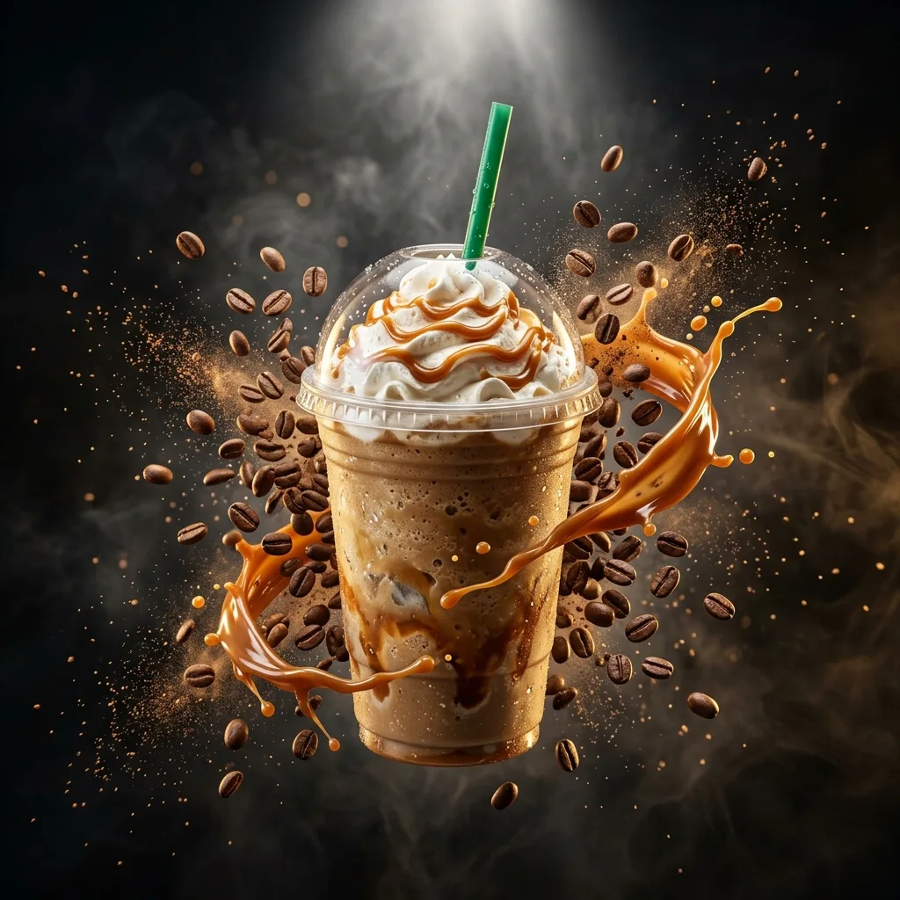

# Realistic, Product Photography

[← Back to the collection](../../README.md) · Category: [Product & Brand](../../gallery/product-brand.md) · Model: `Vinano Image Pro` · ID: `vn-01769`

<a href="https://vinano.ai?utm_source=github&utm_medium=readme&utm_campaign=awesome-image-video-prompts-updating&utm_content=prompt-page-image"></a>

<sub>Preview generated with <a href="https://vinano.ai?utm_source=github&utm_medium=readme&utm_campaign=awesome-image-video-prompts-updating&utm_content=prompt-page-caption">vinano.ai</a></sub>

## Prompt

```text
Ultra-realistic commercial product photography of a caramel frappuccino in a clear plastic cup dome lid and green straw, topped whipped cream and caramel drizzle, floating mid-air. Coffee beans exploding around the cup fine coffee powder dust particles suspended in the air, dynamic caramel splash trails swirling around the drink. Dark smoky background dramatic spotlight from above, warm golden rim lighting, high contrast, sharp focus, macro details, cinematic depth of field, hyper-detailed texture, premium beverage advertisement, 8K resolution. Maintain consistent colour harmony and crisp focus across the whole frame.
```

## Try it on vinano.ai

1. Copy the prompt above.
2. Open **[vinano.ai](https://vinano.ai?utm_source=github&utm_medium=readme&utm_campaign=awesome-image-video-prompts-updating&utm_content=prompt-page-try)**, paste it into the image generator and pick a model.
3. Swap any placeholders (brand, product, city, person…) for your own details, then generate.

More prompts like this: [Product & Brand gallery](../../gallery/product-brand.md) · [all categories](../../README.md#contents)
